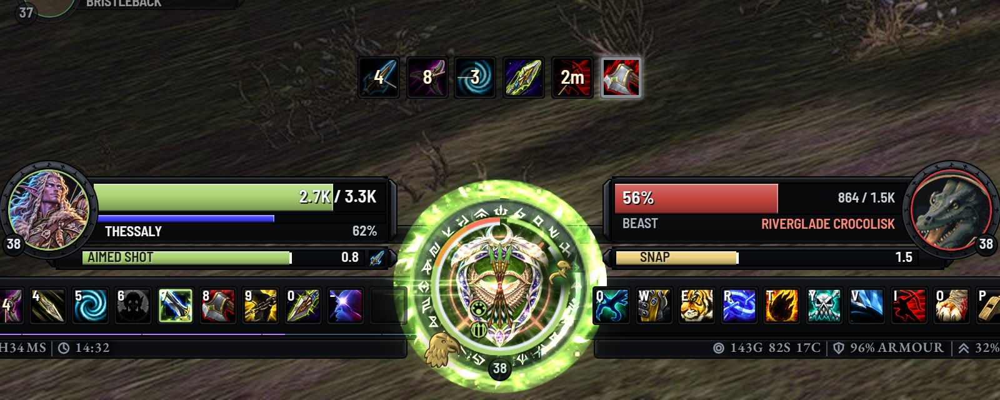

# KstyleUI_ActionBars

Main bar with stance, stealth, form and possess paging, extra bars, pet bar, stance bar, keybind text, cooldown sweeps, proc glows, usable and range shading, and mouseover fade.

## Bar picker and settings

Open **Action Bars** and click **Bar 1–6**, **Pet bar**, **Stance bar** or **Consumables bar** at the top. Every choice shows its own button count and applicable arrangement, text, cooldown, fade and paging controls. Disabled bars keep their switch visible and hide their other rows. **Positions and sizes** immediately follows the selected bar's controls, with its visibility, scale, combat/idle opacity and position. Shared finish, text styling and colour choices follow those settings. The picker wraps using the kit's tabs and stays above the scrolling settings. In Layout Mode, double-click a bar's mover to open this page on that bar; click still selects and right-click still resets. Each bar can turn the double-click shortcut off.

The Medallions slab fixes bars 1 and 2 to one row with shared spacing and backing, so those arrangement controls are hidden while it is on. Switch **Use the Medallions slab** off beside the picker to free them. Button counts stay independent; changing button size while connected still scales both sides, as the slab note explains.

**Custom visibility** accepts secure macro conditions such as `[combat] show; hide`, `[@target,exists] show; hide` or `[mounted] hide; show`. Leave it empty to retain the existing rules. For consumables it replaces and disables the built-in combat/idle switches. It combines with Layout's **Shown** choice; neither overrides a disabled bar, absent pet or empty stance bar. Edits made in combat apply after combat. Consumables also have a **Buttons** limit (12 by default); they keep the highest-priority carried items up to that limit. Pet/stance buttons have no macro names or action-page mapping, and consumables use item-kind selection rather than spell paging or split action rows.

**Visibility conditions** edits that same macro: choose Show or Hide and tick combat, out of combat, target, mounted, group/raid, Shift, Control or Alt. Any ticked condition matches (OR); for example Combat plus Target in Hide mode writes `[combat][@target,exists] hide; show`. No ticks leaves the field empty. Supported macros round-trip into the ticks; an advanced macro stays editable as text and disables the builder until cleared. There is no second runtime visibility rule.

Blizzard's Key Bindings > **KstyleUI** lists **Toggle Action Bar 1–6**, pet, stance and consumables. Each key securely toggles a parent visibility gate, including in combat, while the existing custom and Layout rules continue to apply. Hidden state is saved per character in the account's `actionBarToggles` map, independently of profiles. Layout Mode's handles remain available even for a toggled bar.

**Click through** disables the buttons' mouse hit testing, preserving keyboard actions and Layout Mode handles. Turn it off to restore mouse clicks, hover and flyouts. **Reverse button order** changes positions only: button N keeps its action, page and keybinding. Both options default off on every bar. The connected Medallions slab fixes bars 1 and 2 in their original order and hides Reverse button order with a slab note; freeing the slab restores the saved choice.

No new client API is introduced: macro visibility uses the existing `RegisterStateDriver` path, proven by Gethe/wow-ui-source `forever` at `9dc84f0`, `Interface/AddOns/Blizzard_RestrictedAddOnEnvironment/SecureStateDriver.lua` (`RegisterStateDriver`, `RegisterAttributeDriver`, `SecureCmdOptionParse` and visibility handling).

### EllesmereUI parity audit (2026-11-20)

This inventory uses public product descriptions and release notes, with no addon source copied or used to implement features. Public descriptions do not enumerate every internal menu row; this is the documented feature surface plus the owner's requested controls. **Present** can mean an equivalent control elsewhere in KstyleUI; **Missing** means a follow-up, not a Forever restriction.

| Publicly documented option | KstyleUI status | Control or remaining work | Public source |
| --- | --- | --- | --- |
| Button count / orientation | Present | Every picker choice has Buttons and Fill order; rows, growth, size and spacing apply per bar | [v5.5.6](https://www.curseforge.com/wow/addons/ellesmereui/files/7810128), [v9.2.5](https://www.curseforge.com/wow/addons/ellesmereui/files/8961439) |
| Growth direction / reverse button order | Present | Per-bar Reverse button order changes positions while preserving action and binding indices; connected Medallions bars retain fixed order | [v7.7.7](https://www.curseforge.com/wow/addons/ellesmereui/files/8112628) |
| Mouseover, combat and target visibility | Present | Selected bar > Positions and sizes > Shown; optional Fade until hovered | [Action Bars product](https://www.curseforge.com/wow/addons/eui-action-bars) |
| Mounted / combined conditions | Present | New per-bar Custom visibility, including `[mounted]` and compound macro conditions | [Action Bars product](https://www.curseforge.com/wow/addons/eui-action-bars), [v8.4.5](https://www.curseforge.com/wow/addons/ellesmereui/files/8425382) |
| Visual condition builder | Present | Per-bar Show/Hide mode and condition ticks write and round-trip Custom visibility | [Action Bars product](https://www.curseforge.com/wow/addons/eui-action-bars) |
| Resting, instance and city visibility | Not possible on Forever (no secure macro condition) | Searched the pinned `9dc84f0` tree's `RestrictedEnvironment.lua` direct macro conditional list, `SecureStateDriver.lua`, generated macro APIs and all Interface Lua/XML for resting/instance/city conditions; no secure condition is proven, so no selector is offered | [Action Bars product](https://www.curseforge.com/wow/addons/eui-action-bars); Forever source search described below |
| Bar opacity and out-of-combat fade | Present | Per-bar combat/idle opacity, faded opacity and hover restore | [v7.2.4](https://www.curseforge.com/wow/addons/ellesmereui/files/7998447), [v8.4](https://www.curseforge.com/wow/addons/ellesmereui/files/8388736) |
| Size / scale | Present | Per-bar Button size and Scale; connected slab size intentionally scales both sides | [v9.2.5](https://www.curseforge.com/wow/addons/ellesmereui/files/8961439) |
| Anchoring / width and height matching | Present / Missing | Layout supports anchoring, attachment and snapping; action bars scale rather than independently matching width/height | [Action Bars product](https://www.curseforge.com/wow/addons/eui-action-bars) |
| Always show buttons | Present | Per-bar Show empty buttons; consumables instead use Hide when empty | [v9.5.4](https://www.curseforge.com/wow/addons/ellesmereui/files/9165866) |
| Keybind / macro text switches | Present | Per-action-bar hotkey, count, macro and cooldown text switches | [Action Bars product](https://www.curseforge.com/wow/addons/eui-action-bars) |
| Text font / outline / size | Present | Shared Text section; each bar also chooses text positions and offsets | [v8.9.7](https://www.curseforge.com/wow/addons/ellesmereui/files/8696806) |
| Text corner / edge placement | Present | Per bar and text: four corners, four centre edges, centre and x/y offsets; Current style preserves defaults | [v9.2.5](https://www.curseforge.com/wow/addons/ellesmereui/files/8961439) |
| Custom paging / shapeshifting | Present | Every action bar accepts Custom paging; main bar also has built-in form, stealth, possess and page-key switches | [Action Bars product](https://www.curseforge.com/wow/addons/eui-action-bars) |
| Range colour | Present | Shared Colours > Out of range; same tint on every action bar | [v7.4.2](https://www.curseforge.com/wow/addons/ellesmereui/files/8030140) |
| Shapes / border style / Blizzard style | Missing | KstyleUI has its own socket styles; independent shape/border and Blizzard replacement require artwork and secure-hitbox testing | [Action Bars product](https://www.curseforge.com/wow/addons/eui-action-bars) |
| Glow / animation switches | Present | Shared Motion section and core motion levels; no complete per-bar effect editor | [Action Bars product](https://www.curseforge.com/wow/addons/eui-action-bars) |
| Cooldown desaturation / swipe opacity | Present | Per-bar Desaturate on cooldown and Swipe opacity; the GCD stays coloured and proportionally quieter | [Action Bars product](https://www.curseforge.com/wow/addons/eui-action-bars), [v8.9.5](https://www.curseforge.com/wow/addons/ellesmereui/files/8688485/additional-files) |
| Click through | Present | Per-bar mouse passthrough preserves keybind actions and Layout Mode handles; off restores hover and flyouts | [Action Bars product](https://www.curseforge.com/wow/addons/eui-action-bars) |
| Item quality borders | Present | Per-bar Item quality borders, on by default; item actions and resolved item macros of uncommon quality or better use their quality colour | [v9.3.6](https://www.curseforge.com/wow/addons/ellesmereui/files/9064386) |
| End caps, art size and offsets | Missing | KstyleUI's slab has its own crest; configurable end caps are an art/layout follow-up | [v9.3](https://www.curseforge.com/wow/addons/ellesmereui/files/8988935), [v9.3.1](https://www.curseforge.com/wow/addons/ellesmereui/files/9001557) |
| Runtime visibility key / conditional overrides | Present | Secure per-bar toggle keys combine with existing visibility rules and persist per character | [v8.7.7](https://www.curseforge.com/wow/addons/ellesmereui/files/8597278), [v9.6.9](https://www.curseforge.com/wow/addons/ellesmereui/files/9341121) |
| Extra-action button | Not possible on Forever | Forever disables this button; no placeholder is created (see Hover keybindings below) | [v7.4.2](https://www.curseforge.com/wow/addons/ellesmereui/files/8030140); Forever `Blizzard_ActionBar/Camelot/ExtraActionBarOverrides.lua` |
| Housing / skyriding visibility | Not possible on Forever | These game systems are absent; mounted conditions are available | [v8.8.5](https://www.curseforge.com/wow/addons/ellesmereui/files/8636274/additional-files); design spec Forever facts |

Larger follow-ups are the Missing entries above. The picker stays visible while scrolling, and each bar's mover opens its settings on double-click while preserving click selection and right-click reset. Existing per-bar scale, opacity and range colouring needed no duplicate settings or defaults.

Verification: `test-actionbars-options` drives the real picker, every Buttons slider, visibility conditions, selected-bar layout controls and the slab switch. The existing actionbar config tests cover rows, growth, spacing, split, text and protected combat edits across styles and screen sizes. Render `options_actionbars` at the requested screen size, or use `hud_reference` with `RENDER_BAR2_BUTTONS=6` for the full HUD. `test-hud-bar-shapes` boots the whole suite and checks that a bar 1 or 2 in two rows keeps the HUD's size and stands clear of the other bar and the player and target frames.

Batch 2 verification: `test-actionbars-visibility` checks builder round-trips, advanced text, combat toggles, reload and character isolation, protected queues, click-through, paging/binding identity and slab reversal. `test-consumables` checks the same mouse and toggle paths on the item bar. `options_actionbars` with `RENDER_VISIBILITY_BUILDER=1` opens the builder; `actionbars_config` with `RENDER_BAR_CONFIG=reversed RENDER_HUD_STYLE=Frames` shows reversed slots and their retained keys.

Forever API proof for batch 2, all under `Interface/AddOns/` at `9dc84f0`:

| Behaviour | Proving source |
| --- | --- |
| Macro visibility and combat/target/group updates | `Blizzard_RestrictedAddOnEnvironment/SecureStateDriver.lua`: `RegisterStateDriver`, `resolveDriver` with `SecureCmdOptionParse`, and its combat, target, modifier and group event registrations |
| Target existence, mounted and Shift/Control/Alt predicates | `Blizzard_RestrictedAddOnEnvironment/RestrictedEnvironment.lua`: `DIRECT_MACRO_CONDITIONAL_NAMES` exposes `UnitExists`, party/raid predicates, modifier predicates and `IsMounted` as macro-conditional booleans; the builder uses `combat`, `nocombat`, `@target,exists`, `mounted`, `group`, `mod:shift`, `mod:ctrl` and `mod:alt` |
| Secure hardware toggle, attributes, visibility and references | `Blizzard_RestrictedAddOnEnvironment/SecureHandlerTemplates.xml`: `SecureHandlerClickTemplate`; `SecureHandlers.lua`: `SecureHandler_OnClick`, `SecureHandlerSetFrameRef`; `RestrictedFrames.lua`: `GetFrameRef`, `GetAttribute`, `SetAttribute`, `Show` and `Hide` |
| Binding declarations and localized labels | `Blizzard_PingUI/Bindings.xml`: category declarations; `Blizzard_SettingsDefinitions_Frame/Keybindings.lua`: `GetBindingCategoryName` resolves the category global; `Blizzard_SharedXML/BindingUtil.lua`: `GetBindingName` resolves `BINDING_NAME_` plus the full command; `Blizzard_RestrictedAddOnEnvironment/RestrictedFrames.lua`: `SetBindingClick` delegates to `SetOverrideBindingClick`; `Blizzard_APIDocumentationGenerated/SimpleButtonAPIDocumentation.lua`: `RegisterForClicks` |
| Mouse passthrough | `Blizzard_APIDocumentationGenerated/SimpleScriptRegionAPIDocumentation.lua`: `EnableMouse`; keyboard binding clicks continue through the existing secure action buttons |
| Unsupported location/resting conditions | Searches of the direct conditional list above, `SecureStateDriver.lua`, `Blizzard_APIDocumentationGenerated/UIMacrosDocumentation.lua` and `MacroConstantsDocumentation.lua`, plus all Interface Lua/XML for `[resting]`, `[instance...]` and `[city...]`, yielded no secure macro condition. No insecure substitute is installed |

## Text placement, cooldown finish and item borders

The selected bar has **Desaturate on cooldown**, **Swipe opacity**, **Item quality borders** (action bars), and **Double-click mover for settings**. Each applicable text has **Text position**, **Horizontal offset** and **Vertical offset** below its own heading. The preview follows the selected bar. **Current style** with zero offsets keeps the shipped anchors; desaturation starts off and swipe opacity stays at 0.65, with quiet global cooldowns at 0.4. Desaturation affects real cooldowns, while unusable and power shading keep their existing rules. Under 30 units, consumables keep their compact style anchors: count takes priority over keybind text, and the centred countdown temporarily replaces both. Protected layout changes wait for combat to end.

**Item quality borders** starts on for each bar. An uncommon or better item's quality colours its socket border in Frames and Medallions, including consumable items placed on action buttons; poor and common items and spells retain their usual rim. Disabling it restores the ordinary finish. Item identity and quality refresh on action-slot changes and item-data arrival for that item ID, with no polling or item API reads while painting.

API proof: Gethe/wow-ui-source `forever`, commit `9dc84f0d3bbae1768ac3405b3716000bd93eda06`, `Interface/AddOns/Blizzard_APIDocumentationGenerated/FrameAPICooldownDocumentation.lua` (`SetSwipeColor`, secret arguments allowed when tainted), `SimpleTextureBaseAPIDocumentation.lua` (`SetDesaturated`, secret arguments allowed when tainted), and `ItemDocumentation.lua` (`GetItemQualityByID`, `GetItemQualityColor`, `GET_ITEM_INFO_RECEIVED`). `Blizzard_ActionBar/Shared/ActionButton.lua` proves `GetActionInfo` item identity and `ACTIONBAR_SLOT_CHANGED`. Every new API call checks availability and every item result is checked for secrecy before use. Missing item APIs leave the regular border. Cooldown state uses the existing duration-object setters and native show/hide callbacks, without reading or parsing countdown text.

`test-actionbars-parity` drives all bar settings, all nine text anchors, cooldown/GCD restoration, poor/common/uncommon/rare/epic items, swaps and filtered late item data, quality toggles, the pinned picker and every mover shortcut. `actionbars_parity` renders all four texts at every anchor, rare and epic item rims and desaturated cooldowns; `RENDER_PARITY=before` restores the previous visual choices. `options_actionbars` accepts `RENDER_OPTIONS_KEY=bar2.desaturateCooldown` to show the new controls while the picker stays visible.

## Hover keybindings

Type `/kb`, `/kstyle kb` or `/kstyle keybind`, hover a button, and press a key, middle or extra mouse button, or wheel with optional modifiers. Shift, Ctrl, Alt and Meta (Cmd on Mac) use Blizzard's chord order. Left and right clicks are ignored to preserve world selection and camera controls. Escape clears every binding for the hovered button. The panel highlights the button and shows its keys using the client's localized key names. **Save** applies the edits to account bindings, or character bindings with **Character bindings** selected. Switching from character to account bindings requires confirmation and loads the existing account set before applying edits. **Discard**, toggling the mode off, disabling Action Bars, switching input devices or entering combat drops unsaved edits. Binding mode cannot start in combat. `/kb` and `/bb` are registered only when another loaded addon has not claimed them; `/kstyle kb` always opens KstyleUI's mode.

Bindings use the game's commands (`ACTIONBUTTONn`, `MULTIACTIONBARnBUTTONn`, `BONUSACTIONBUTTONn`, `SHAPESHIFTBUTTONn`, and `VEHICLEEXIT`), appear in Blizzard's Key Bindings, and remain when KstyleUI is disabled. Stance buttons securely forward clicks to Blizzard's stance buttons, whose form selector toggles stealth off; directly casting the form spell cannot do that.

Blizzard's native possess buttons remain visible and can also be hovered in `/kb`. Forever has no `POSSESSBUTTONn` binding entry, so these use persistent `CLICK PossessButtonn:LeftButton` game bindings; the cancel slot retains Blizzard's taxi, vehicle and pet-possession behavior. Slot 1 keeps Blizzard's informational behavior. Forever also disables the extra-action button and omits its binding; on a client exposing that button, `/kb` supports `EXTRAACTIONBUTTON1`. No placeholder extra button is created.

| Field | Value |
| --- | --- |
| Module name | `ActionBars`: its switch in `Core/Features.lua` and the `name` it registers with `KstyleUI.Modules.Register` |
| Approach | Replace |
| Loads | With the core addon, switched off until the player turns it on |
| Files | `KstyleUI_ActionBars.toc` lists `ActionBars.xml`, which loads every Lua file in order, so adding a file never edits the TOC |

## Rules

These come from the [design spec](../docs/superpowers/specs/2026-11-07-kstyleui-design.md). The roadmap's Global Constraints and [AGENTS.md](../AGENTS.md) apply too.

- Action bars are KstyleUI's own secure buttons. Keybinds use `SetOverrideBindingClick`. Paging uses `RegisterStateDriver`. Cooldowns use `C_ActionBar.GetActionCooldownDuration` with `Cooldown:SetCooldownFromDurationObject`.
- Events update only what they change. `SPELL_UPDATE_COOLDOWN` names its spell (`SpellBookDocumentation.lua:927`): with a readable spell, no cooldown category and a start recovery category other than the global cooldown's (`Constants.SpellCooldownConsts.GLOBAL_RECOVERY_CATEGORY`), it refreshes the filled action buttons holding that spell or its base spell, those without a spell and those last seen on the global cooldown; otherwise, or when no button holds the spell (such as an override removed before its event, `CooldownViewer.lua:384-390`), every action button. Pet and stance buttons take only their cooldown on it, never a full update. `UPDATE_SHAPESHIFT_FORM` re-sets each action button's icon, as Blizzard's `ActionButton.lua:987-992` does, and updates a button in full when its slot holds no plain spell (an item macro's count and quality can follow the form) or its spell changed; the jewels redraw on it only when the class, kind or count changed. A button's icon, and the crest, bloom and particle art, are written only when the texture differs. The consumables bar listens for cooldown and bag events only while it is on. `test-perf-bar-events` holds the cost.
- KSTY-44 (the overhaul mock-ups Lee approved on 2026-11-12, which replace LEE-20's picture for the tray): bars 1 and 2 are enabled preset rows of twelve 45.125-unit buttons (38 px at 1080p), with 3.5625-unit gaps (3 px), inside the [Frames tray](#frames-tray) card. LEE-20's 36.7-unit tiles stay on the rail's bars 4 to 6. Absolute button origins are snapped instead of accumulating rounded gaps. Bars 4 to 6, the rail's columns of twelve on the same slots, do the same, so a column is as tall as the 491 units the layout reserves at any scale. Keybind, stack and cooldown text sit on the kit's square tiles; no name labels.
- Blizzard's bars are reparented to a hidden frame through `KstyleUI.Safe.HideBlizzard`. The module never touches `Blizzard_GamepadActionBars`, and switching to gamepad mode must not error or taint.
- Protected work in combat goes through `KstyleUI.Combat.Queue`.
- At load the module only registers itself with `KstyleUI.Modules.Register`. It creates no frames, registers no events and installs no hooks until `Enable` runs. `test-modules-load.lua` checks the frames.
- Every element it shows registers with `KstyleUI.Layout.Register`, and every setting is declared through `KstyleUI.Options.Register`, so the player can resize and customise everything from the settings window.
- UI comes from `KstyleUI.Widgets`, colours from `KstyleUI.Tokens` and strings from `KstyleUI.L`. Translations live in the core string tables; see Languages in the repository README.
- Build mode: check that an API exists before calling it, check `issecretvalue` before any comparison, fall back to a safer path when the preferred one is unavailable, and log the path taken with `KstyleUI.DevTest.Log`.

## Files

### Resource jewels

Under Medallions, **Crest resource jewels** (Action Bars > Slab and cooldowns, on by default) puts one cut gem per point of the player's secondary resource across the top arc of the hub ring, filling left to right: combo points on the target for a rogue or a druid in cat form (embers, `jewelCombo`), and holy power for a paladin (gold, `jewelHoly`). Soul Shards are items in a warlock's bags on Forever, not a power, so no jewel reads them; a warlock's crest counts them as soul wisps ([ranged crest trackers](#ranged-crest-trackers)). Other classes, and a druid out of cat form, show none; off restores the plain ring. The count is `UnitPowerMax` for that power, capped at ten, five when the maximum is secret, and none when it is zero, so a client without the power draws nothing. Up to five jewels sit 30 degrees apart; six to ten share the same 120-degree arc.

Each jewel is a gilt setting, a darker lip and a faceted steel socket (`forgedDiamond`, `jewelSocket`), with every layer an even number of physical pixels so it centres exactly. A lit gem has a darker rim (`jewel*Rim`), its body, a bright core (`jewel*Core`), a white glint at the upper left and a soft glow. A gained jewel's core flares (0.03 s up, 0.09 s down); a spent jewel holds for that long, then drains over 0.18 s while its glow fades over 0.2 s. **Glow at max** (under it, on by default) lights the whole rune ring at the maximum: the rune glyphs (`medRuneGlyphs`) glow in the resource's colour over the band and a halo 1.6 times the ring sits a level under the hub, so the ring and socket hide it inside the rim and it shows only round the ring. It fades in over 0.2 s on reaching the maximum, out over 0.2 s on a spend, and breathes like the cap ring (`SlabEffects.CAP_LOW`, `CAP_BREATH`) at Full. While it is on, the paladin's cap ring leaves holy power to it; off keeps today's ring.

Lua never compares the value. Every lit layer is a one-point status bar (range `i - 1` to `i`, the ring's `max - 1` to `max`) fed the raw `GetComboPoints` or `UnitPower` value now, or the value before it, stored and never read: the gem, rim, core, glint, flare, glow and ring take the value now, the ember and the glow before take the value before. Each change restarts the fades, and the order makes them right for every jewel: the glow now fades in as the glow before fades out, so an unchanged jewel's sum stays steady; the ember (a copy of the gem body fed the value before) sits over the flare and holds until the flare ends, so only a jewel that was dark shows it; and the ring now and before cross-fade the same way. Motion follows the effects level: Full and Calm play the fades and the flare, only Full breathes, and Off stops every group and shows the end states. Nothing runs OnUpdate. The jewels listen only while the hub shows them: `UNIT_POWER_FREQUENT` for their own power token, `PLAYER_TARGET_CHANGED` and `COMBO_TARGET_CHANGED` for combo points, the max-power and form events for the count and a druid's form, and `EffectsLevelChanged`.

### Hawk perches

Under Medallions, **Hawk perches** (Action Bars > Slab and cooldowns, on by default) shows a hunter's Summon Hawk hawks on the crest (the idea is Baine's). Forever keeps each hawk in a totem slot: Summon Hawk (1293241, ranks 1293525 to 1293527) fires a missile whose impact summons the guardian with 1293248 into slot 2 or 1312637 into slot 3 (SummonProperties 6837 and 6838), so two hawks at most, each for 18 s. A hunter who knows any rank (`C_SpellBook.IsSpellKnown`, checked again on `SPELLS_CHANGED`) gets two perches on the rune ring's shoulders, 40 degrees either side of the crown and 78 units out: slot 2 on the left and slot 3 on the right, each a gilt hawk sigil (`hawkSigil`, mirrored on the right so both face the crest) in a dark socket with a gilt seat, inside a timer ring (`orbRing`) that drains clockwise in hunter green (`jewelHawk`). An empty perch shows a steel hawk, hidden while its hawk is out (the slot's boolean through `SetAlphaFromBoolean(have, 0, 0.45)` while secret), so the gilt hawk never sits over it. Anyone else, or a hunter without the spell, gets no frame, event or callback, and a spellbook change leaves the perches alone unless that answer changes.

The engine draws everything from the slot. `GetTotemInfo`'s `haveTotem` lights the perch through `SetAlphaFromBoolean` while it is secret and shows or hides it while it is not; `GetTotemDuration`'s duration object feeds the timer's `SetCooldownFromDurationObject`. Lua never reads, compares or times a hawk. On each `PLAYER_TOTEM_UPDATE` the perch's flare (a white-gold burst over a larger sigil, 0.05 s up and 0.4 s down) is gated by the slot's boolean now, and a copy of the lit hawk gated by the boolean before fades out over 0.35 s, each on its own frame so the animation never overrides the gate. So a summon flares, an expiry fades to steel, and a third summon, which the game puts in the oldest hawk's slot, flares that perch while its old hawk fades under a lit one. At Full a summon also lifts the hawk off its perch ([hawk perch motion](../docs/medallions-effects.md#hawk-perch-motion)): the gilt hawk and its flare travel 13 units outward while the sigils swell from 0.55 to 1.35 times in 0.12 s, then come home and settle to their own size over 0.30 s, and a hunter-green ripple grows from the seat to 1.5 times and fades in 0.35 s; the timer ring, its ember and the socket never move. An expiry or a dismissal sinks the fading hawk 3 units in towards the crest over the same 0.35 s. A proc or level-up holding the hub keeps the lift still, and one that arrives mid-lift stops it, so the urgent effect owns the motion. While both hawks are out the rune glyphs glow and a halo 1.6 times the ring shows under the hub, in hunter green, gated by both slots' booleans on two nested frames and breathing like the jewels' ring at Full while both slots are readable; while either is secret the ring holds still, because Lua cannot tell whether it draws. A readable change from one hawk to two fades the glyphs and halo in over 0.30 s; a secret change switches them, since Lua cannot tell a second hawk from a third summon's refresh, and a refresh never fades them again. Full plays the lift, ripple, sink, flare, fade and glow fade; Calm plays only the flare, the fades and the glow fade, with no travel, swell or ripple; Off shows the end states at once with the count and timers kept. Nothing runs OnUpdate.

### Spirit Poles

**Shaman totem bar** (Action Bars > Slab and cooldowns, on by default, shown to shamans under Medallions and Frames) replaces Blizzard's `MultiCastActionBarFrame` with KstyleUI's own secure bar (`Totems.lua`), the way the stance and pet bars replace theirs: Blizzard's bar goes to Safe's hidden parent and comes back when the setting is off, out of combat. Forever loads the Wrath bar (`Blizzard_ActionBar/Blizzard_ActionBar.toc:53-55`); its four positions follow `SHAMAN_TOTEM_PRIORITIES`, earth, fire, water, air (`Blizzard_FrameXMLBase/Constants.lua:233-238`), and each position's action slot is the totem slot plus `(C_ActionBar.GetMultiCastBarIndex() - 1) * 12` (`Blizzard_FrameXML/SecureTemplates.lua:670-682`). An element with no known totem (`GetMultiCastTotemSpells`) has no socket, and a shaman who knows none gets no bar.

- **Sockets** are secure action buttons on those slots: left click drops the chosen totem, shift right click dismisses it (`*type2 = "destroytotem"`, `SecureTemplates.lua:494-496`; the client looks up `shift-type2`, `*type2`, `shift-type*`, `*type*` and `type` with Shift held, `SecureTemplates.lua:10-29`, so a plain `type2` would drop the totem instead). An empty slot shows the element's rune; a chosen totem its icon (at 82% until that totem is up, then full: while the slot is readable `GetTotemInfo`'s spell ID, `Blizzard_APIDocumentationGenerated/TotemDocumentation.lua:78`, must match the chosen spell, so another totem of the element leaves it at 82%; while it is secret the slot's boolean lifts it through `SetAlphaFromBoolean`), cooldown and mana state, repainted by the action bars' own cooldown and usable code: `SPELL_UPDATE_COOLDOWN` carries a spell, not a slot, so it repaints every socket and alone refreshes the global cooldown flag, as on the action bars.
- **The fan**: right click opens a socket's fan, "no totem" and every totem `GetMultiCastTotemSpells` returns, as Blizzard's flyout lists them (`MultiCastActionBarFrame.lua:716-733`), as secure `multispell` buttons (`SecureTemplates.lua:387-394`) that set the slot and close. They sit on a shallow arc (330 units round a point 200 below the hub's centre, 5.2 degrees apart, at most 32 degrees across, slid towards the socket), between the sockets and the essential cooldown row, so an open fan clears the cooldown row, the crest debuff fan, the ring and the unit frames at every screen size; it covers the spires while open. At Full and Calm the fan unfolds from its socket over 0.12 s, each choice sliding out from the socket and fading in (an animation, not a move, so nothing protected changes); at Off it opens at once. One fan opens at a time (each fan's secure handler shuts the others), it opens in combat, hides itself when the mouse leaves, and shuts when the bar goes. The chosen totem is selected.
- **Spires**: each socket carries a crown spire (`pipSpire*`, baked at the socket's angle). `GetTotemInfo`'s boolean lights it through `SetAlphaFromBoolean` while it is secret and shows or hides it while it is not; `GetTotemDuration`'s duration object drains its lit steel, rune core and halo as `SetTimerDuration` bars by the time left. Lua never reads a secret. A drop flares the runes and ignites the spire from its base at Full and Calm; a readable expiry plays neither. At Full a spire flickers through the last fifth of its totem's life: while `GetTotemInfo`'s start and duration are readable one timer per spire starts the flicker when the last fifth begins, if the slot is still readable and the bar still on (a refresh keeps the timer, a new totem replaces it); a secret slot, Calm and Off hold the stub steady, because Lua cannot read when a secret slot's last fifth starts. With all four totems up the hub's rune glyphs and a halo 1.6 times the ring light in the shaman's class colour (`Theme.Palette`, taken again on every refresh, so a class colour edit applies at once), the halo under the crest and the glyphs over it as on the hawks' ring, gated by the four slots' booleans on four nested frames; they breathe in the cap ring's timing at Full while all four are readable, and hold still at Calm, at Off or while any slot is secret. Off shows the end states. Nothing runs OnUpdate.
- **Medals**: Ghost Wolf (the shaman's form spell, drawn as a spirit wolf's head, `figureWolf`, over a dark shade and ringed spectral blue in wolf form) and Call of the Elements (the four element runes in their colours, two by two, each almost half the medal) (66842 on `*type1`; right click Totemic Recall on `*type2`, 36936 or 437009, whichever the spellbook knows; the tooltip says so). A click whose spell is not known does nothing, and the medal shows while either spell is known.
- **Placement**: under Medallions the sockets sit on an arc above the crest ring at 126, 102, 78 and 54 degrees, 98 units out, their spires clear of the essential cooldown row and the crest debuff fan, and the medals on its shoulders, Ghost Wolf left and Call right. The bar follows the crest, so it needs the Medallions slab; without it Blizzard's bar stays. The lone Ghost Wolf stance bar hides while the bar shows. A state driver hides it in a vehicle or under an override bar (`[vehicleui][overridebar]`), as Blizzard hides its totem bar when the main action bar is overridden (`MultiCastActionBarFrame.lua:333-342`, `Blizzard_ActionBarController/ActionBarController.lua:155-158`). Spellbook changes (`SPELLS_CHANGED`, `UPDATE_MULTI_CAST_ACTIONBAR`) are heard while the bar is hidden too, so learning the first totem brings it. Under Frames the poles stand upright in a row at the stance bar's place right of the tray, sized as its buttons, Ghost Wolf and Call after the sockets, each fan a column above its socket, with no rune ring (`test-actionbars-frames-totems`).
- **Bindings**: Forever's bindings XML declares no `MULTICASTACTIONBUTTON` keys, so the bar adds its own to Key Bindings > KstyleUI: the four sockets (earth, fire, water, air), Call of the Elements and Totemic Recall. A bound socket shows its key. While the bar is off the buttons lose their action types, so their keys do nothing.
### Storm orbs

Under Medallions, **Lightning Shield on the crest** (Action Bars > Slab and cooldowns, on by default) shows a shaman's Lightning Shield charges on the crest. Forever trains seven ranks (324, 325, 905, 945, 8134, 10431, 10432), each an aura of its own spell ID with three charges; no talent a Forever shaman can learn changes that. A shaman who knows any rank (`C_SpellBook.IsSpellKnown`, checked again on `SPELLS_CHANGED`) gets three gilt-rimmed steel studs on the ring's inner rim, at 30, 150 and 270 degrees and 54 units out, inside the ring and clear of the totem sockets above it and the medals on its shoulders. Over each stud sits an orb of ball lightning (`stormOrb`, with a second filament layer, `stormOrbSpark`), and a storm halo (`medAmbientShaman`, four cells on desynced flipbooks) crackles round the rim while the shield is up. Anyone else, or a shaman without the spell, gets no frame, container, event or callback.

Under Frames the charges show as three storm orbs in the player's class resource row instead ([Unit Frames README](../KstyleUI_UnitFrames/README.md#class-themed-pips)); the crest orbs are Medallions only.

Blizzard's aura slots draw the charges. Four `CustomAuraContainerTemplate` containers on `"player"` (one for the halo, one per orb, so each orb's container travels with it) each hold slots filtered to the seven ranks; a slot's button shows only while the shield is up, which gates the halo, and each orb is a status bar the engine feeds through `SetApplicationBar` from the aura's own charge count, filling from `i - 1` to `i` charges, so orb `i` is lit while the shield holds `i` charges and drains from the top when that charge goes, under the engine's ease at Full and Calm. Lua never reads or compares the count in combat. The halo's flipbooks and the orbs' shimmer are the slots' `AddAuraShownAnimation` groups, so the engine plays them only while the shield shows.

Lua keeps its own count only to choose the flourishes. A Lightning Shield cast (the player's own `UNIT_SPELLCAST_SUCCEEDED`, readable) sets three and bursts the crest (`medBurstShaman`) while every orb ignites. Each spent charge flares its orb and throws a bolt (`stormBolt`) outward from where the orb is on its orbit, aimed to the side or down so it never crosses the sockets above; one charge left dims the halo and flickers the last orb; the shield ending crackles the halo out. Exactly one signal counts each hit. While auras are readable, `UNIT_AURA` reads the charges back (`C_UnitAuras.GetPlayerAuraBySpellID`, the last matched rank first) while the shield is up, a drop of one is a strike and a drop to none ends the shield, and the strike's own cast event changes nothing, so the two arrive in either order. While auras are secret, the strike's cast event (26363 to 26370) spends one instead, and an expiry then shows only as the engine hiding the orbs and halo. `PLAYER_REGEN_ENABLED` reads the count again without a flourish. Strikes the addon misses while the setting or the Medallions hub is off leave the count unknown, and while it is unknown no flourish plays and the engine still shows the charges. The orbs are built only while auras are readable (the engine refuses tainted calls on its buttons while they are secret), so learning the spell or a `/reload` in combat shows them when combat ends. Unless the count is none, the orbs circle the emblem once every 9 s (24 translations, no OnUpdate). Full plays everything; Calm holds the orbs on their studs and keeps the burst, ignite, bolts and crackle; Off stops any flourish already playing and shows the charges alone, a spent orb going dark at once (`Immediate` rather than `ExponentialEaseOut`). Changing the effects level rebinds the application bars and re-registers the engine's loops, which waits while auras are secret and lands on `PLAYER_REGEN_ENABLED`. Off restores today's crest.

### Melee crest trackers

A warrior, paladin or rogue gets more pieces on the crest (`SlabTrackers.lua`, the one tracker lifecycle every class registers its rows with, built from the shared medals and sockets in `SlabMedals.lua`; the API is in [docs/medallions-effects.md](../docs/medallions-effects.md#crest-trackers)). Each piece has its own switch under Action Bars > Slab and cooldowns, on by default and shown to its class; off restores today's crest exactly. A piece exists only while its class knows one of its spells (`C_SpellBook.IsSpellKnown`, checked again on `SPELLS_CHANGED`), so a low-level character sees only what it has. Other classes get no frame, container, event or callback.

| Class | Piece | Seat | Feed |
| --- | --- | --- | --- |
| Warrior | **Battle Shout on the crest**: a gilt war horn hung inside the ring, its bell up towards the band, that drains from the bell over the shout and at Full, once when the shout lands and once as its last fifth begins, calls out a ring and sends a wave of light round the band, and flickers through the shout's last fifth | inner left side | aura slot on `"player"`, `"HELPFUL"` (anyone's shout counts, as the buff does), Battle Shout's ranks and Commanding Shout 403215 |
| Warrior | **Openings on the crest**: the strike that is usable now draws its weapon out of the hilt, flashing the right half of the band in its colour: Execute a red axe, Overpower a gilt sword, Revenge a blue sword, Victory Rush a green sword, Bloodthirst a red sword, Whirlwind an orange axe, Shield Block and Shield Slam a shield. Battle Stance (and no stance): Execute, Overpower, Revenge, Victory Rush; Defensive Stance: Revenge, Shield Block, Shield Slam; Berserker Stance: Execute, Bloodthirst, Whirlwind, Victory Rush; before Overpower, your Rend on the target as a sword dripping blood | right shoulder | `C_Spell.IsSpellUsable` on `SPELL_UPDATE_USABLE`, with `GetSpellCooldown`'s never-secret `isActive` and `isOnGCD` so a strike on cooldown stays dark; a secret answer keeps the last state |
| Warrior | **Enrage on the crest**: jagged cracks of fire across the whole rune band, with the warrior's fire through them, while Enrage, Bloodrage or Berserker Rage is up, cooling clockwise as it drains | the rune band | aura slot on `"player"`, `"HELPFUL"`; a cell of `medAmbientWarrior` and the cracks as a swipe that drains with the buff |
| Paladin | **Seal on the crest**: a scalloped seal glowing the colour of the Seal that is up (Righteousness gold, Command orange, the Crusader white, Light green, Wisdom blue, Justice violet, Fury red), the same colour flooding the inner rim and draining clockwise with the Seal, its halo breathing at Full | above the crest; the inner rim | one aura slot per Seal on `"player"`, `"HELPFUL"` |
| Paladin | **Judgement on the crest**: a gilt hammer that draws up out of its haft over the cooldown and, ready, strikes: it flares and the left half of the band flashes | left shoulder | `C_Spell.GetSpellCooldownDuration(spell, true)` into `SetCooldownFromDurationObject` on `SPELL_UPDATE_COOLDOWN`; the flare plays from `OnCooldownDone` |
| Paladin | **Judged target on the crest**: a brand in your Judgement's colour (the Seal's) that stamps on with a flash of the right half of the band and drains with it | inner right side | one aura slot per Judgement on `"target"`, `"HARMFUL|PLAYER"` (an enemy target), refreshed on a new target |
| Paladin | **Vengeance jewels**: the five ring jewels light from Vengeance stacks (talent 20049 and ranks, aura 20050), else Holy Shield charges, else Reckoning stacks (1326084); with none of them a paladin draws no jewels, since Forever has no holy power | the jewels | one aura slot per lit layer and jewel, each feeding its one-point bar through `SetApplicationBar`; off restores today's holy power feed |
| Rogue | **Slice and Dice on the crest**: a fine golden fuse that burns down clockwise round the outer band, broken over the level number, with a spark orbiting it once every 1.6 s while the buff runs; in Stealth a violet veil falls over the emblem and the opener that is usable draws out on the inner left side (Ambush a gilt dagger, Cheap Shot a pale blue hammer, Garrote a drop of blood) | the rune band; inner left side | aura slot on `"player"`, `"HELPFUL"`, Slice and Dice and Blade Dance |
| Rogue | **Rupture on the crest**: blood flooding the ring's inner right side that recedes and drips with your Rupture or Garrote on the target; in Stealth, a violet flood charging over Vanish's cooldown | inner right side | aura slot on `"target"`, `"HARMFUL|PLAYER"` |
| All three | **Cooldowns on the crest**: the newest major cooldown burns a ring just inside the inner rim and each running one lights its own sigil below the centre (an animated aura of moving spell light, Blender-baked: the class's own sigils in its colour, the shared racial and potion sigils tinted by the rail; never the spell's icon) in a place of its own, three to a line, each with a draining ring; a family the character lacks takes no place. Warrior: Recklessness, Death Wish, Shield Wall, Last Stand, Sweeping Strikes, Retaliation (Bloodrage and Berserker Rage burn with Enrage). Paladin: Divine Shield, Divine Protection, Divine Favor, Blessing of Protection and Freedom on yourself, Templar's Bulwark, Voice of Truth. Every class adds the racial and potion buffs, and each equipped trinket with a use effect burns its cooldown on the same ring while a jewel inside the rings at 9 or 3 o'clock (for a warrior, paladin or rogue lower, below their objects) refills in the class's cooldown colour and flares when ready (**Trinkets on the crest**; an icon medal under Frames, and for a warrior, paladin, rogue, priest, druid or shaman the crest's jewel refilling over the cooldown). Rogue: Blade Flurry, Adrenaline Rush, Evasion, Sprint, Cold Blood, Vanish, Ghostly Strike | inner rim and centre | one aura slot (newest by `AuraInstanceIDOnly`) per unit and one aura slot per family (two more for a sigil's fire and still, each in a container of its own under a layer `Rest` sets at once), `"player"`, `"HELPFUL"`, seated out of combat; buff IDs checked in `SpellEffect` (Last Stand 12976 from 12975, Vanish 11327 and 11329 from 1856 and 1857) |
| Warrior | **Threat on the crest**: a gem on the top band fills with your threat on the target and glows while you hold it (gold in Defensive Stance, red otherwise); **Tank glow on the crest** lights the crest gold while you tank in Defensive Stance | top gem; the crest | `UnitDetailedThreatSituation("player", "target")`: `scaledPercentage` into `SetValue`, `isTanking` into `SetAlphaFromBoolean` while secret |
| Warrior | **Crest hips**: the lower-left groove in the band charging with molten orange light over the main strike's cooldown (Mortal Strike > Slam > Thunder Clap; Berserker: Bloodthirst > Whirlwind > Slam) or, in Defensive Stance, blue with anyone's Thunder Clap on the target; the lower-right groove draining with Flurry (orange, 3 embers) > Sweeping Strikes (gilt, 5) > Reckless Swings (red, 4), an ember lit per stack along the band, or in Defensive Stance a blue ward over the emblem with Shield Block's 2 rivets | the rune band's lower left and right; the emblem | cooldown duration objects; aura slots with an application bar per pip |
| Warrior | **Crest feet**: the short grooves beside the level badge charging over their cooldowns: Shield Bash (Berserker: Pummel) in pale blue, the interrupt's colour on every class, its notch lit when ready; Charge (Berserker: Intercept) in gilt, or in Defensive Stance Taunt, turning red while your taunt holds | either side of the level badge | cooldowns; an aura slot on the target, `HARMFUL\|PLAYER` |
| Paladin | **Crest hips**: the lower-left groove charging in holy gold over Protection's Hammer of the Righteous > Holy Strike, Holy's Holy Shock > Divine Favor > Holy Strike, else Holy Strike; on the right Protection's Righteous Fury as five flames along the band (steel when missing), Holy's Oath of Light on your focus (a gold arc) or target (a white arc just inside it) and Light's Vigil on the target, inside the emblem's lower edge, else the lower-right groove lit red while Hammer of Wrath is usable > charging over Exorcism | the rune band's lower left and right; the emblem | spec by known talents (Holy Shield or Reckoning; Holy Shock or Divine Favor) |
| Paladin | **Crest feet**: the short groove left of the badge charging over Hammer of Justice and your threat (gold for Protection, red otherwise); a Holy paladin's healthstone or rune as a small green flask and mana potion as a blue one hanging on the band either side of the level badge, in front of the Seal's ring, full while in the bags, emptied and refilling under a draining ring while they cool, an empty flask with none | either side of the level badge | cooldown; threat; `C_Item` counts and cooldowns |
| Paladin | **Crest inner ring**: Holy Shield (Protection) as a gold ward over the emblem with a rivet per charge, or Vengeance (Retribution) as holy fire round the inner rim; under Frames a ward or a flame | the emblem; inner rim | aura slot |
| Mana classes | **Five-second rule on the crest**: a mana-blue ring round the level badge runs for 5 s after each spell that costs mana; under Frames a medal in the row, and for a paladin the same ring standing free | the level badge | the player's own `UNIT_SPELLCAST_SUCCEEDED` and `C_Spell.GetSpellPowerCost` |
| Rogue | **Crest feet**: the short groove left of the badge charging pale blue over Kick (Gouge before it); right of it five green beads lighting per Deadly or Occult Poison stack on the target (Assassination), a silver glint while Riposte is usable (Combat), a blood bead with Hemorrhage on the target (Subtlety), a red brand for Death Mark, a charge over Shank | either side of the level badge | cooldown; aura slots with stacks; usable |
| Rogue | **Crest inner ring**: fire while Remorseless, Ghostly Strike's opener or Poised is up, and Venom's ring; under Frames a flame and a vial | inner rim | aura slots; `medAmbientRogue` |
| Rogue | **Poison vials**: a flask hanging inside each lower side of the ring whose green liquid drains with its weapon's poison; under Frames a green flask | inner lower sides | `AddItemEnchantment` (main hand, off hand) with `SetDurationBar`; the off-hand vial only while an off-hand item is equipped (`PLAYER_EQUIPMENT_CHANGED`) |

Every object with an aura sheet burns it as moving spell light inside its lit part, tinted in the piece's colour, clipped to the fill's lit end so it drains and charges with the fill; an aura piece burns the fire and the still on two copies of its aura slot, so a motion level changed in combat swaps them at once ([crest effects](../docs/medallions-effects.md#melee-crest-effects)). No piece shows a spell's or item's icon or sits in a round socket: each is part of the crest from `SlabArmory.lua` ([crest effects](../docs/medallions-effects.md#melee-crest-effects)): an object perched inside the ring (48 units out, 6 up), a groove cut into the rune band, a ward over the emblem, blood or flames on the band, or the Seal above the crest (80 units up, under the cast bar), all clear of the unit slab strip, the unit plates, the cast bar, the level badge and the action slots; an object is a steel ghost at rest and a groove a dark cut; the engine lights it while its aura or enchant is up and drains it from the aura's own duration object. Lua never reads or compares a secret. Full flares a piece in its class burst when it lights (the engine's assigned animation for aura pieces, so a different aura taking a lit medal flares it again; Lua for the opening and Judgement) and burns Enrage's fire; Calm and Off light without the flare and hold the fire still, and Calm crest at rest holds it still too. The pieces are built only out of combat, so learning a spell or a `/reload` in combat shows them when combat ends. A seat with stance or Stealth choices builds every known choice out of combat and swaps them on `UPDATE_SHAPESHIFT_FORM` by `GetShapeshiftFormID()` (Battle 17, Defensive 18, Berserker 19, Stealth 30), in combat too, with no engine call; a secret form keeps the last. While auras are secret Blizzard's aura buttons, and every region the crest made under them, refuse addon calls (`DenyTaintedAccessWhenAurasAreSecret`, `Blizzard_AuraContainerShared.lua:108`, applied in `Blizzard_AuraContainerFrameProviders.lua:84-85`), so an aura button holds only what the engine drives (icon, timer, bars, pips, its shown and assigned animations) and everything the crest changes in combat is its own frame above it: each aura piece's burst and a rim's fire and still flames sit on a second slot of the same aura under the piece's own gate, a vial's enchant check gates the enchant's whole container, and the imbue runes, the storm halo's dimming and Inner Fire's cast burst are the crest's own layers. Every prepared choice is sized when it is built and again whenever its pixel size changes out of combat, so a first stance, form or Stealth swap in combat only shows and seats sized pieces. A prepared choice's containers stay enabled while its piece is hidden; a hidden container registers no aura events (`ShouldRegisterForDynamicEvents`, visible and enabled, `Blizzard_AuraContainer.lua:157-158`). Under Frames a weapon's imbue medal keeps one engine-timed ring per element (and a gilt one) on second slots of its enchant, and shows the element's ring at once. What still needs an aura button (the engine's feeds and bindings, a new scale, the crown ring's colour and the jewels the engine feeds) waits for `PLAYER_REGEN_ENABLED` or `ADDON_RESTRICTION_STATE_CHANGED` (`RestrictedActionsDocumentation.lua:96-101`, fired after a restriction ends) and rechecks `C_Secrets.ShouldAurasBeSecret`. Under Frames the same effects stand at medal size, each on a square plate, in a strip of up to ten a line centred above the player cast bar and sized as the stance buttons, in the table's order; without the unit frames' cast bar the strip starts over the stance bar's first button instead. Stacks there keep small pips under the medal; the crest's 16-unit pips are for the crest (Enrage a red flame, the vials green flasks, the cooldowns one medal showing the newest). Nothing runs OnUpdate.

### Ranged crest trackers

A hunter, a mage and a warlock register their crest rows with the tracker lifecycle from `SlabRanged.lua` (every piece and choice in [medallions-effects.md](../docs/medallions-effects.md#ranged-crest-trackers)). Each piece breaks out of the medal into the crest itself in additive light (a hunter's forged marks are solid under an additive sheen: each Aspect and Sting a cast medal, its figure raised on its own dark plate inside a rim, and each strike over the emblem a free-standing figure; a mage's and a warlock's marks and cooldown sigils, the soul wisps and the hunter's gust burn as looping spell-light auras, each its own figure in its spell's colour, in a socket or over its figure drawn black, playing at Full and holding a still frame at Calm and Off; a mark an aura slot feeds burns its fire and its still on two copies of that slot, the fire's loop bound to the engine at every level and only the copies' layers choosing which shows, because the engine's buttons refuse addon calls while auras are secret and a motion level chosen in a boss pull must still show at once; a perch or fuse head adds a third copy bound for Calm alone, under a layer only Calm lights, for its still arrival cue, so Off never shows a cue and Calm shows it at once), never a spell or item icon and never a round socket frame (the socket under a seated aura is a small empty plate, part of the mark), with one meaning per placement: your damage over time is a fuse burning down the right band with its own mark at its head; the pet's or demon's health is light along the band; a buff on you perches its sigil on the ring or, for a mage's armor, grows crystals that thaw along the upper left band; Frost Nova frosts the inner ring; a bag stone hangs from the lower right; an interrupt is a blade through the lower left; a school's stacks are embers and a cooldown an arc filling on the left band; Hunter's Mark is a reticle on the left band and the ready shots are overlays on the emblem; a warlock's spires keep their glyphs at their feet. A hunter's marks are forged: each Aspect is a gold figure of the animal it names (a hawk's head for the Hawk) haloed in the Aspect's colour, each Sting a gold cast mark haloed in its colour, seated just inside the ring at the fuse's head (smaller and in its own colour in the Frames row), Raptor Strike flashes a gold taloned foot, and the cooldown sigils are solid metal with a white body on the medal's dark face while their buff runs. The pet's perch shows the paw sigil when no pet is out (steel) or it lies dead (red), Trueshot Aura perches the Aimed Shot sigil on the upper left, and Improved Tracking the reticle mark on the upper right that turns gold while your tracking names a hostile target's creature type; these three are existing still marks standing in until their animated auras land. The tracking mark reads the minimap's tracking list and the type's number (`UnitCreatureType`'s second return), only for a target `UnitCanAttack` allows, comparing only plain numbers and staying steel or hidden when either is secret. The pet's focus is a second light within its health, fed the engine's reading unchanged. A range ring round the emblem shows gilt while only melee reaches a hostile target and red while nothing does; it reads `C_Spell.IsSpellInRange` on `SPELL_RANGE_CHECK_UPDATE` after `C_Spell.EnableSpellRangeCheck` (the pinned Forever source's event-driven range feed), so it never polls. It never turns a range check off again: other code may share the engine's check, so switching the ring off unregisters its events instead. The dead zone and too far are one reading (both spells out of range), so both show red. The pet's family ability perches on the right trinket seat (dark while it cools, ringed while its debuff or Furious Howl runs), Growl's mark on the lower band turns red when its autocast is wrong for solo or group or the pet attacks another target, and a potion pendant hangs on the left trinket seat. A class's own feed kinds (`pet`, `tracking`, `range`, `orders`) are declared in its hooks' `kinds`, each with its own events: SlabTrackers registers a kind's events only while a prepared piece of that kind exists and keeps such pieces out of `Medals.Refresh`, so they cost nothing to other classes or to a hunter who switched them off. [crest-coverage.md](../docs/crest-coverage.md#hunter-homes) gives every hunter need in the crest needs ledger its home or the reason it has none. Endings blink in the aura's pandemic window. Under Frames the same objects stand free in the tracker row. Every seat has a choice for each build, pet state and level band. Each is its own switch under Action Bars > Slab and cooldowns, on by default and shown to its class, with the cooldown sigils on the shared Cooldowns on the crest; off restores the crest as it was. Auras light through Blizzard's aura slots, the pet's light through its unit's health, the hound through `UnitExists` and `UnitIsDead` on the pet, and the gem, Healthstone, shards and ammo through plain counts and item cooldowns, so Lua never compares a secret. Soul Shards are items in the bags (item 6265), not a power: the soul wisps read the total across every bag, a soul bag included, on `BAG_UPDATE_DELAYED` only, draw up to five wisps and show the exact count as a number above five.

A hunter's **Cooldown rail** (on by default, Medallions only) stands up to four abilities of the talent tree the game names and the on-use trinket as forged medals on an arc above the crest (a flat row between the cooldown rows while the centred cast bars show), each built only while known and burning with its sigil's animated Blender aura: ready medals light gold, a cooling one turns steel under a dark sweep and a refilling ring, keeping a small steel sigil above its countdown, and relights with a flare, and pressing Rapid Fire, Deterrence or Bestial Wrath lifts its medal to the crown while the buff runs, its seat draining, the newest running buff owning the crown, then folds it home ([the rail's states](../docs/medallions-effects.md#hunter-crest-rail)). While the rail shows, the cooldown sigils it seats, Rapid Fire's crest gust and the crest's trinket socket stand down; switching it off gives them back.

### Healer trackers

Under Medallions the crest also tracks what a priest, a druid and a shaman watch, each piece on its own switch under Action Bars > Slab and cooldowns, shown only to its class and on by default; off restores today's crest. A piece is built the first time the character knows one of its spells (`C_SpellBook.IsSpellKnown`, checked again on `SPELLS_CHANGED`), so a low-level character sees only what it has, and another class gets no frame, container, event or callback. Every piece is drawn by Blizzard's aura slots, a weapon enchant's own frame, a spell's cooldown duration object (`C_Spell.GetSpellCooldownDuration` with the global cooldown ignored, refreshed on `SPELL_UPDATE_COOLDOWN`) or values the client never makes secret; Lua never reads or compares a secret. Pieces are built only while auras are readable, so learning a spell in combat shows it when combat ends. The three register their rows with the one tracker lifecycle in `SlabTrackers.lua`, and the pieces come from the shared crest medals and sockets in `SlabMedals.lua` ([medallions-effects.md](../docs/medallions-effects.md#crest-trackers)).

- **Priest** (`SlabVigil.lua`). **Inner Fire on the crest**: a halo (`medAmbientPriest`) round the inner rim while the buff is up and four flames (`trackerFlame`) on gilt studs 54 units out; each flame is an application bar fed five of the buff's twenty charges, so they burn down from the top right as hits spend them. While Lua can read the count (out of combat, or twenty after the player's own cast) the last flame flickers at Full and the halo dims; a fresh cast restores the halo and an unreadable count drops the flourish. Each figure stands bare on the crest, never in a socket, in a soft bloom of its colour that breathes at Full; an aura's figure fades in over 0.12 s, burns down and flickers through the engine's pandemic window before it ends (the engine hides it the moment the aura goes), and a cooldown's stands in steel and charges. Prayer of Mending's bloom is gold so its white ring and star stay apart at 1080. **Penance on the crest**: the lance of holy light perched on the left shoulder (`figureLance`) charges from the base over Penance's cooldown for a holy or discipline priest and flares when ready; before Penance and for a shadow priest (Shadow Weaving or Shadowform known) a violet orb (`figureMindOrb`) charges over Mind Blast's. **Shadowfiend and Shadowform on the crest**: the fiend (`figureFiend`) perched on the right shoulder charges over Shadowfiend's cooldown; a shadow priest out of form sees Shadowform's shroud (`figureShroud`) there, and in Shadowform the whole crest floods violet (in combat too) while your Vampiric Embrace's fangs (`figureFangs`) burn down on the target, or Shadowfiend's fiend charges without it. **Shadow Word: Pain gem on the crest**: the gem at the top of the ring, 60 units up, drains with your Pain on the target, or for a healer refills over Prayer of Mending's cooldown. **Your heals on the crest**: a healer's Power Word: Shield on the target is a gilt dome of light over the whole crest (`figureDome`), dimmed so the crest reads through it, and Renew's sprout and Mending's ring (`figureRenew`, `figureMending`) stand at the feet beside the level badge, each burning down with your aura. A shadow priest's feet hold Devouring Plague's cloud burning down on the target and Shadow Word: Death's reaper blade charging, and a ring socket Silence ready. **Weapon oil on the crest**: the lower-right socket drains with a main-hand oil while one is in the bags or an oil's enchant (2623 to 2629, 2685) is on the weapon.
- **Druid** (`SlabGrove.lua`), a full crest in every form; every form's choice is built out of combat, so a shift, even in combat, only shows one. **Your effects on the crest**: an aura slot per effect on the target, each burning its own bare figure down over the aura's time in a breathing bloom: Moonfire's moon or Rejuvenation's bud and Insect Swarm's swarm or Regrowth's sprout perched on the shoulders as a caster, a moonkin or in travel and aquatic form; in Cat Form Rake's claw marks (with Pounce's bleed) and Rip's tear rip across the crest's face; in Bear Form Demoralizing Roar's waves rise over the crown and Faerie Fire's sparkle perches on the right shoulder (Faerie Fire (Feral) has no spell record on Forever); a form without its own effects shows none. **Faerie Fire and Wild Growth on the crest**: the figure above the crown holds your Faerie Fire on an enemy or Wild Growth on a friend as a caster and Faerie Fire as a moonkin; in Cat Form Faerie Fire sits in the lower-left socket, clear of the combo crown. **Clearcasting on the crest**: leaves (`trackerLeaf`) round the inner rim, with a thin nature-green ring that pings once as the proc lights and the animated proc aura (`procAura`) in nature green, while Clearcasting is up; at Full the engine unfurls them as the aura shows (Forever has no hidden-aura animation, so they cannot scatter as it is spent). **Swiftmend and Maul on the crest**: the top gem refills over Swiftmend's, Nature's Swiftness's or Innervate's cooldown as a caster, over Nature's Swiftness's or Innervate's as a moonkin, and lights while Maul is queued in Bear Form (`C_Spell.IsCurrentSpell` on `CURRENT_SPELL_CAST_CHANGED`); Cat Form leaves the gem seat to the combo crown. In Bear Form Growl's fang and Feral Charge's chevrons charge on the feet, Primal Bite and Bash in the ring sockets, and the emblem glows gold while you hold the target's threat (**Tank glow on the crest**). The five-second rule shows only as a caster or moonkin.
- **Shaman** (`SlabStormforged.lua`), beside the Spirit Poles and storm orbs. **Weapon imbues on the crest**: a rune stone (`trackerStone`) in the ring's lower left for the main hand and lower right for the off hand (only with an off-hand weapon, `C_PaperDollInfo.OffhandHasWeapon`); while the weapon holds an imbue (its enchant ID, never secret, is one of the element table's) the rune (`trackerRune`) glows in the element's colour, the totem sockets' colours, guttering through the last five minutes at Full, and held still at the flicker's low light at Calm, on one cancellable wake-up per visible stone; with no imbue, or another temporary enchant, the stone is dark under a gilt rim that pulses at Full. **Shock cooldown on the crest**: a sweep in the crest's own shape dims the emblem while the shock cooldown runs, the interrupt every spec keeps, then sparks. **Flame Shock and Riptide on the crest**: the left foot burns down your Flame Shock's flame or Stormstrike's bolt on an enemy, or Riptide's wave on a friend; any one of the three builds it. **Reincarnation on the crest**: the right foot's ankh (`figureAnkh`) charges over Reincarnation's cooldown and greys, its gilt bloom out, without an Ankh in the bags (`C_Item.GetItemCount(17030)`).

Motion follows Appearance > Motion: Full plays the flares, flickers, pulses, the leaves' unfurl and the rims' flipbooks; Calm keeps the flares and holds the rest still; Off shows end states. Calm crest at rest calms the crest's pieces too (`Slab.Resting`). Nothing runs OnUpdate.

Each class's major cooldowns and self-enhancements (**Cooldowns on the crest**, shared with every class) burn on the rim, each lighting its own sigil below the emblem: Power Infusion, Inner Focus, Fade, Fear Ward and the priest's race spells (every rank of Dark Sacrifice and Contingency Plan); for the druid by form, Innervate, Nature's Swiftness, Barkskin, Dash and Nature's Grasp as a caster or moonkin, Dash and Barkskin in Cat Form, and Frenzied Regeneration, Enrage, Barkskin and Dash in Bear Form; Lightning Mastery (Forever's Elemental Mastery), Nature's Swiftness and Rage of the Farseer for the shaman. Rune spells a Forever character cannot learn (Pain Suppression, Berserk, Tiger's Fury, Earth and Water Shield) are left out.

Under Frames the same figures, jewels and stones stand free at medal size, with no medal frame, in the trackers' strip above the player cast bar, ten a line, with no spell or item icon: Inner Fire's flame burns down with its charges, each weapon's rune stone lights in its element's colour inside a gilt ring the enchant's own timer drains and gutters through the last five minutes, the shock is a bolt charging over its cooldown, the five-second rule the plaque's ring, the bear's threat a gem lit while you hold it, a trinket the crest's jewel (these three classes only; every other class keeps its medals), and the cooldowns their sigils on a line of their own above the rest.

### Crown

Under Medallions a rogue's or cat-form druid's combo points are a crown: one piece per point fanned out of the top of the rune ring (`SlabCrown.lua`), filling left to right with the jewels below them: daggers for a rogue, claws for a druid. The count is the jewels' (`SlabJewels.Count`, from `UnitPowerMax`), up to five, at 130, 110, 90, 70 and 50 degrees (three use 110, 90 and 70; none at 0); other classes have none. An empty point is a ghost-steel piece; a gained one slides out of the ring under a white-hot flare and burns in the class's colour; a spent one holds, flashes a slash and cools back to ghost steel; at the maximum a glint runs up every piece, 0.05 s apart, while the jewels' Glow at max lights the ring. Under Medallions at Full, while the count is known to be the maximum, the glints return after a 3.5 s rest, every piece on the same period, so the 0.05 s wave keeps its shape. A cat-form druid's mana stays on the unit frames' druid bar, with its own settings, which sits on a seat the crown offers 8 units above its tips. A changed maximum reuses the pieces built for that count, and a power event that leaves a readable count unchanged plays nothing, and a crest update that changes neither the count nor the pieces leaves a running animation alone. Each piece is a `Widgets.ClassPip` ([widget kit](../Core/Widgets/README.md#classpip)), so Lua never compares the count, and the art is baked at each angle (`Pip<piece><angle>.png`). The crown follows the unit frames' **Class resource**, **Combo points** and **Class-themed pips** settings (Unit Frames > Player > Class resource), read from the saved profile and its `SettingChanged`, and is on when all three are on or unset, also when Unit Frames is off. It hands that seat to `Widgets.SetClassCrown` while it shows (nil otherwise), and the unit frames' row gives way only while it does. It assumes the lane above the crest is free of the player's cast bar. It listens for combo points, target changes, form and maximum changes and the effects level only while the class has a crown.

A warrior's banners, a priest's candles, a mage's shards, a hunter's arrows and a bear's talons are crowns the game feeds instead (`Widgets.FedCrown` in `Core/Widgets/ClassPip.lua`), each shown only while its spell or talent is known (`C_SpellBook.IsSpellKnown`, rechecked on `SPELLS_CHANGED`):

| Class | Pieces | Fed by |
| --- | --- | --- |
| Warrior | 5 war-banners | Sunder Armor stacks on the target (7386, 7405, 8380, 11596, 11597; Devastate 20243) |
| Priest | 5 candles | Shadow Weaving stacks on the target (15258), with the Shadow Weaving talent (15257) |
| Mage | 4 arcane shards | Arcane Blast stacks on the player (400573, 1300176, 1300177, 400586), with Arcane Blast known (400574, 1239696, 1239697, 1239699, 1239700) |
| Hunter | 3 arrows | Sniper Shot's empowered shots on the player (1310687, 1310785, 1310786) |
| Druid in bear form | 5 talons | the druid's own Lacerate stacks on the target (`HARMFUL|PLAYER`; 1328617, 1328616, 414644, 1235826, 1235827) |

Each is one Blizzard aura container (`CustomAuraContainerTemplate`) on the unit, with an aura slot per layer filtered to the spell IDs (`includeSpellIDs`, allowed for helpful auras on the player and harmful ones on a hostile target, `Blizzard_AuraContainerUtil.lua:68-111`): each piece's glow and lit art are application bars from `i - 1` to `i` (`SetApplicationBar`, `Blizzard_CustomAuraButton.lua:68-77, 419-431`), and one more slot from the full count up is the gate the ring hangs from, so the game feeds the stacks and Lua never reads or compares a count. A gain lights the piece's glow at once and sweeps its art up from the base under the bar's `ExponentialEaseOut`; a lost stack drains it; the aura going (expired, consumed, or a new target without it) clears the pieces at once, because Lua cannot know the count before. Motion Off binds `Immediate`. The pieces fan at the combo crown's angles (four at 130, 110, 70 and 50 degrees) except the hunter's three arrows at 105, 90 and 75 degrees, which clear the hawk perches' rings by more than six units. Their maximum lights the rune glyphs and a halo 1.6 times the ring under the hub in the class colour (the druid's orange for the talons), retinted on `ThemeChanged` so palette edits reach it. While one shows, the crest reports its seat through `Widgets.SetClassCrown`, and a bear's druid bar sits on it above the talons as a cat's does above its claws. Each kind is built and bound once, while auras are not secret, and a druid builds and binds the talons when it first shows the crest, so a shift in combat makes no frames and calls no guarded button; a bind that fails (no `SetApplicationBar`) draws nothing and leaves the seat to the unit frames. Blizzard's aura buttons refuse addon calls while auras are secret, so a build, a motion change or the ring's colour waits for `PLAYER_REGEN_ENABLED` or `ADDON_RESTRICTION_STATE_CHANGED`, which the crest listens for only while one waits; the ring is tinted when the crown is built. A target crown refreshes its container on `PLAYER_TARGET_CHANGED`. Each class registers only its own crown's events; only the combo classes follow form and maximum-power changes.

### Crest travel

In Medallions, **Crest travel clicks** defaults on. Left click uses `item:6948`; the native action does nothing when no Hearthstone is carried, and preparation clears its action type too. Right click opens travel above the crest and both central cast bars. Right click again, Escape, or using a destination closes it. The crest tooltip uses the shared KstyleUI tooltip, showing the bind location, remaining Hearthstone cooldown (`--` when secret), missing-Hearthstone notice and both clicks. Turning the setting off hides the secure overlay and restores click-through artwork.

Only the crest overlay is created at startup. First hover or right mouse-down prepares the travel list and flyout; after preparation both clicks work through secure handlers in combat. If the first preparation is requested during combat, it waits for `Combat.Queue` and the tooltip explains that travel will be ready after combat. The native `item:6948` action remains harmless when no Hearthstone is carried, even before the first inventory scan.

The flyout uses the action bars' own `Widgets.Slot`, `Socket.Decorate` and `Slab.Dress` builders, with single-line Home, Travel and Mounts section caps. Empty groups hide; each group has twelve destinations per page, so a large mount collection cannot grow it off screen. Page changes, opening, closing and Escape bindings run in secure snippets, including in combat. Bag, spell, mount and entering-world events mark the inventory dirty; it is scanned only while the menu is open or on the next hover or right mouse-down. Tray, pet-bar and zone events keep the menu open and reuse its contents. Protected changes run through `Combat.Queue` and coalesce while combat holds them.

`TravelData.Read()` returns three ordered lists of `{ kind, id, name, icon }` entries plus whether a Hearthstone is carried. `TravelData.Hearth()` returns bind location and cooldown text. `TravelData.lua` has no UI, events or dependency on the enabled Action Bars module; it attaches to its loader's private namespace, so a future Hearthstone data widget can load that same source with the generated item list. `Tools/data/travel-items.json` is the curated transport item source; run `python Tools/data/travel-items.py` after editing it. The behaviour test checks that the shipped generated IDs match it.

Forever's source proves **item mounts** (`ItemClass.Miscellaneous=15`, `ItemMiscellaneousSubclass.Mount=5`) and known Paladin/Warlock mount spells. Carried item mounts must pass `C_Item.IsUsableItem`; class mount spells must be known and usable. The code also reads the documented core `C_MountJournal` API if the client exposes it, filtering collected, usable and non-hidden mounts and casting their spell IDs. It never loads `Blizzard_Collections`, whose TOC excludes camelot, and never assumes the old companion API exists: this source has no `GetNumCompanions` or `GetCompanionInfo` declaration. API documentation does not prove a populated journal on a live camelot character, so the in-game checks must confirm which guarded route the client provides. Bag items and class spells work without a journal.

The matching UI source is build **1.60.1.70862**, commit **9dc84f0**, at `C:/Users/leeba/.cache/wow-ui-source/Interface/AddOns/`. New API and secure contracts are proved there:

| Contract | Proving file and line (relative to `Interface/AddOns/`) |
| --- | --- |
| `C_Container.GetContainerNumSlots`, `GetContainerItemInfo`, item names/IDs/icons | `Blizzard_APIDocumentationGenerated/ContainerDocumentation.lua:313`, `:192`, `:766` |
| Bag slot constants (guarded; classic fallback is bags 0–4) | `Blizzard_APIDocumentationGenerated/ItemConstants_MainlineDocumentation.lua:59`, `:61` |
| `C_Item.GetItemCooldown`, `GetItemInfoInstant`, `IsUsableItem` | `Blizzard_APIDocumentationGenerated/ItemDocumentation.lua:434`, `:659`, `:1627` |
| Equipped transport trinkets stay available after the secure item action equips them: `IsEquippedItem`, `GetItemNameByID`, `GetItemIconByID` | `Blizzard_APIDocumentationGenerated/ItemDocumentation.lua:1339`, `:846`, `:611`; equipment-before-use behaviour is `Blizzard_FrameXML/SecureTemplates.lua:434` |
| Mount item class and subclass | `Blizzard_APIDocumentationGenerated/ItemConstantsDocumentation.lua:291`, `:465` |
| `C_SpellBook.IsSpellKnown`, `C_Spell.GetSpellInfo`, `C_Spell.IsSpellUsable` | `Blizzard_APIDocumentationGenerated/SpellBookDocumentation.lua:738`; `SpellDocumentation.lua:416`, `:980` |
| Optional `C_MountJournal.GetMountIDs`, `GetMountInfoByID` (spell, usable, hidden, collected) | `Blizzard_APIDocumentationGenerated/MountJournalDocumentation.lua:268`, `:278` |
| Collections does not load on camelot | `Blizzard_Collections/Blizzard_Collections.toc:13` |
| `GetBindLocation`, `GetTime`, `issecretvalue` | `Blizzard_APIDocumentationGenerated/PlayerScriptDocumentation.lua:266`; `SystemTimeDocumentation.lua:57`; `FrameScriptDocumentation.lua:287` |
| `SecureActionButtonTemplate`, `SecureHandlerBaseTemplate` | `Blizzard_FrameXML/SecureTemplates.xml:4`; `Blizzard_RestrictedAddOnEnvironment/SecureHandlerTemplates.xml:6` |
| Button suffixes `type1`, `item1`, action `type`, `item`, `spell` | `Blizzard_FrameXML/SecureTemplates.lua:6`, `:30`, `:396`, `:418` |
| Release-only `useOnKeyDown=false` plus `AnyUp`/`AnyDown` | `Blizzard_FrameXML/SecureTemplates.lua:792`; `Blizzard_APIDocumentationGenerated/SimpleButtonAPIDocumentation.lua:271` |
| Secure pre/post click wrapping, suppressing the underlying click and returning a post message | `Blizzard_RestrictedAddOnEnvironment/SecureHandlers.lua:272`, `:602` |
| Secure hide wrapping and frame references | `Blizzard_RestrictedAddOnEnvironment/SecureHandlers.lua:406`, `:702`; `RestrictedFrames.lua:205` |
| Restricted `Show`, `Hide`, `GetAttribute`, `SetAttribute`, `SetBindingClick`, `ClearBindings` | `Blizzard_RestrictedAddOnEnvironment/RestrictedFrames.lua:394`, `:402`, `:192`, `:522`, `:545`, `:537` |
| Blizzard flyout toggle, close after use and Escape precedents | `Blizzard_ActionBar/Shared/SpellFlyout.lua:278`, `:30`, `:11`; our combat path uses the restricted handlers above |
| Frame clamping, scale and top measurements | `Blizzard_APIDocumentationGenerated/SimpleFrameAPIDocumentation.lua:1207`, `:381`; `SimpleScriptRegionAPIDocumentation.lua:308` |
| Frame creation precedent and ordinary frame methods (`SetFrameStrata`, `SetAttribute`, `GetAttribute`, `IsShown`, `Hide`, `Show`, `SetShown`) | `Blizzard_RestrictedAddOnEnvironment/SecureHandlers.lua:589`; `Blizzard_APIDocumentationGenerated/SimpleFrameAPIDocumentation.lua:1293`, `:1169`, `:290`, `:915`, `:687`, `:1539`, `:1484` |
| `ClearAllPoints`, `SetAllPoints`, `SetPoint`, FontString `SetText` | `Blizzard_APIDocumentationGenerated/SimpleScriptRegionResizingAPIDocumentation.lua:22`, `:111`, `:135`; `SimpleFontStringAPIDocumentation.lua:664` |
| Bag, spell, entering-world, mount and zone events | `Blizzard_APIDocumentationGenerated/ContainerDocumentation.lua:677`; `SpellBookDocumentation.lua:968`; `SystemDocumentation.lua:136`; `MountJournalDocumentation.lua:656`; `MapDocumentation.lua:653`, `:659`, `:665` |

The travel IDs are confirmed against `Tools/data/abilities.json`, including Forever's `Teleport: Dalaran` (1297659) and `Portal of Summoning` (437169), and every spell is filtered through `IsSpellKnown`. Shared overlay placement is `Core/Widgets/Base.lua:659` (`Widgets.Cover`); deferred updates use `Core/Combat.lua:27`; bag record reads follow `KstyleUI_Bags/Data.lua:130`.

In game: check left/right click and Escape inside and outside combat, missing Hearthstone, secret cooldowns with forced restrictions, learned spells, carried mounts and transport trinkets, mount skill restrictions, changing bags during combat, and disabling the option. The harness proves protected-call discipline and geometry; it cannot prove client taint or protected-action permission.

`ActionBars.xml` loads them in this order:

| File | What it holds |
| --- | --- |
| `Init.lua` | The addon table the files share |
| `Data.lua` | The bar table and the pure parts: `GridSize`, `Cell`, `Slot`, `PagingDriver`, `PAGE_SNIPPET`, `FontFlags` |
| `Settings.lua` | The defaults and the settings schema |
| `Socket.lua` | The action bars' state on the kit's shared `Slot` (see [Lumen sockets](#lumen-sockets)) and the one table of tokens it reads |
| `Button.lua` | One button: the kit's `Slot` on `SecureActionButtonTemplate`, and every visual update |
| `Flyout.lua` | KstyleUI's own secure spell flyout |
| `Bar.lua` | One bar: a Layout holder, a secure state header, the button grid, paging and the mouseover fade |
| `Tray.lua` | The [Frames tray](#frames-tray): one card behind bars 1 and 2 while they stand stacked |
| `Slab.lua` | The [Medallions slab](#medallions-slab): the slab behind bars 1 and 2, the crest hub between them and its motion |
| `SlabEffects.lua` | The Medallions effects beside the slab: the slot ready flash, the hub's resource-cap ring and the hub's 3D models ([medallions-effects.md](../docs/medallions-effects.md)) |
| `SlabJewels.lua` | The Medallions hub's [resource jewels](#resource-jewels): combo points or holy power as gems on the ring |
| `SlabHawks.lua` | The Medallions hub's [hawk perches](#hawk-perches): a hunter's Summon Hawk hawks and their timers on the ring |
| `SlabStorm.lua` | The Medallions hub's [storm orbs](#storm-orbs): a shaman's Lightning Shield charges as orbs circling the emblem |
| `SlabRanged.lua` | The [ranged crest trackers](#ranged-crest-trackers): a hunter's, mage's and warlock's rows and their own builders |
| `SlabVigil.lua`, `SlabGrove.lua`, `SlabStormforged.lua` | The priest's, druid's and shaman's [healer trackers](#healer-trackers) |
| `Bindings.lua` | Keybind mirroring and the hotkey text |
| `Keybind.lua` | Hover overlays, the Save/Discard panel and staged game bindings |
| `Blizzard.lua` | Hiding and restoring Blizzard's bars, and the gamepad check |
| `Vehicle.lua` | The leave-vehicle button beyond the Medallions slab's right end (bar 2, or bar 1 while bar 2 is hidden), or beside bar 1 in Frames (beyond an active stance bar) |
| `Preview.lua` | The settings window's live preview |
| `Ranks.lua` | One learned-spell dialog: update ranks or add new active spells to empty visible slots |
| `Module.lua` | `Modules.Register`, `Enable`, `Disable`, events and settings changes |

Tests: `Tools/regression/test-actionbars-data.lua` (the pure parts and the page snippet), `test-actionbars.lua` (bars, paging, bindings, Blizzard's bars, gamepad mode, combat, the settings page) and `test-actionbars-buttons.lua` (button states, flyouts, the leave-vehicle button, the pet and stance bars, the preview). `Tools/regression/actionbars_env.lua` is their fake game: action slots, bindings, a pet, forms, flyouts, secure frames that record protected calls in combat, and a restricted environment that runs the page snippet and wrapped clicks.

## Bars

| Bar | Element key | Blizzard page | Binding names | On by default |
| --- | --- | --- | --- | --- |
| Action bar 1 | `actionbars.bar1` | 1, paged | `ACTIONBUTTON1` to `12` | Yes |
| Action bar 2 | `actionbars.bar2` | 6 (bottom left) | `MULTIACTIONBAR1BUTTON1` to `12` | Yes |
| Action bar 3 | `actionbars.bar3` | 5 (bottom right) | `MULTIACTIONBAR2BUTTON1` to `12` | No |
| Action bar 4 | `actionbars.bar4` | 3 (right) | `MULTIACTIONBAR3BUTTON1` to `12` | Yes, in the right rail (the owner's picture, LEE-20) |
| Action bar 5 | `actionbars.bar5` | 4 (left) | `MULTIACTIONBAR4BUTTON1` to `12` | Yes, in the right rail (the owner's picture, LEE-20) |
| Action bar 6 | `actionbars.bar6` | 13 (Blizzard's bar 6) | `MULTIACTIONBAR5BUTTON1` to `12` | No |
| Pet bar | `actionbars.pet` | pet actions 1 to 10 | `BONUSACTIONBUTTON1` to `10` | Yes, shown while a pet exists |
| Stance bar | `actionbars.stance` | shapeshift forms 1 to 10 | `SHAPESHIFTBUTTON1` to `10` | Yes, shown when the class has forms. Folded into rows (the layouts write three rows of four), it keeps a full row's width and fills from its bottom left, so up to four forms make one row on the bar's foot, beside the tray card and on its bottom edge, and a fifth starts the row above. Its backing strip and Medallions plate hug the shown forms, not the full row |

A bar is built the first time it is switched on, so a bar that stays off costs nothing. Each bar is a plain holder frame registered with `KstyleUI.Layout.Register` as a scalable element, with the label and default position from `Setup.Layouts`. The holder's child is a `SecureHandlerStateTemplate` header, and the buttons are the header's children, so Layout owns the holder's position, scale, opacity and shown rule while the module owns the header's visibility, paging and fade.

When the module starts it reparents `MainActionBar`, `MultiBarBottomLeft`, `MultiBarBottomRight`, `MultiBarRight`, `MultiBarLeft`, `MultiBar5`, `MultiBar6`, `MultiBar7`, `StanceBar` and `PetActionBar` to a hidden frame through `KstyleUI.Safe.HideBlizzard`. Turning the module off restores them through `Safe.RestoreBlizzard`. The possess bar stays native, with shared icon chrome and a Layout Mode mover; the shaman totem bar (`MultiCastActionBarFrame`) is left alone unless [Spirit Poles](#spirit-poles) takes it over. Blizzard's leave-vehicle button is a child of `MainActionBar` and hides with it, so `Vehicle.lua` puts a KstyleUI leave button beside bar 1 while `CanExitVehicle()` is true. Medallions places it below the left slab, aligned with its outermost slot, at the rendered slot size and clear of the experience strip; Frames places it beyond the stance bar when forms are active. It is an action slot (`Widgets.Slot`, bar 1's fill and rim, the close glyph in its well; KSTY-60 item 26 found the old kit button a flat steel-blue tile): `VehicleExit` and `TaxiRequestEarlyLanding` are not protected, so it shows, hides and works immediately in combat. The plain leave button stays at full opacity in a vehicle, independent of bar 1's opacity, fade and hidden state.

## Buttons

Each button is `KstyleUI.Widgets.IconButton` built on `SecureActionButtonTemplate`, with the kit's `silent` option so a key press does not click.

| Kind | Attributes | Clicks |
| --- | --- | --- |
| Action | `type = "action"`, the button's ID 1 to 12, `useparent-actionpage`, `checkselfcast`, `checkfocuscast`, `checkmouseovercast` | `AnyUp` and `AnyDown`; mouse clicks act on release, bindings follow `ActionButtonUseKeyDown` |
| Pet | `type = "pet"`, `action` = the slot, `type2 = "click"`, `clickbutton` = `PetActionBar.actionButtons[slot]` | Right-click forwards to Blizzard's pet button through `SECURE_ACTIONS.click`, never by calling an autocast toggle |
| Stance | `type = "click"`, `clickbutton` = `StanceBar.actionButtons[slot]`; the spell ID is retained for change detection | Blizzard's secure stance click selects or cancels the form, including stealth |

| State | Source |
| --- | --- |
| Icon | `C_ActionBar.GetActionTexture`, passed to `SetIcon` untouched (a secret file ID included) |
| Cooldown sweep | `C_ActionBar.GetActionCooldownDuration` into `Cooldown:SetCooldownFromDurationObject`. Without it, `GetActionCooldown` when its values are not secret. |
| Charges | The kit's charge cooldown with `GetActionChargeDuration` while `GetActionCharges().isActive`, only for actions whose `maxCharges` is above 1 |
| Count | `C_ActionBar.GetActionDisplayCount`, passed to the text untouched |
| Macro name | `C_ActionBar.GetActionText` when `UsesActionText` |
| Proc glow | `SPELL_ACTIVATION_OVERLAY_GLOW_SHOW` and `HIDE` for spells and spell macros, and `C_SpellActivationOverlay.IsSpellOverlayed` on each update. The socket shows it as a gilt rim and a glow inside the icon (see [Lumen sockets](#lumen-sockets)). |
| Usable and power | `ACTION_USABLE_CHANGED`, and `IsUsableAction` on each update. Unusable greys the button; lacking power desaturates the icon, tints it with the power colour (the cool token by default) and dims it to 70%. |
| Range | `C_ActionBar.EnableActionRangeCheck` for each slot with an action on a shown button of a shown bar, released when the slot, the bar or the module goes, and `ACTION_RANGE_CHECK_UPDATE`. A target change also polls `IsActionInRange`. Known out-of-range actions show an exclamation mark as well as the range tint; unknown range shows neither. |
| Selected | `IsCurrentAction` or `IsAutoRepeatAction` |
| Empty | A dark kit tile at full alpha, with its bold white key, including in combat. **Show empty buttons** still hides it when switched off; holding an action (`ACTIONBAR_SHOWGRID`) shows every drop target. Only alpha changes, so the secure button keeps its size and place in combat. LEE-20 supersedes the former 0.35/0.12 fade. Bars 4 and 5 are the exception (KSTY-34, the owner's ruling that the rail's 23 empty squares do not draw): their **Show empty buttons** defaults to off, so an empty slot there draws nothing at rest, and shows while an action is held (`ACTIONBAR_SHOWGRID`) and while Layout Mode is open (`Layout.Enter` and `Layout.Exit`); a filled slot always draws. |

A secret value is never compared: a secret flag counts as its safe default (usable, in range, not selected), and a secret count or text goes to the font string untouched. A slot the client does not have, such as page 13 on a client with fewer slots, is found once with `pcall(C_ActionBar.HasAction, slot)` and logged, and its button stays empty.

Drag and drop works out of combat only. With **Lock Action Bars** on (`lockActionBars`), dragging needs the pick-up modifier, as Blizzard's bars do. `PickupAction`, `PlaceAction` and `PickupPetAction` never run in combat.

Hover keybinds go through Blizzard's own Quick Keybind mode (`Blizzard_QuickKeybind`, which Edit Mode's and the keybinding settings' buttons open, and `/kstyle bind` shows out of combat). Each KstyleUI button carries `commandName`, its slot's binding command (`ACTIONBUTTON3`, `BONUSACTIONBUTTON2`), and Blizzard's `QuickKeybindButtonSetTooltip`; while the mode is on, entering a button calls `QuickKeybindFrame:SetSelected(commandName, button)` and leaving clears it, so the next key pressed binds that slot, as it does over Blizzard's buttons, and `UPDATE_BINDINGS` mirrors the new key onto the button.

## Frames tray

Action Bars > Use the tray releases bars 1 and 2 from the Frames sizing and removes the Frames tray when turned off. Use the Medallions slab does the same for Medallions: off exposes every grid control on both bars while keeping their shared button skin. Both switches default on. With the slab on, each side holds up to twelve buttons in one row; either size slider scales both sides, and keybind, count, macro, cooldown and fade controls remain available. The page explains why socket spacing, rows, fill, growth, splitting, empty slots and backing are hidden until the slab is off.

Every free bar, including bar 3, pet and stance, uses the same Buttons, Rows, Fill order, Growth, Button size, Spacing, Backing and Fade controls. Twelve buttons in two rows means six buttons per row. When bar 1 or bar 2 takes more than one row at its default place, the frames above it (bar 2 under Frames, then the unit frames, cooldown rows, swing timer and combat text) move up by the added rows; a frame you placed yourself in Layout Mode stays where you put it. Pet and stance default to Rows 0 and Spacing -1, which retain their current style's layout; choose positive rows or nonnegative spacing to override it. Combat queues geometry changes until combat ends; text visibility, empty slots and fade update immediately. Layout footprints and Auto-size cache entries include the configured geometry.

Possession actions inherit bar 1's configuration. The native two-button possess bar keeps its secure cancellation behavior, gets the shared icon skin, and can be moved as Possess in Layout Mode; it does not receive the free-bar grid controls.

The Frames HUD style's tray is one card behind bars 1 and 2, as the KSTY-44 mock-ups draw it (style-B-frames-*, detail-B-unit-frames-and-tray). `Tray.lua` owns it: a plain frame on bar 1's holder, below the headers, wearing the quest card's chrome (`Widgets.Chrome` with the `card` shape, so the selected card material and its corner brackets), anchored 10.6875 units (9 px at 1080p, `Layouts.TRAY_PAD`) outside bar 2's top left and bar 1's bottom right. The bars take the mock-up's 38 px tiles 3 px apart (45.125 and 3.5625 units); the card spans 602.06 by 115.19 units, its bottom 47.5 units over the screen's bottom edge. `Layouts.TRAY_TOP`, `TRAY_BOTTOM`, `TRAY_WIDTH` and `TRAY_PAD` publish its edges, so the player and target block stands over its top and the experience strip under its bottom.

The card shows while bars 1 and 2 stand stacked: both shown and steady (no fade, no mouseover rule, the same combat and idle opacity), their left and right edges within one physical pixel, bar 2 straight above bar 1 within two gaps. Any other arrangement hides it, and `Tray card` in the settings (on by default) turns it off. This original card-only setting keeps its saved meaning; the separate default-on `Use the tray` switch frees sizing and removes the tray. It follows the bars' holders, so it moves and scales with bar 1; it is re-placed only when the pair or a settings pass changes, never on a per-event update. The pet and stance bars stand beside it on its bottom edge, three rows of four, and the leave-vehicle button keeps the pad's distance from it. `Tray on the centre column` (on by default, the finish plan's G6) draws bars 1 and 2 with 37.6-unit buttons 3.6 apart, so the twelve span the 491-unit column the unit bars and the experience strip share. Each row keeps its 45.125-unit slot, bar 1's buttons at its top and bar 2's at its bottom, so the layout, the scale fit and the rows' one-gap spacing do not move, and the card wraps the buttons. Off draws the KSTY-44 tiles again. The forged row ornament (finials and keystone) that once framed the pair is gone: the bible allows ornament at card corners only (KSTY-44, section 3.3).

## Lumen sockets

Every action, pet, stance and flyout button is the kit's shared [`Slot`](../Core/Widgets/README.md#slot). `Socket.Decorate` wraps each action button's `Paint` and `Restyle`, and the preview's buttons, to add only ability state; the body, rim, bevel, well, key, cooldown edge and number, and the hover, press, proc and ready motion are the slot's.

| State | Socket |
| --- | --- |
| Rest | With **Accent** on **Quiet rim** (the default), the rim is the `quietRim` token, the slot's lit `slotRim`. Hover lays the slot's lighter ring over it by an animation group. Gold is kept for the proc. The other accents keep the kit's accent rim. |
| Keybind and count | The keybind sits 3 units in from the top left, left-justified; the count stays at the bottom right. |
| Cooldown | The kit's radial swipe with the slot's lit edge, and the countdown centred on the icon. |
| Press | The slot's press flash, once per key or mouse press, on its way down. |
| Proc | A rim in the `gilt` token, the slot's gilt glow inside the icon and its gilt halo past the slot, breathing between 1 and 0.45 at 0.7 seconds a breath (a `BOUNCE` animation); with reduced motion it holds still. The KSTY-44 mock-ups draw the halo past the slot, and Lee approved them on 2026-11-12, so the earlier rule that nothing reaches past the socket is replaced. |
| Out of range | The range colour on the icon and on the keybind text. |
| No resource | Desaturated, the power colour (the `cool` token), dimmed to 70%. |
| Empty | 35% at rest, 12% in combat, full under the pointer and while an action is dragged. Only alpha changes. |

`Socket.TOKENS` names the three tokens the sockets read: `gilt` (`giltLit`), `quietRim` (`slotRim`) and `cool` (`rare`). They change in that one table.

## Paging

Bar 1's header runs a state driver on `page`. `PagingDriver` builds it from the bar's paging rules and the player's class:

1. **Possess and vehicles**: `[vehicleui] vehicle; [overridebar] override; [possessbar] possess; [shapeshift] shapeshift; [bonusbar:5] possess`
2. **Page keys**: `[bar:2] 2` to `[bar:6] 6`
3. **Stances, forms and stealth**: `[bonusbar:N] 6+N`. A rogue's bonus bars 1 and 2 and a druid's bonus bar 2 (prowl) follow the stealth rule; every other bonus bar follows the stances and forms rule.
4. `1`

`PAGE_SNIPPET` is the header's `_onstate-page`. A number is the page. A special state resolves the way Blizzard's `ActionBarController` does: the vehicle bar, then the override bar, then the temporary shapeshift bar, then the bonus bar, then Blizzard's own page. It sets the header's `actionpage`, which every button reads through `useparent-actionpage` when it is clicked, so a key always casts what its button shows, in combat too. A hook on the header's `OnAttributeChanged` then updates the buttons' icons and states, which needs no protected call.

**Custom paging** replaces the rules with the player's own macro conditions on any action bar. The conditions are checked with `SecureCmdOptionParse` first; ones that raise an error or resolve to something that is not a page or a special state are logged and the default rules are used.

## Flyouts

A flyout action (portals, teleports, pet calls) must not reach Blizzard's `SpellFlyout`: its `Toggle` calls `GetPopupDirection` and `TogglePopup` on the clicked button, which KstyleUI's buttons do not have, and giving them those methods would run KstyleUI's code inside Blizzard's secure flyout path. So every action button's `OnClick` is wrapped with `SecureHandlerWrapScript` on KstyleUI's own flyout frame, a `SecureHandlerBaseTemplate` frame with 12 secure spell buttons:

- Every action, pet and stance button uses the wrap to distinguish the synthetic `Keybind` click from pointer clicks. With `Safe dragging` on (the default), pointer clicks set `useOnKeyDown` to false; binding clicks clear it so the game CVar still decides their timing, then forward as `LeftButton` for native delegates. The wrap reads action slots with restricted `GetActionInfo`; ordinary actions continue to the secure template.
- For a flyout, key down or mouse release lays out one button per spell beside the owner, in the bar's `flyoutDirection` (up from a bottom bar, down from a top one, inward from a side column), shows the frame and returns `false`, so the action never reaches Blizzard's code. The other half is swallowed. A second click on the owner closes it, and it closes itself once the pointer has been away for a second (`RegisterAutoHide`).
- Each flyout button casts its spell (`type = "spell"`) and closes the flyout on release.
- `Flyout.Refresh` stores each flyout's known spells on the frame as attributes, out of combat: the flyouts from `C_Flyout.GetNumFlyouts` and `GetFlyoutID`, and any flyout on an action slot. Like Blizzard's action-bar flyouts it keeps only the highest known rank of each spell. It runs at Enable, on `SPELLS_CHANGED`, `LEARNED_SPELL_IN_SKILL_LINE` and `SPELL_FLYOUT_UPDATE`, and when a slot gains a flyout it does not know. Slots cannot change in combat, so every flyout bar 1 can page to is known before combat starts.

A flyout action shows a small chevron on the edge it opens from.

## Keybinds

`Bindings.lua` reads `GetBindingKey` for each shown button's Blizzard binding name and points every key at the KstyleUI button with `SetOverrideBindingClick(owner, false, key, buttonName, "LeftButton")`. It clears and rebuilds them out of combat on `UPDATE_BINDINGS`, a settings change or a gamepad transition; in combat the old bindings keep working until the queued rebuild runs. The player's own bindings are never changed: the override bindings sit on top of them and vanish when the module or the bar turns off. `Button.KeyFor(slot)` is the key of the shown button that holds a slot, which `Widgets.ActionKey` hands to Cooldowns; a slot change and a hotkey refresh tell it the keys moved. The hotkey text is the kit's `Widgets.ShortKey` (`Core/Widgets/Text.lua`, shared with the Cooldowns keybinds) of the first key, such as `S1` for Shift-1 and `M4` for mouse button 4, with `GetBindingText(key, true)` for a key it does not know.

## New spell ranks and new spells

`Ranks.lua` puts a newly learned rank on the bars. `LEARNED_SPELL_IN_SKILL_LINE` queues the spell, and half a second later the module checks the batch against action slots 1 to 180 with `GetActionInfo`. Those slots cover every page, so bar 1's stance, form and stealth pages count too: a warrior's stance bars are slots 73 to 108. A slot holds a lower rank when its spell has the same `C_Spell.GetSpellName` and a lower number in `C_Spell.GetSpellSubtext`, such as "Rank 2". The module skips a secret name, rank text or slot. When the player learns two ranks of one spell together, the higher rank wins. A spell whose text has not loaded yet, which `C_Spell.GetSpellSubtext` returns as an empty string, is not skipped: when `C_Spell.IsSpellDataCached` says the data is not cached (or the API is missing), the module calls `C_Spell.RequestLoadSpellData` and checks the spell again when `SPELL_DATA_LOAD_RESULT` reports it with `success`. A spell is requested once per learn, at most 20 spells load at once, a failed load drops the spell, and a result with a secret spell ID is ignored. Without `RequestLoadSpellData` the spell is skipped and logged once. Forever's own `SpellMixin:ContinueOnSpellLoad` is not used: its `SpellEventListener` comes from `AsyncCallbackSystem.lua`, which `Blizzard_ObjectAPI.toc` loads only for the mainline game type. `SPELLS_CHANGED` is not used, because it does not say which spell is new, and scanning the bars on it would offer ranks a player keeps low on purpose. The **New spell ranks** setting picks what happens. **Ask**, the default, shows a KstyleUI dialog that lists each new rank with its icon and has **Update bars** and **Not now** buttons. A rank learned while the dialog is open joins it. **Update automatically** swaps with no dialog, and **Off** does nothing. Tests: `Tools/regression/test-actionbars-ranks.lua`.

The swap runs out of combat only. For each slot that still holds the old rank, it calls `C_Spell.PickupSpell` with the new rank, then `PlaceAction(slot)`, then `ClearCursor()`. `PlaceAction` swaps the old rank onto the cursor and `ClearCursor` drops it, so the old rank never lands anywhere. The module then reads each slot again and logs once for a slot that did not take the new rank. **Update bars** in combat queues the swap through `Combat.Queue` and says so in a second dialog. While the cursor holds something, such as an item the player is moving, the swap waits and checks again every second. A waiting swap holds only the ranks the player approved, and choosing **Off** cancels it. Macros, flyouts, the pet bar and the stance bar's form buttons never change, because only slots whose action type is `spell` qualify.

The neighbouring **New spells** setting defaults to **Ask** and also offers **Always add** and **Never**. A newly learned active spell absent from every action page joins the same dialog, under **New spells**, with an **Add new to bars** button. Passives, professions, off-spec and future spells, flyouts, and higher ranks of spells already on the bars are excluded. Only buttons for the pending kinds appear; choosing one leaves the other kind available, while **Not now** dismisses both. Learning in combat collects the batch until combat ends before showing the dialog. Accepting a dialog just as combat starts also waits for combat to end.

Addition checks the spellbook and all action pages again, then fills bar 1 followed by bar 2 in visible row order, left to right. It uses each button's current page slot, including bar 2's page 6 (slots 61–72), and skips disabled or hidden bars and buttons beyond the configured count. Existing actions, including items and macros, are never replaced. A busy cursor waits; a full pair of bars reports no room and asks the player to make space and drag spells from the spellbook.

Forever already auto-pushes spells: KstyleUI leaves `AutoPushSpellToActionBar` untouched and never duplicates a spell the client places, including a push after the offer opens or while an approved addition waits. At UI-source commit `9dc84f0`, `Blizzard_NewPlayerExperience/Blizzard_TutorialWatchers.lua` toggles that CVar and `Blizzard_FrameXML/IconIntroAnimation.lua` receives `SPELL_PUSHED_TO_ACTIONBAR` with the native destination slot. `Blizzard_APIDocumentationGenerated/SpellBookDocumentation.lua` proves `LEARNED_SPELL_IN_SKILL_LINE` (the replacement for the deprecated `LEARNED_SPELL_IN_TAB`), `SPELLS_CHANGED`, `FindSpellBookSlotForSpell` and `GetSpellBookItemInfo`; `Blizzard_PlayerSpells/SpellBook/Blizzard_SpellBookFrame.lua` consumes the learn event. Profession spellbook ranges come from `GetProfessions` and the `numSpells`/`spellOffset` returns of `GetProfessionInfo`, as used by `Blizzard_ProfessionsBook/Camelot/Blizzard_ProfessionsBook.lua` and `Blizzard_ProfessionsBook/Blizzard_ProfessionsBook.lua`. `Blizzard_SharedTalentUI/Blizzard_SharedTalentSelectionTemplates.lua` proves that the spell ID is the fourth `GetCursorInfo` return. Missing or secret eligibility data skips addition safely. Render: `bash Tools/render/shoot.sh actionbars_spells --ppu 1 --strict`; behaviour: `test-actionbars-ranks.lua`.

## Gamepad mode

`IsGamepad` compares `C_InputInterfaceStyle.GetCurrentStyle()` with `Enum.InputDeviceInterfaceType.Gamepad`. In gamepad mode every bar's visibility driver is `hide` and the override bindings are cleared, so Blizzard's gamepad bars own the screen and the pad's keys. `INPUT_DEVICE_INTERFACE_TRANSITION` reruns this, through `Combat.Queue` in combat. The module never names a frame or function of `Blizzard_GamepadActionBars`; `test-actionbars.lua` checks every name that addon defines against this folder's code.

### Controller glyphs

A player can keep the keyboard interface and still play with a gamepad, binding pad keys in Key Bindings. While the gamepad is the input in use (`IsUsingGamepad()` at enable, then the `GAME_PAD_ACTIVE_CHANGED` payload; `C_GamePad.IsEnabled()` only says gamepad support is on, so a keyboard player with it on sees no glyphs) and Action Bars > Controller button icons is on (default), `UpdateHotkey` takes the first key `IsBindingForGamePad` accepts and writes it as inline atlas markup: the game's own normal-state glyphs from `Blizzard_SharedXML/Shared/InputIcons/InputIconTexture.lua`, Xbox for the `Generic` and `Letters` label styles, PlayStation for `Shapes` and Switch for `Reverse`, read once per refresh from `C_GamePad.GetDeviceMappedState(C_GamePad.GetActiveDeviceID()).labelStyle` as `InputDeviceIconSetManager` does; a secret device ID or state, or no mapped pad, keeps today's text. Shift and Ctrl show as the left and right triggers, as `InputIconTextureSetUtility.GetInputIconNameFromBindingKey` maps them. A pad key outside that set (paddles, stick directions, `PAD5` and `PAD6`, the system and share buttons), or one whose atlas `C_Texture.GetAtlasInfo` does not know, takes the atlas from the game's own binding text, `GetBindingText(key, true)`, which `SetGamepadBindingStrings` in `Blizzard_SharedXML/SharedConstants.lua` defines for every pad key. A pad key with no glyph at all (Alt as a pad modifier) shows its own key name; keyboard-only keys never change, and a client without these functions keeps the key's text. Each glyph is 1.5 times the keybind text's size, shrunk so the whole chord fits the button less its text insets, and a text restyle (`RefreshVisuals`) redraws it at the new size. The markup bypasses `SetHotkey`, whose upper-casing would break the `|a` close. `GAME_PAD_CONNECTED` refreshes the glyphs for a newly connected pad. With the setting off, the pad events only record whether a pad is in use and redraw nothing. The gamepad interface still hands the screen to Blizzard's gamepad bars, as above.

## Settings

The page starts with **Bar to edit**, a picker that shows one bar's rows at a time. Each bar's rows carry `scope = { key = "editBar", value = <bar> }`, so the settings search finds every bar's rows, whichever bar is picked.

| Per bar | Values |
| --- | --- |
| Show this bar | On for bars 1, 2, 4 and 5, the pet bar and the stance bar |
| Buttons, Rows | 1 to 12 (10 for the pet and stance bars). The columns follow from the two. By default each bar takes the rows its layout element plans (`Setup.Layouts.Grid`): bar 1 one row, bars 2 and 3 one row each (their slots stack over bar 1), bars 4 to 6 one column of twelve (bars 4 and 5 stand as two columns in the right rail under the story slot, bar 6 a third column beside them: the owner's picture, LEE-20, replaced #208's columns left of the rail), the pet and stance bars three rows of four beside the tray card (two rows of five reached far enough out to close the chat-side column that Blizzard's tracked buff icons fall back to), and the stance bar grows up. |
| Fill order, Growth | Along rows or down columns first; right or left, then down or up |
| Button size, Spacing | 16 to 64 and 0 to 16 units. 45.125 and 3.5625 for bars 1/2 (the tray); 38 and 3 for bar 3; 36.7 and 4.6 for the rail's bars 4 to 6 as well (LEE-69: the picture's 64 px slots at a 72 px pitch, the same as the centre rows); 30 and 3 for pet/stance. |
| Show empty buttons, Backing strip, Fade until hovered, Faded opacity | On (off on bars 4 and 5), off, off, 0. Lumen's sockets float with no band behind them; the backing strip is the v3 mockup's band behind each bar row, measured in the theme spec: the opaque `buttonFill` body with the panel's light edge line, 10-unit chamfered ends, 3 units beyond the buttons on every side, a child of the bar's header so it fades with the bar |
| Keybind text, Count text, Macro names, Cooldown numbers | On, on, off, on; the keybind at 12 and the cooldown number at 19, the mock-ups' sizes in a 45-unit tile |
| Paging (bar 1) | Stances and forms, Stealth, Possess and vehicles, Page keys: all on |
| Custom paging (action bars) | Empty |

Shared rows: the font, size and outline of each of the four texts (the size is multiplied by the Appearance page's text size), the accent (the quiet rim, the default, or the interface accent, the class colour or a custom colour), the out-of-range and not-enough-power colours, and when tooltips show. Position, scale, opacity in and out of combat, strata and the shown rule come from Layout, on the same page under **Positions and sizes**.

## Why

- **Own secure buttons, not Blizzard's.** Writing to Blizzard's action buttons, or reusing them, taints Blizzard's action dispatch and its gamepad bars for the whole session. KstyleUI's buttons are its own `SecureActionButtonTemplate` buttons, so nothing KstyleUI writes ever reaches a Blizzard button.
- **Paging in the header, not in Lua.** The page has to change in combat, when Lua may not set attributes on a secure frame. The state driver and the restricted snippet change `actionpage` securely, and the buttons read it when they are clicked, so a key can never cast an action from a page the button does not show. Lua only follows along to redraw.
- **Possess and vehicles resolve like Blizzard.** The snippet asks the same questions in the same order as `ActionBarController_UpdateAll`, so bar 1 shows what Blizzard's main bar would have shown.
- **Override bindings, mirrored.** The player sets keys in Blizzard's keybinding settings as always. Override bindings leave those bindings untouched and disappear with the module, so turning KstyleUI off can never lose a keybind.
- **A holder and a header.** Layout shows, hides, fades and moves the holder; the module shows, hides and fades the header. Neither ever undoes the other.
- **Alpha for empty buttons.** A protected button cannot be shown or hidden in combat, but its alpha can change, so a page change in combat can still hide empty slots.
- **Fonts on the module, toggles on each bar.** One font change restyles every bar, which is what a player changing the keybind font wants; each bar still chooses which texts it shows.
- **Safe dragging is on by default.** Mouse clicks act on release so a drag starts before any action can cast. Keys retain `ActionButtonUseKeyDown`. Action Bars > Bars > Safe dragging restores the old mouse timing when switched off. Action and pet pickups retain the lock modifier and combat guards; stance buttons remain non-draggable and keep their native form selector.
- **A flyout of our own.** Blizzard's spell flyout expects Blizzard's button mixins and runs secure code on the button it opens from. A secure wrap and a small flyout frame of KstyleUI's own keep flyouts working in combat without KstyleUI code ever running inside Blizzard's flyout.
- **Bars 3 and 6 start off; bars 4 and 5 start on.** The owner's picture (2026-11-09, LEE-20: "let the picture win") draws bars 4 and 5 as two columns of twelve in the right rail with every slot shown. Bars 3 and 6 are one switch away, and their Blizzard keybinds keep working on Blizzard's hidden buttons until the player turns them on.

## Medallions slab

**Extra bars layout** on the Action Bars page is offered in Medallions and defaults to **Off**; under Frames it stays on the page, with only Off and the applied preset, while a preset is applied, so the player can undo it there. **Two rows on the slab** enables bars 4 and 5 as upper rows of twelve, using the main slab's sockets, size and spacing. The slab grows around aligned upper rows and the crest centres between the rows. **Beside the slab** enables two smaller bars of eight buttons, in two rows of four, at the slab's outer ends. Both use the same slab plate and socket builders.

These are quick starting layouts: rows, button count, size, spacing, scale and Layout Mode positions remain editable. An upper bar moved away from the main slab wears its own plate. Choosing another preset keeps the original restore point; choosing Off restores every bar setting and saved layout entry from before the first preset, including disabled bars. The restore point survives reloads and profile export. Selection, application and restoration wait for combat to end through `Core/Combat.lua`; the latest selection wins.

Under Frames the preset bars keep their shape: bar 5 stands above bar 4 on the right rail instead of beside it, and bars wider than the rail's three columns move up to the top of the rail, under the quest card, clear of the micro menu, bag bar and tooltip anchor. A change to bar 4 or 5's buttons, rows, size, spacing, split or switch re-places them. C lifts the default unit and cast cluster just enough to clear the upper row; attached cooldowns follow the unit cluster. D lifts the default chat card and loot feed at 16:9 and moves the pet and stance defaults above the new side bars. A saved chat position stays untouched; when it conflicts, D places its left bar above the chat instead. Saved positions of other elements stay under the player's control.

`test-actionbars-extra-presets` checks the settings, restoration, edits, reloads, saved chat and combat queue on the four owner screens. `test-layout-extra-presets` checks the overlap guard for both presets, all roles and arrangements on those screens. `test-extra-bars-frames` boots the whole suite, applies each preset in Medallions, switches to Frames on three screens and checks that bars 4 and 5 stand clear of each other and every other element at full size, and that Off undoes the preset there. Render with `RENDER_EXTRA_BARS=off|rows|beside RENDER_HUD_STYLE=Medallions RENDER_SIZE=auto` and `hud_reference` (or `RENDER_HUD_STYLE=Frames` for the kept preset), and `options_actionbars` with `RENDER_HUD_STYLE=Frames RENDER_EXTRA_BARS=rows RENDER_OPTIONS_KEY=extraBarsLayout` for the Frames selector.

The Action Bars page has four independent, default-on finish choices. **Quiet empty sockets** draws empty Medallions action, pet and stance sockets at 0.4 alpha, restoring full opacity while dragging, binding or editing the layout. **Quieter cooldowns** removes the global cooldown edge, uses the softer three-quarter-size edge for real cooldowns and charges, and keeps cooling icons at 0.65 brightness. **Readable countdowns** centres an outlined number at 42% of the slot size, keeps the key label inside the top-left corner at the text floor, and dims it to 0.6 during a real cooldown; one engine rule formatter supplies bare seconds, minute labels and hour labels capped at 9h without reading timer text. **Seat the crest** uses a 123-unit canvas and a two-unit metal lip. Switching each choice off restores its earlier appearance.

Under the Medallions HUD style (KSTY-87 and KSTY-88, Lee's rulings of 2026-11-15, LEE-1543 and the KSTY-110 polish of 2026-11-16), bars 1 and 2 are the two groups of one action slab: one row of twelve each on every screen (Lee's v0.2.0 report: one row, as the mock-up). Every slot is a 42-unit recessed socket at a 5-unit gap at 21:9 and wider; at 16:9 the socket shrinks to 33.5 units with the gap and the icon inset scaled by the same share, the largest that keeps both groups, the hub and the pet and stance slabs clear of the chat, the micro menu and the data strip without lowering the game's automatic HUD size on any CREW screen (`Layouts.MEDALLIONS_SLOT`, with a 33-unit floor after pixel snapping; `Slab.Size` and `Slab.Spacing` scale them by the share a player gives the bar's own size). Keybinds are 11 units with Readable countdowns on (10 with it off) with an outline inside the slot's top-left corner (`Slab.TextSize`, `Slab.TextFlags`), and the count, macro and cooldown texts still scale with the slot down to the text floor. The pet and stance bars stand in two rows of five, 30-unit sockets at a 4-unit gap, each in its own small slab 12 units outboard of the action slab and on its lower edge (`Layouts.MEDALLIONS_SIDE`): the pet bar left and the stance bar right at 21:9 and wider; at 16:9 both stand right of the slab, the stance slab sitting on the pet slab, so nothing sits between the chat and the slab and the stance slab stays under the micro menu (`test-layout-medallions` holds it clear of the micro menu, the data strip, the bags and the damage meter). `Layouts.lua` places the groups on one baseline with `MEDALLIONS_HUB_GAP` (158) between them and the experience strip along the slab's lower edge (`Layouts.MEDALLIONS_SLAB`: a 9-unit pad above the sockets, then 3 units, the 3-unit strip and a 3-unit lip below them).

`Slab.lua` draws one connected piece: the slab (the `medActionSlab` slice, else a dark tile) encloses both groups and the strip, and the crest hub sits in the gap, its centre on the slots' top edge and its frame level 8 over the slab, so it draws over the strip and the slab passes behind it. The hub has no wings (Lee, 2026-11-16, KSTY-110 decision 1): from the back it is the class glow (peaking at 0.43), the dark socket (118 units), the crest (a 123-unit canvas with Seat the crest on, or up to 150 units with it off, capped with its pulse and bloom to the original 256 px bake, full colour and alpha at rest and in combat, clipped with its bloom to the circular 118-unit opening), the gunmetal ring (`medRingLarge`, 150 units with a 16-unit band), the rune line inside it in the class colour at 0.35 (`medEnamelLarge`), the turning runes at 0.25, and the round 18-unit level badge on the ring's foot. The strip's holder (DataBars) moves to strata `LOW` under Medallions so the hub draws over it. `test-actionbars-medallions-slab` holds the rows, the socket, gap and icon inset, no gap between the slab, the hub and the strip at rest and in combat, and the pet slab's place, at every CREW screen.

- **Slots draw above the hub.** The slab, the side slabs and the hub, with its ring, runes, glow, sheen, particles, burst and badge, draw at strata `LOW`; the slots and everything on them inherit the root's `MEDIUM`. The hub scales down to fit a gap narrower than its ring plus 4 units each side, so no part of it covers a slot. The level number draws one sublevel above the badge on the same frame (`OVERLAY` 4 over 3), so the badge never hides it. `test-actionbars-medallions-hub` holds all three at every CREW screen.
- **Sockets.** Under Medallions an action, pet or stance slot hides its own chrome and wears the socket: the opaque well (`medSlotSocket`, else the `medSocket` colour) behind the icon, the icon inset 3 units and cropped 8% each side, and the socket's frame (`medSlot`) over it with its rounded opening, plus the highlight, pushed and checked overlays. A slot with no action (`C_ActionBar.HasAction` plain false; a secret answer counts as an action) shows only the socket, with no keybind (`Slab.Keybind`).
- **The crest** comes from `KstyleUI.Medallions.Crest("player")` (its first return, with the second as the bloom), else a placeholder.
- **Motion** is AnimationGroups only: the runes turn (Rotation, 90 s a turn, 2.25 times faster in combat through `SetAnimationSpeedMultiplier`), the glow and bloom breathe (Alpha 0.28 to 0.43, 4.2 s), a sheen crosses the crest every 6 s, and 5 particles rise at rest, 10 in combat. `PLAYER_REGEN_DISABLED` fires the shockwave, crest flash and a light sweep along the slab both ways. `SPELL_ACTIVATION_OVERLAY_GLOW_SHOW` draws a 2-unit border in the class colour inside the socket (`medSlotChecked`), starts the class's flipbook clipped to the socket's opening, and pulses the crest and the rune line; `SPELL_ACTIVATION_OVERLAY_GLOW_HIDE` stops them, and the slot's own gilt halo stays off. `PLAYER_LEVEL_UP` writes the level, turns the badge gold and plays the burst. Each piece asks `KstyleUI.Effects.Allows(kind)` (ambient, flare, particle or pulse) and follows `EffectsLevelChanged` when the effects layer is loaded, else maps the motion setting the same way: Full plays everything, Calm keeps the rune turn, breathing and sheen and every one-shot flare but holds the slot loop still and shows no particles, Off keeps the hub still. With **Calm crest at rest** on (the Medallions page, `Medallions.restingCrest`, the default), out of combat with no target, no proc and no effect holding the hub, the runes pause where they stand, the sheen ends its pass, the particles go and only the glow and bloom breathe, at half speed; entering combat, `PLAYER_TARGET_CHANGED` to an existing target (`UnitExists`) or a proc wakes it at once and the runes turn on from their angle; a wake during the sheen's last pass restarts the sheen. A target or proc repaints the hub only when ambient motion is on and its rest actually changes. Off keeps the full idle motion.
- **Textures** are M3's `med*` tokens; until they exist each falls back to an existing texture.
- **The effects layer** (`SlabEffects.lua`, [medallions-effects.md](../docs/medallions-effects.md)): a proc holds its slot and adds the class's 3D model at the hub; a level-up adds the level-up model over the 2D burst; while either holds the hub its sheen and particles pause. A slot's ready flash is a steel flash, with a wash over its icon while Soft proc and ready glow is on, that yields to a proc, and the hub's rune glyphs light while the player's resource is capped.

## Automatic consumables bar

The holder and secure slots are created on the first nonempty out-of-combat scan (or when Hide when empty is turned off); a new kind acquired during combat waits for the existing queue. The bar is part of Action Bars, reusing `Settings.lua`'s BarRows, `Widgets.Slot`, shared text styling and `BarClass`'s hover fade; it needs no new addon, packaging or independent option plumbing. It starts on, attached, in two rows of six, and hides when empty. Buttons default to 26 units with no gap between them and the shared Chrome tile backing on. Medallions keeps its slot ratio. Spacing -1 keeps the HUD style's proportional gap. Below 30 units, count, keybind and cooldown text scale with the button with a nine-pixel floor and an outline. The centered countdown replaces the count while cooling. Keybind text defaults off; on compact buttons it shows only when Count text is off, and the binding stays in the item tooltip. At 30 units or above, text keeps the previous styling and floor. Existing saved size, backing and keybind choices stay. Options > Action Bars > Bar to edit > Consumables bar controls rows, fill order, growth, size, spacing, backing, mouseover fade, combat/idle visibility, count/cooldown/keybind text, all twelve kinds and Other. Bind the buttons through `/kb`.

The full twelve-slot mover follows the chosen rows even when the live bar has fewer items. By default it sits outside the player's portrait on the left, growing outward. Dragging, nudging or entering a position in Layout Mode turns off Attach to the player frame and keeps the new position. Turning Attach back on re-docks it. The default 2x6 footprint is checked in both styles at 1080p, 1440p, ultrawide and 4K. The consumables bar never participates in HUD auto-scale selection. Medallions clears both the player aura timers and side bars. Custom shapes may need repositioning in Layout Mode. A bar detached before the default grew from 19 to 26 keeps its saved centre, so it widens about 16 pixels on each side at 1080p in Frames; one saved that close to another bar now overlaps it and needs moving in Layout Mode.

`ConsumableData.lua` is the curated priority/rank list drawn from `Tools/data/items.json`; `test-consumables.lua` verifies each id against that source. Healing, mana, Dark or Demonic Rune (trade goods with a use effect, sharing Healthstone's two-minute category 1153), Healthstone, bandage, food, drink, rejuvenation, buff food, flask, battle elixir, guardian elixir and scroll take one slot each, in that order. Other usable consumables group by use-spell id, with required level then item level ranking, and fill remaining space up to twelve. Hearthstones, teleport items and travel-use spells are excluded before any kind, including Other; Warlock Healthstones stay. Unknown items without loaded metadata retry on GET_ITEM_INFO_RECEIVED. Unknown items with maximum stack size one are conservatively excluded so permanent usable items never get auto-added. Flask/elixir/scroll stat preferences are deliberately fixed by the curated list, rather than guessed from tooltips.

Buttons bind `item:<id>`, never bag coordinates. `/kb` assigns the shortcut to the category (use spell for Other), not its position. When no eligible item remains the key does nothing. Old numbered consumable bindings cannot identify a category: bind them again in `/kb`. Item requirements are checked before comparing ranks, including after levelling and item-data arrival. The optional shortcut label and item tooltip follow the active controller. Binding mode previews the previous action before Save. In combat only counts, icon desaturation and cooldown/text paint change: an emptied rank stays at zero until `Combat.Queue` rebinds, packs and resizes out of combat. New and better items wait too. Healing and Healthstones keep independent slots and independent item cooldowns, without comparing cooldown categories. Secret bag records/fields are skipped; secret cooldowns go directly to the cooldown setter without arithmetic or comparison.

Forever API evidence (Gethe/wow-ui-source `forever`, commit `9dc84f0`, build 1.60.1.70862):

| Addon file | Proving source |
| --- | --- |
| `ConsumableData.lua` | `Blizzard_APIDocumentationGenerated/ContainerDocumentation.lua`: GetContainerNumSlots, GetContainerItemInfo, ContainerItemInfo; `ItemDocumentation.lua`: GetItemInfoInstant, GetItemSpell, GetItemInfo; `ItemConstantsDocumentation.lua`: consumable class |
| `Button.lua` | `Blizzard_FrameXML/PVPHonorSystem.lua`: SetItemByID; consumables use the existing owner-checked action-button tooltip functions |
| `Consumables.lua` | `Blizzard_FrameXML/SecureTemplates.xml`, `SecureTemplates.lua`: SecureActionButtonTemplate item action; `Blizzard_ChatFrameBase/Shared/ChatFrameUtil.lua`: SecureCmdItemParse/UseItem; `ItemDocumentation.lua`: GetItemCooldown; `Blizzard_FrameXML/PVPHonorSystem.lua`: GameTooltip:SetItemByID; `ContainerDocumentation.lua`: BAG_UPDATE_DELAYED/COOLDOWN; `ItemDocumentation.lua`: GET_ITEM_INFO_RECEIVED; `Blizzard_RestrictedAddOnEnvironment/SecureStateDriver.lua`: visibility conditions; `SimpleFrameAPIDocumentation.lua` and `SimpleScriptRegionResizingAPIDocumentation.lua`: protected geometry/visibility |
| `Keybind.lua` | `Blizzard_QuickKeybind/QuickKeybind.lua`: GetBindingKey; `Blizzard_Settings_Shared/Blizzard_Keybindings.lua`: SetBinding; `Blizzard_ClickBindingUI/Blizzard_ClickBindingUI.lua`: SaveBindings; the existing staged `/kb` flow writes the consumable buttons' CLICK bindings |

`Settings.lua`, `Module.lua` and `Core/Setup/Layouts.lua` use existing KstyleUI services; they introduce no new client API.
