<h1 align="center">KstyleUI</h1>

<b>The whole World of Warcraft: Forever interface, in one forged style.</b>

KstyleUI replaces every part of the Forever screen with one look: dark forged cards, gilt trim and painted ornaments. It reads the fight for you, stays inside the rules Forever sets for addons, and sets itself up on your first login.

<a href="https://github.com/korallis/KstyleUI/releases">Releases</a>&nbsp;&nbsp;&nbsp;<a href="https://gist.githack.com/korallis/4061c2bddaede3a2d45fb91c39c3cbe9/raw/index.html">Product page</a>&nbsp;&nbsp;&nbsp;<a href="https://gist.githack.com/korallis/4061c2bddaede3a2d45fb91c39c3cbe9/raw/gallery.html">Every frame and feature</a>&nbsp;&nbsp;&nbsp;<a href="#get-started">Get started</a>

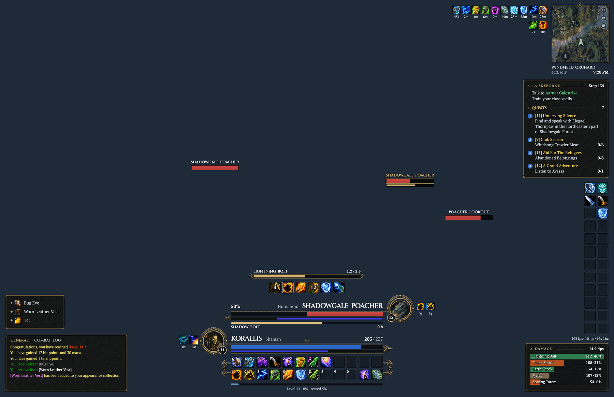

Test render of the DPS layout on a 3456 by 2234 screen, ornaments on Full. Every picture on this page is a test render drawn from the addon's own code, not a game screenshot.

## Why KstyleUI

### One forged material for the whole screen, Blizzard's windows included

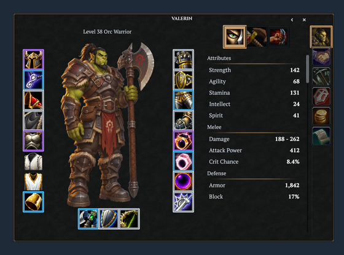

Test render of the character sheet, skinned.

Every panel, card and window is dark forged iron with a textured frame and corner brackets, and your class colour on every accent. Open **Options, General, Card material** to pick another surface: Forged iron with brackets (the default), Forged iron with gilt ticks, Slate, Flat or the original smoked Glass. The change repaints the open screen at once, with no reload, and **Panel opacity** sits beside it.

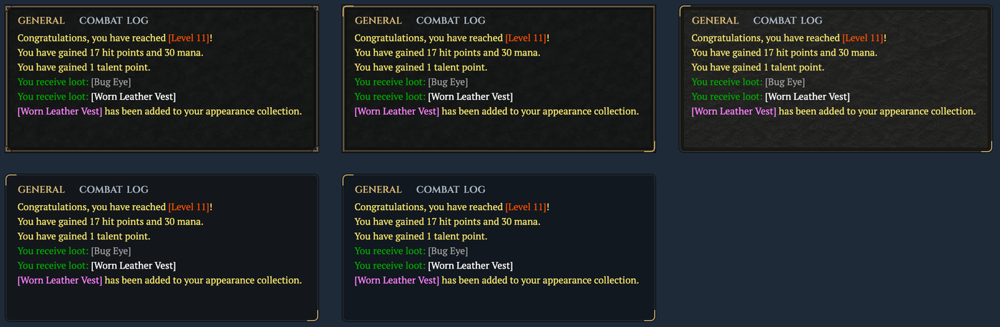

Test render of one card at each material. Top row: Forged iron with brackets, Forged iron with gilt ticks, Slate. Bottom row: Flat, Glass.

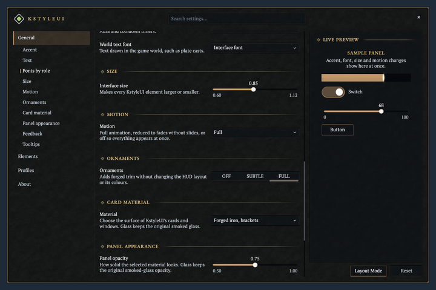

Test render of the settings window's General page at the Ornaments and Card material rows.

Turn on the Skins module and the game's own windows take the same surface, one switch per window: character sheet, spellbook, talents, world map and quest log, mail, merchant, professions, loot, group finder, friends, guild, popups and the Escape menu.

### Painted ornaments, at three levels

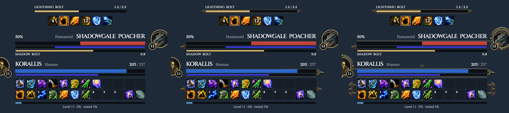

Test render of the same part of the HUD at Off, Subtle and Full, left to right.

Ornaments are painted trim on the unit frames, their cast bars and the action bars: end pieces, rails, rivets, the portrait band and the rank pendants. **Off** draws nothing, so the screen is exactly the plain layout. **Subtle** draws thin gilt rails and plain pointed ends. **Full**, the default, draws forged rails, clawed ends and the action-bar tray. Ornaments never move anything. The setup's ornaments step and **Options, General, Ornaments** choose the level, and the Glass material draws none. [`docs/ORNAMENT-SPEC.md`](docs/ORNAMENT-SPEC.md) lists the pieces and where each shows.

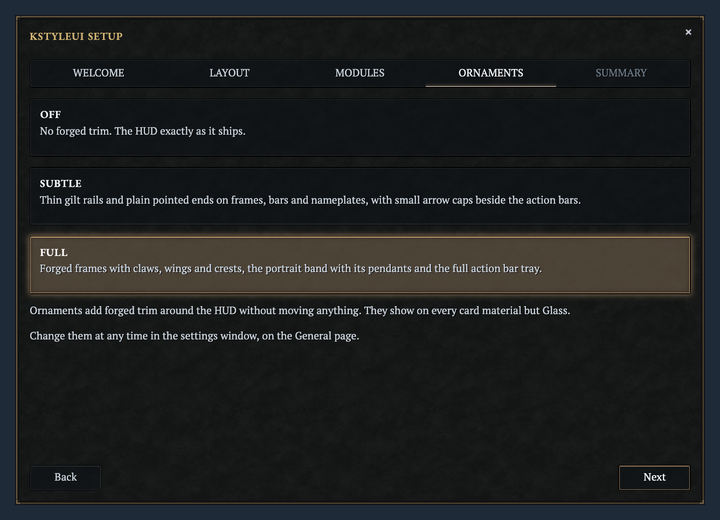

Test render of the setup's ornaments step, with Full picked.

### Folio or Lumen type, and a font for every role

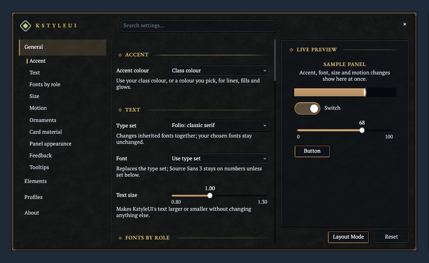

Test render of the settings window's General page.

Folio is the default type set: IM Fell and EB Garamond for titles and captions, Cinzel for names, and PT Serif for reading and figures. The Lumen set of Cinzel and Alegreya Sans is one dropdown away. Under **Fonts by role** each of 13 roles (display, heading, title, capitals, names, unit name, body, prose, caption, number, time, timer and world text) takes its own font, from KstyleUI's bundled faces or from LibSharedMedia. A font you pick stays when you change the type set.

### Three layouts: DPS, Tank and Healer

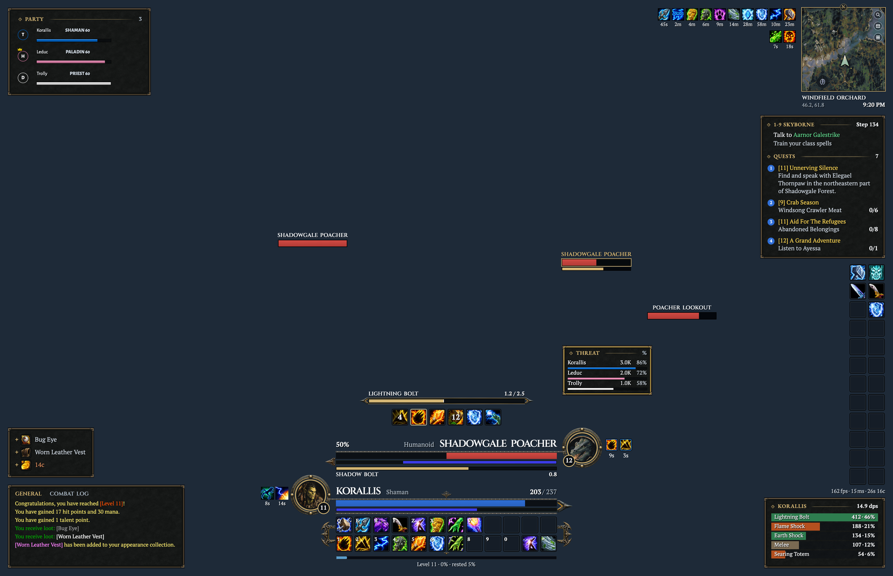

Test render of the Tank layout: the DPS layout with the threat meter in the combat cluster.

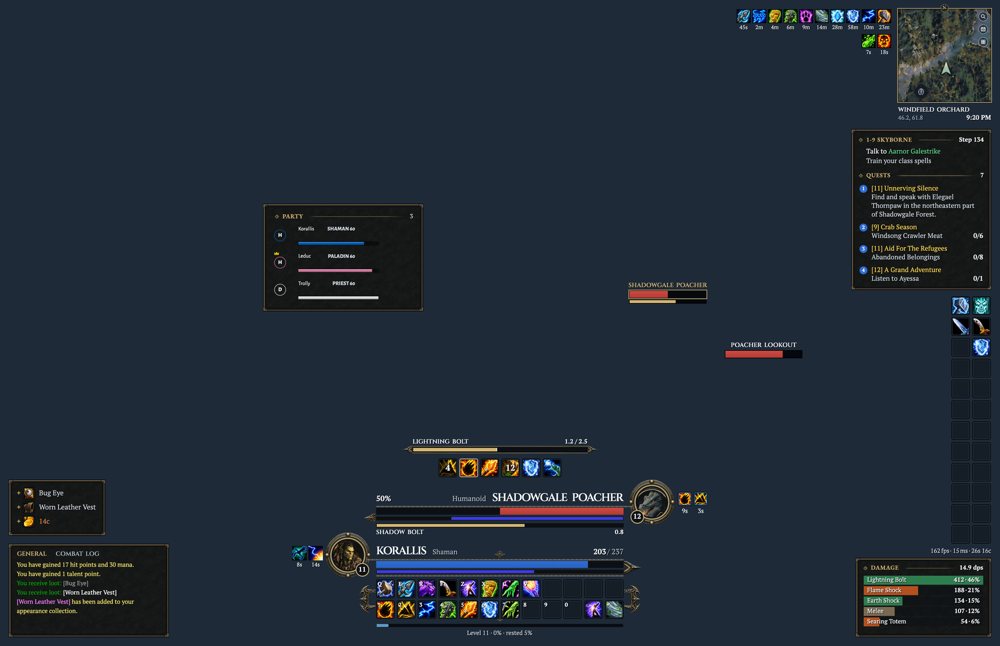

Test render of the Healer layout: larger party and raid frames beside the combat cluster, dispellable debuffs first.

The first-run setup puts every element in the place its layout draws. The three layouts share the left and right rails and the centre column, and differ where the role needs them to: Tank adds the threat card, Healer gives the group frames more room and heads the left rail with the boss cards.

### A combat cluster you read without looking down

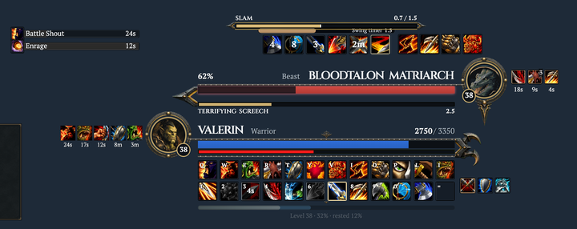

Test render of the combat cluster in a pull.

Your target stands over your own frame in the same column: the name, a health bar, a thin cast line and the portrait on the far side with its level. A cast you cannot interrupt reads <b>Locked</b> in red, even when the game keeps that fact secret.

When a frame's aura row is full, the last socket reads <b>+N</b>. The game's secure aura engine does the counting, so the number stays true in combat. Boss cards stand in a column. The boss you target folds to a slim Targeted chip because the target frame already shows its health and cast.

### Party and raid frames at a healer's standard

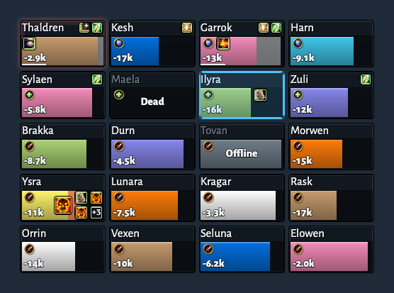

Test render of twenty raid tiles: missing health, debuffs, a dead and an offline member.

Up to 40 members on the game's own group headers, so clicks land on the right person mid-fight. Dispellable debuffs lead the row, a member with a boss debuff glows red, a dispel tints the tile by its type, a thin line shows the whole shield even at full health, and your own heals over time sit in their own lane.

Six indicator slots each show a category of auras in the nearest free spot. The frames work with the game's Click Casting, and the settings page shows your bindings live.

### Set up in one window on your first login

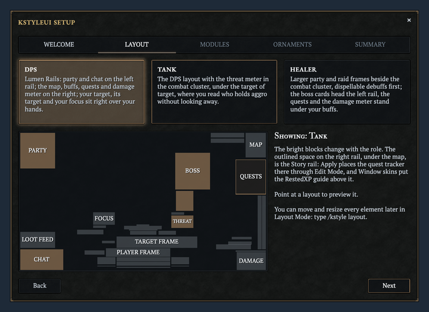

Test render of the layout step: three layouts over one preview of the one you point at.

A five-step window opens on your first login: pick the DPS, Tank or Healer layout from a real-size preview, choose your modules, choose the ornament level, apply. KstyleUI then writes a layout into Blizzard's Edit Mode so the quest tracker, the damage meter and your tracked buffs take their places too.

Closing it early still gives you the DPS layout with Full ornaments. <b>Keep my UI</b> leaves the game's interface exactly as it was. Run it again any time with <code>/kstyle setup</code>.

### Built for Forever from the start

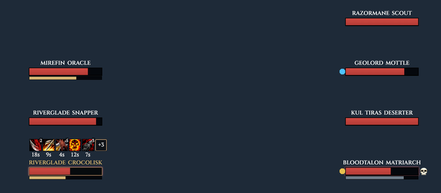

Test render of a seven-mob pull: stacked plates, your debuffs on each, two casts, one of them your target's.

Health, power, casts and auras go straight to the game's widgets. Every comparison is guarded by <code>issecretvalue</code>, and a secret takes a safe default. Protected work waits for combat to end. Blizzard's frames are hidden by reparenting, never scripted, and come back when a module stops.

Nameplates show your debuffs through the engine with an honest +N chip, and colour a cast you could interrupt right now. In the gamepad interface KstyleUI steps aside for Blizzard's bars, frames and bags.

### The rest of the screen, in the same hand

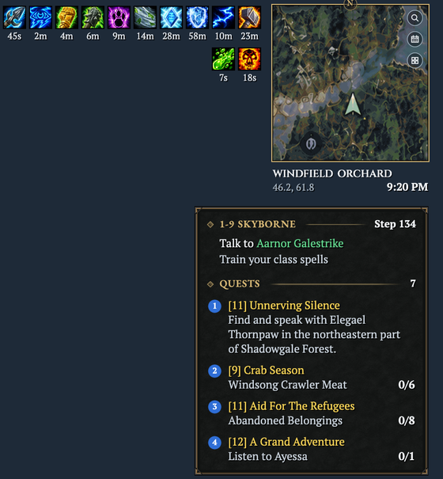

Test render of the right rail while questing: the aura rows, the minimap and the quest card.

The minimap is a square with a thin gilt rim and a round N plate on its top edge: the zone name, your coordinates and the clock sit under it, and the tracking, calendar and addon-drawer buttons stand down its right edge (the zoom slider shows while your pointer is over it). Your buffs and debuffs are plain icon rows beside it: a thin rim, the time left under each icon, stack counts on a corner badge, a +N on the last icon when the rows are full, and a right-click to cancel. A buff the Cooldown Manager already tracks shows there only. The damage meter is a small card that reads from the game's own meter data: a DAMAGE cap with your damage per second, then one bar per spell, coloured by its school, with the spell's damage and its share of the total at the right ("412 · 46%"). Alone, it lists your own spells; in a group, it lists the group and a spell breakdown opens under the row your pointer is on. The Now, Last, All switch shows only while your pointer is on the cap's right end.

Bags sort into sections with a search that understands <code>&amp;</code>, <code>|</code>, <code>!</code> and <code>ilvl&gt;30</code>. Chat sits on a forged card, tooltips become forged cards, and experience is a thin bar with its rested overlay.

### Every screen size

The layout and ornament tests draw the HUD on nine screens: 1280 by 720, 1366 by 768, 1920 by 1080, 2560 by 1440, 3440 by 1440, 5120 by 1440, 3840 by 2160, 2383 by 1540 and 3456 by 2234. Everything draws on one canvas 1080 units tall, so it takes the same share of the screen at each size, and every border is a whole number of physical pixels. Where an ornament piece does not fit, as on 1280 by 720, it is left out, never squeezed or thinned. A render is not the game, so the owner checks each release in game before it ships.

## What it changes

KstyleUI is one core addon and one addon per module. A module that is off costs nothing: no frames, no events and no hooks, and the first-run setup switches on the ones you pick.

<table>
<tr>
<td width="50%" valign="top">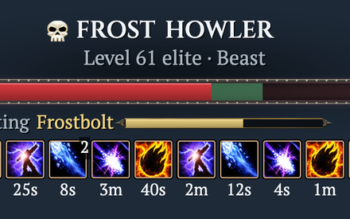 <b>Unit frames</b> Player and target as mirrored columns with a portrait band, focus and boss cards.</td>
<td width="50%" valign="top">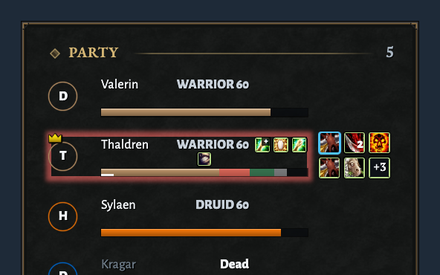 <b>Party and raid</b> Secure frames with role rings, dispel and boss debuffs, shields and your heals.</td>
</tr>
<tr>
<td width="50%" valign="top">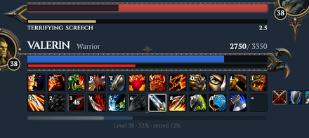 <b>Action bars</b> Six secure bars as dark sockets. A socket's rim turns gold while a proc is up.</td>
<td width="50%" valign="top">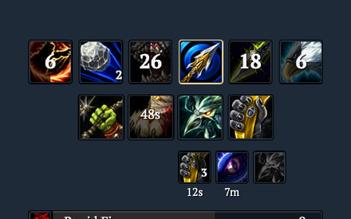 <b>Cooldowns</b> Blizzard's Cooldown Manager mirrored as KstyleUI icons and bars, each movable.</td>
</tr>
<tr>
<td width="50%" valign="top">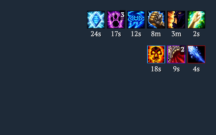 <b>Aura rows</b> Your buffs and debuffs as plain icon rows, drawn by the game's secure aura engine.</td>
<td width="50%" valign="top">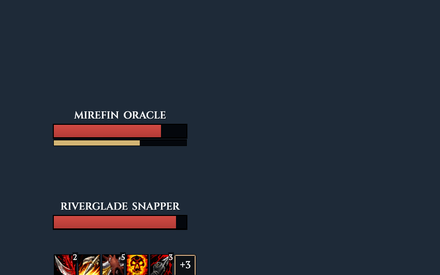 <b>Nameplates</b> Health, level, your debuffs and a cast bar that says when you can interrupt.</td>
</tr>
<tr>
<td width="50%" valign="top">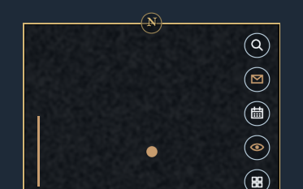 <b>Minimap</b> A square map in a gilt rim with an N plate, its zone, coordinates and clock under it and round buttons down its edge.</td>
<td width="50%" valign="top">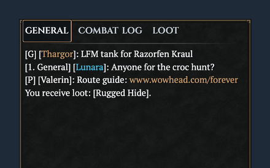 <b>Chat</b> Blizzard's chat on a forged card with gilt tabs and a copy window.</td>
</tr>
<tr>
<td width="50%" valign="top">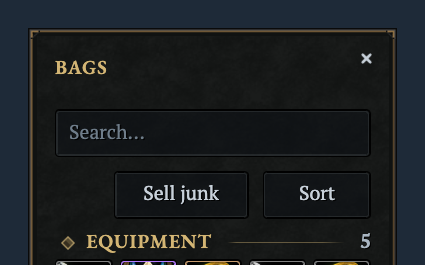 <b>Bags and bank</b> One window, sections by item type, and a search grammar.</td>
<td width="50%" valign="top">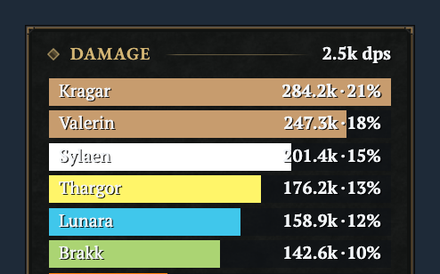 <b>Meters</b> Damage and threat from the game's own data, with fight segments and spell lists.</td>
</tr>
<tr>
<td width="50%" valign="top">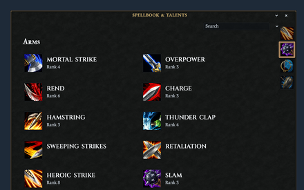 <b>Blizzard windows</b> The spellbook, talents, map, mail, merchant and more on the same forged surface.</td>
<td width="50%" valign="top">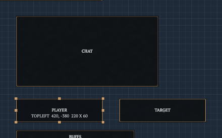 <b>Layout Mode</b> Mover plates, snapping, a grid, resize handles, undo and redo.</td>
</tr>
</table>

Every picture in this grid is a test render.

Every element KstyleUI shows can be moved, resized or scaled in Layout Mode and from the settings window, and every module has its own fonts, textures, colours and sizes.

Every module, in one table

| Module | What it does |
| --- | --- |
| Core | The design system, the settings window (with its General page's type set and fonts by role, card material, ornaments, panel opacity, panel shadows, interface sounds and tooltip size), Layout Mode, profiles, the first-run setup and `/kstyle` |
| Unit Frames | Player, target, target of target, focus, focus target, pet and boss 1 to 5, with portraits, cast bars, frame auras, the class resource, threat glow and status icons |
| Group Frames | Party and raid frames up to 40, with class colours, roles, range fade, incoming heals, absorbs, debuffs and the dispel highlight |
| Action Bars | Secure action bars with stance, stealth, form and possess paging, pet and stance bars, keybind text, cooldowns, proc glows, range and usability shading, fade on mouseover, and a dialog that puts a newly learned spell rank on the bars |
| Cooldowns | Blizzard's Cooldown Manager in KstyleUI's style: essential and utility rows in the HUD band, tracked buff icons and bars |
| Auras | Your buffs and debuffs as plain icon rows beside the minimap |
| Nameplates | A KstyleUI plate on each nameplate, with health, cast bar, threat colour and your debuffs |
| Combat Text | Damage and heal numbers on KstyleUI's frames and plates, and KstyleUI's font for the game's own numbers |
| Minimap | A square map in a thin gilt rim with an N plate, the zone, coordinates and clock under it, and round buttons and an addon-button drawer down its edge |
| Chat | Forged chat cards, tabs with an accent underline, timestamps, short channel names, clickable links, class-coloured names, a copy window, and a plus glyph in the tab row that opens the chat settings |
| Bags | Combined bags and bank with the keyring, search, sorting, quality borders and junk selling |
| Tooltips | Forged tooltips with quality and class colours, a health bar, optional IDs and cursor anchoring |
| Data Bars | XP, reputation and honour bars, the micro menu, the bag bar and a data strip with frame rate, latency, gold, durability and time |
| Meters | A damage meter, a threat meter and a swing timer |
| QoL | Faster auto loot, auto repair, quest accept and turn-in, the farthest camera and quiet error text |
| Skins | Blizzard's windows in KstyleUI's style: the character sheet, spellbook, talents, world map, quest log, objective tracker, game menu, group finder, mail, merchant, trainers, professions, social windows, Legacy, loot, popups, ready check and the AddOns list, and the RestedXP Guides addon's windows |

No module compares or does arithmetic on Forever's secret values, every protected change made in combat waits for combat to end, and the action bars, group frames, bags, auras, and the data bars' micro menu and bag bar hand back to Blizzard's in the gamepad interface.

## Every class

The same HUD on all nine classes: each class's own colour on every accent, its power type, its spells, its cast, its buffs and its pet.

<table>
<tr>
<td width="33%">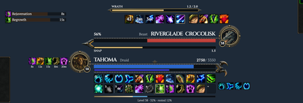 Druid</td>
<td width="33%">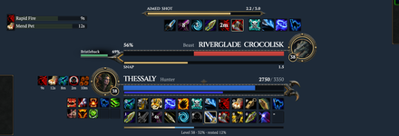 Hunter</td>
<td width="33%">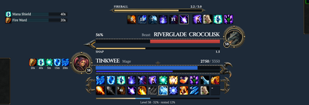 Mage</td>
</tr>
<tr>
<td width="33%">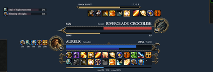 Paladin</td>
<td width="33%">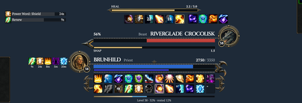 Priest</td>
<td width="33%">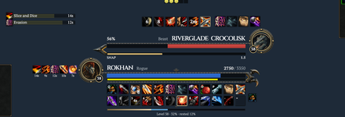 Rogue</td>
</tr>
<tr>
<td width="33%">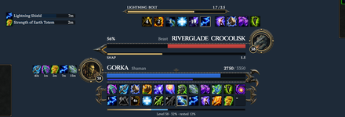 Shaman</td>
<td width="33%">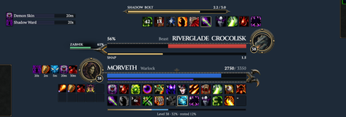 Warlock</td>
<td width="33%">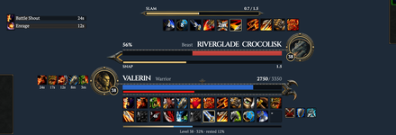 Warrior</td>
</tr>
</table>

Every picture in this grid is a test render.

## Get started

KstyleUI targets the Forever client only (TOC `16001`, game type `camelot`). It has not been released yet: the first release follows the owner's in-game test of the `staging` branch. Until then, follow [Install the addons](docs/TESTING.md#install-the-addons) in the test guide to run the current `staging` build from a clone.

1. Download the latest zip from the [Releases page](https://github.com/korallis/KstyleUI/releases) and unzip it into `World of Warcraft/_forever_/Interface/AddOns`, so that `KstyleUI` and the `KstyleUI_*` module folders sit there. Start the game. If the addons are not ticked in the game's AddOns list, tick them.
2. Log in. The first-run setup opens: pick the DPS, Tank or Healer layout, the modules you want and the ornament level, then click **Apply** and **Reload**. Close it early and you still get the DPS layout with Full ornaments. **Keep my UI** changes nothing.
3. Type `/kstyle` for the settings window: a page per module, a search across every setting and a live preview of what you change.
4. Type `/kstyle layout` to place things your way. A mover plate covers every element: drag, snap, nudge with the arrow keys, undo. Positions save per profile.

Every command

| Command | What it does |
| --- | --- |
| `/kstyle` | Opens or closes the settings window. Esc > Options > AddOns > KstyleUI and the minimap's addon compartment open it too. |
| `/kstyle layout` | Enters or leaves Layout Mode. |
| `/kstyle setup` | Runs the first-run setup again. |
| `/kstyle bind` | Opens Blizzard's Quick Keybind mode: hover a button and press a key to bind it. |
| `/kstyle test` | Runs the smoke checks and writes the results to the devlog. Type `/reload` afterwards to save them. |
| `/kstyle devlog on`, `/kstyle devlog off` | Arms/stops the developer-only [Edit Mode geometry recorder](docs/EDIT_MODE_RECORDER.md) for this session; off after every reload. |
| `/kstyle profile` | Lists the profiles and marks the one this character uses. |
| `/kstyle profile use <name>` | Switches this character to a profile, creating it if needed. |
| `/kstyle profile new <name>` | Creates a profile with the default settings. |
| `/kstyle profile copy <name>` | Copies a profile into the active one. |
| `/kstyle profile rename <name>` | Renames the active profile. |
| `/kstyle profile delete <name>` | Deletes a profile. |
| `/kstyle profile reset` | Resets the active profile to the defaults. |

The settings window's Profiles page also exports a profile as one string and imports one back.

### The repainted icons are optional

KstyleUI's repainted icons are a separate download, `KstyleUI-Icons-<version>.zip` on the [release](https://github.com/korallis/KstyleUI/releases), not part of the addon. Quit the game, unzip it, and copy its `Interface` folder into `World of Warcraft/_forever_/` so the files land in `_forever_/Interface/Icons/`. Then start the game (a full restart, not `/reload`). The client loads the files itself, so every icon the pack covers changes everywhere, buff and debuff tiles included. To go back to Blizzard's icons, delete those files and restart. Encrypted store and event icons stay Blizzard's. [`docs/icons.md`](docs/icons.md) has the details, the install script and how the pack is made.

### Languages

KstyleUI ships English, German (`deDE`), French (`frFR`), Spanish (`esES`, also used on `esMX`) and Simplified Chinese (`zhCN`). The translations use WoW's own terms for each language, taken from Blizzard's localised interface strings for the Forever build. They are machine-made and have not yet been read by a native speaker, so report a wrong or awkward string as an issue. A string with no translation shows in English.

KstyleUI's bundled fonts have no Chinese or Korean glyphs. On `zhCN`, `zhTW` and `koKR` clients every KstyleUI text uses the game's own font for that language, and on `ruRU` the game's Cyrillic font replaces Cinzel and Folio's display face. A font you pick from another addon stays your choice.

## For developers

[`docs/DEVELOPING.md`](docs/DEVELOPING.md) has the repository layout, the checks to run, how to add a translation and where the design spec and the branch flow live.

## Licence

All rights reserved. See [`LICENSE.md`](LICENSE.md).
