
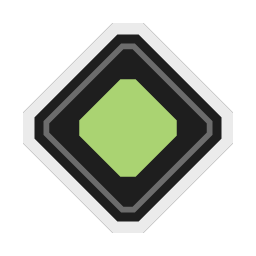

<h1 align="center">KstyleUI</h1>

<b>A complete, pixel-perfect interface for World of Warcraft: Forever — one dark forged style, three HUDs, set up in one window.</b>

<!-- CF_URL -->
<!-- WAGO_URL -->

<a href="https://github.com/korallis/KstyleUI/releases/latest">Download</a>&nbsp;&nbsp;&nbsp;<a href="#install">Install</a>&nbsp;&nbsp;&nbsp;<a href="#three-hud-styles">HUD styles</a>&nbsp;&nbsp;&nbsp;<a href="#every-screen-ultrawide-included">Ultrawide</a>&nbsp;&nbsp;&nbsp;<a href="#faq">FAQ</a>

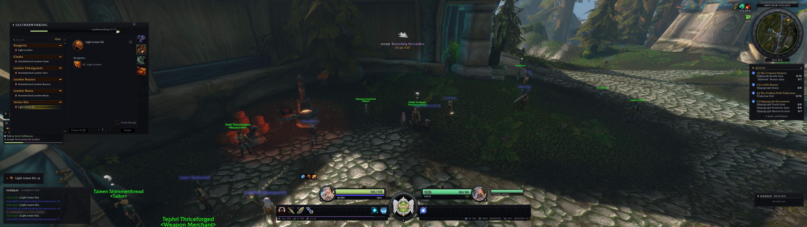

In-game: the Medallions HUD on a 5120 by 1440 screen, in Tirisfal Glades. Chat and distant player names are blurred.

**Why players switch**

- **Three HUDs, one choice at setup.** Medallions, Frames or Orbs — pick yours on first login, change it any time.
- **The whole game in one style.** Bars, nameplates, bags, tooltips, windows and the damage meter all wear the same dark forged chrome.
- **Sharp on every screen.** Pixel-perfect sizing from a laptop to a 32:9 ultrawide, with text that never drops below a readable size.
- **Nothing you don't want.** Every part is its own module. Switch one off and it costs nothing.
- **Ready in minutes.** One short setup, layouts for DPS, Tank and Healer, and profiles you can copy between characters.

## Three HUD styles

Pick your style in the first-run setup. Switch later in **Options, General, HUD style**, which shows a picture of each; out of combat the change applies at once, in combat it waits for the fight to end.

### Medallions

Dark gunmetal with rounded, bevelled edges, like a piece of forged hardware. You and your target are slabs with clean bars and a round medallion on the outer end, its rim engraved with runes. Yours is a painted portrait of your race, class and sex — other players get their own; a creature, pet or boss shows the game's portrait.

Your first two action bars sit in recessed sockets on one dark slab: twelve buttons each side of a crest painted for your race and class, 52 in all, in a ring of runes in your class colour. Your pet and stance bars get small slabs beside it, and your experience runs along the slab's lower edge.

<table>
<tr>
<td width="50%">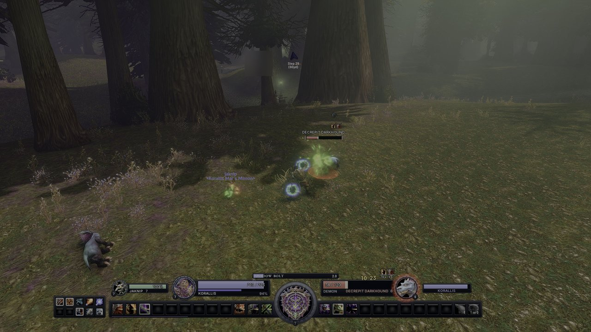</td>
<td width="50%">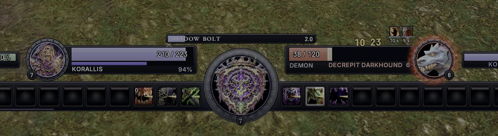</td>
</tr>
</table>

In-game crops of the same capture: a 16:9 view on the left, the medallions, cast bar and crest up close on the right.

Medallions also answers what happens in a fight:

- A slot flashes when its cooldown comes back, and its socket takes your class colour when the ability lights up.
- Your cast bar flashes when a cast lands, and red when it is stopped or fails.
- A red edge grows round the screen at low health; a burst blooms behind your portrait when you level up.
- Three seconds after combat your side frames dim, and come back with the next fight.

**Medallions motion** (Options, General, Medallions) sets how much moves: Full adds the game's own 3D spell effects for the big moments, Calm keeps the slow motion and short flashes, Off stills it. The general **Motion** setting still wins over it.

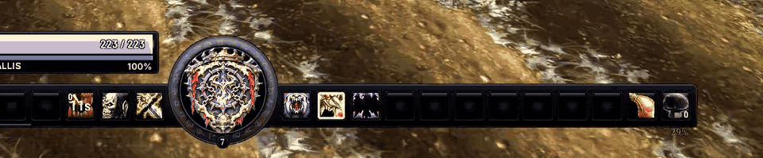

In-game: selecting a Tirisfal Farmer brings in the target medallion; its red ring pulses at low health.

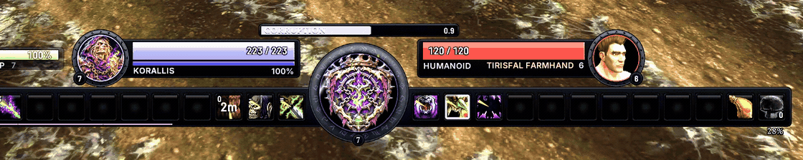

In-game: Corruption, Immolate and Shadow Bolt fill the cast bar above the breathing crest while the sockets sweep through their cooldowns.

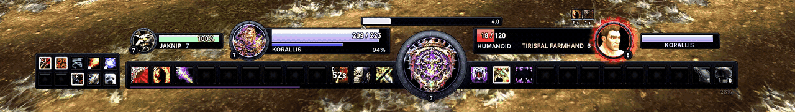

In-game: an interrupted cast flashes, then a channel counts down above the crest as the target frame clears.

### Frames

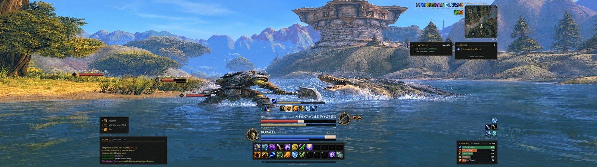

Test render: the Frames HUD in combat on a 5120 by 1440 screen, in the Spread arrangement.

**Frames** is the classic layout, cleaned up: your health and resource on a player card above the action bars, your target's card stacked over it with its portrait on the far side.

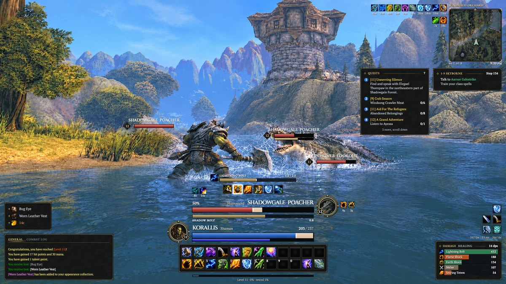

Test render: the Frames HUD on a 1920 by 1080 screen, in combat.

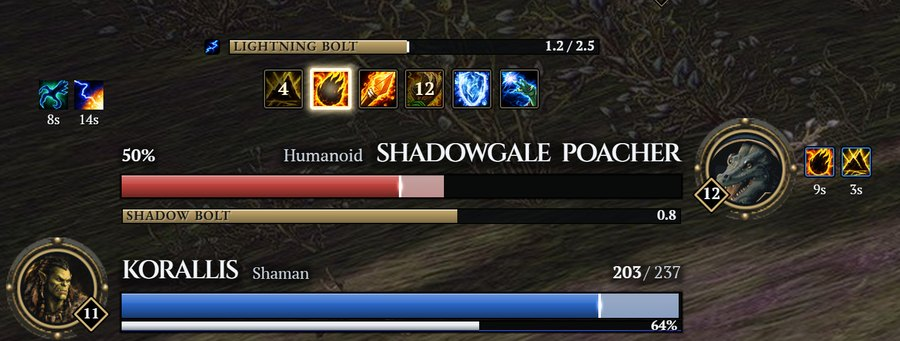

Test render: the target over the player, both mid-cast.

Whichever style you pick, the bars read the same way: a hit flashes, the health you just lost holds as a pale band before it drains, and cast bars are tall enough to read in a pull. Action buttons share one slot design, with a proc glow and a gilt flash when an ability is ready again.

### Orbs

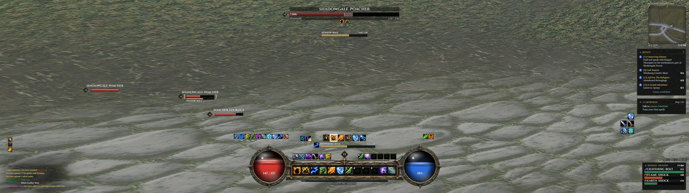

Test render: the Orbs HUD in combat on a 5120 by 1440 screen, in the Spread arrangement.

**Orbs** puts your health and resource in two orbs either side of a forged tray round your first action bar, and moves your target to a wide bar at the top of the screen.

<table>
<tr>
<td width="50%">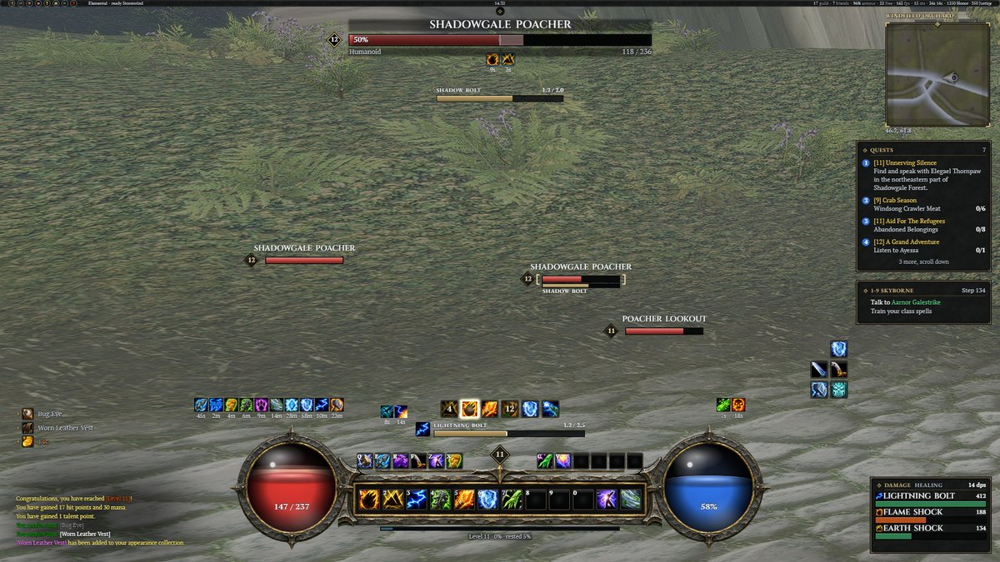</td>
<td width="50%">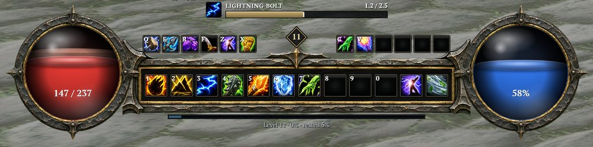</td>
</tr>
</table>

Test renders, in combat: the Orbs HUD on a 1920 by 1080 screen on the left, the orbs and the forged tray up close on the right, a moment after a hit.

## Every screen, ultrawide included

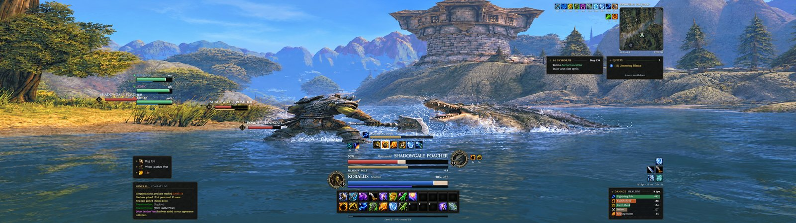

Test render: the Healer layout on 5120 by 1440, Centred.

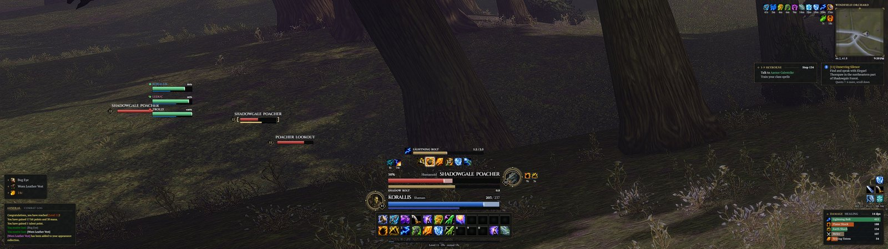

Test render: the Healer layout on 5120 by 1440, Spread.

On a 21:9 or 32:9 monitor, you choose how the HUD uses the width:

- **Centred** (the default) keeps everything in a band in the middle, so nothing is stranded at the far edges.
- **Spread** moves the side columns out to the screen edges and keeps your group frames close to your character.

Set it in **Options, Elements, Ultrawide arrangement**, and set the band itself — 21:9, 16:9 or the full width — under **HUD width**. Laptop screens and 4:3, 3:2 and 16:10 displays are covered too.

## Set up in one window

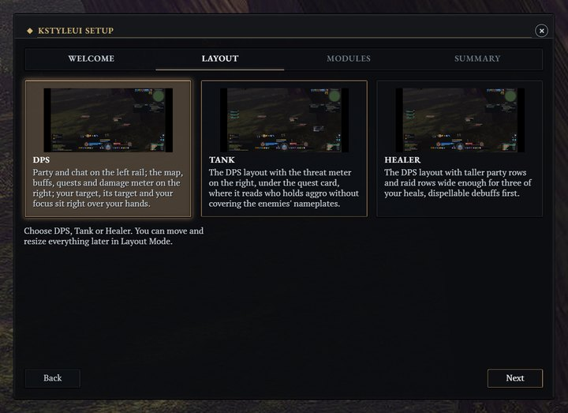

Test render: the first-run setup on its layout step.

The first time you log in, one short setup does it all: pick Medallions, Frames or Orbs, pick the DPS, Tank or Healer layout over a live preview, choose your modules and trim, then apply. KstyleUI also writes a matching Edit Mode layout, so the quest tracker and your tracked buffs land in place. Close it early and you get the DPS layout with every module on; **Keep my UI** leaves the game's interface untouched. Run it again any time with `/kstyle setup`.

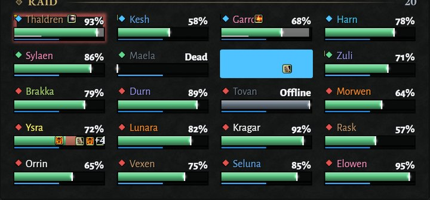

Test render: the raid frames.

Tank adds a threat card in the combat cluster. Healer gives party and raid frames more room: dispellable debuffs lead the row, a member with a boss debuff glows, shields and your heals over time show on each tile, and the frames work with the game's Click Casting.

## The rest of your UI, in the same style

### Nameplates that stay out of the way

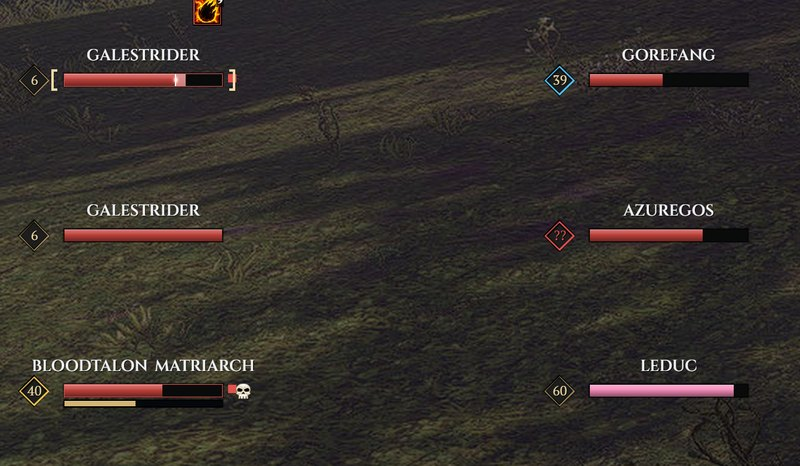

Test render: nameplates in combat.

Plain flat bars under tracked capital names, with your own debuffs on top. Your target wears brackets, a cast flashes when it starts and when it is stopped, and objects such as a mailbox get a name-only plate.

### A group damage meter

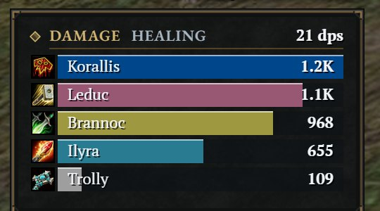

Test render: the damage meter in a party of five.

One card, a class-coloured bar per player, in the style of Details. Switch between this fight, the last fight and the whole session; point at a row for that player's spell split. The threat card beside it follows the same design.

### Quests, guide and map on the right

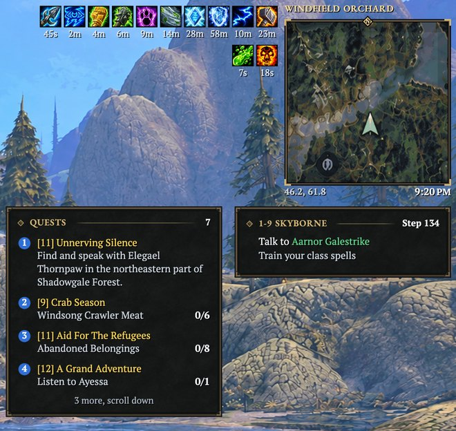

Test render: the right rail — map card, quest card and guide card.

Your buffs sit above a map card with the zone, your coordinates and the clock. The quest card keeps four quests in view and scrolls for the rest. With a RestedXP guide open, the guide takes the tall column beside it with room for your whole current step, and RestedXP's target and item boxes dock underneath. The minimap's drawer collects every addon button cluttering the map.

### Bags, tooltips and windows

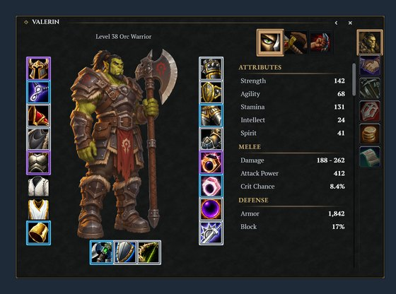

Test render: the skin on the character sheet.

- **Bags:** combined bags and bank with search, sorting, categories, quality borders and junk selling.
- **Tooltips:** on the same dark card, with quality and class colours and a health bar.
- **Window skins:** the character sheet, spellbook, talents, world map and quest log, mail, merchant, professions, loot, group finder, social windows, the game menu — and the RestedXP windows — all in KstyleUI's style.
- **Settings that stay simple:** `/kstyle` opens one window with a page per module, a search across every setting and a live preview. Layout Mode moves, resizes or scales any element.

Every module

KstyleUI is one core addon and one addon per module. A module you switch off costs nothing.

| Module | What it does |
| --- | --- |
| Core | The settings window, the HUD style, Layout Mode, profiles, the first-run setup, fonts, card material and `/kstyle` |
| Unit Frames | Player, target, target of target, focus, pet and boss 1 to 5, as cards under Frames, as orbs and a wide target bar under Orbs, and as dark slabs with a round medallion under Medallions (a painted portrait for a player, the game's own portrait for a creature, pet or boss), with cast bars, auras, the class resource and threat |
| Group Frames | Party and raid frames up to 40, with roles, range fade, incoming heals, shields, debuffs and the dispel highlight; under Medallions, painted party badges and class-coloured raid tiles |
| Action Bars | Secure action bars with paging, pet and stance bars, keybinds, cooldowns, proc glows, range shading and fade on mouseover, and an offer to put a newly learned rank on your bars; under Medallions, one dark slab round your race and class crest |
| Cooldowns | Blizzard's Cooldown Manager in KstyleUI's slots: essential and utility rows, tracked buff icons and bars |
| Auras | Your buffs and debuffs as icon rows beside the map, sorted by how you use them |
| Nameplates | Flat plates with your debuffs, a cast bar, threat colour and name-only plates for objects |
| Combat Text | White hits and gold crits with a short rise, on KstyleUI's font |
| Minimap | A square map card (round in a dark ring with an N badge under Medallions) with the zone, coordinates, clock and an addon-button drawer, with guide pins on the map's edge hidden unless you want them |
| Chat | Chat on a card, with tabs, timestamps, short channel names, clickable links, a copy window and history that survives a reload |
| Bags | Combined bags and bank with search, sorting, categories, quality borders and junk selling |
| Tooltips | Tooltips on the same card, with quality and class colours, a health bar and cursor anchoring |
| Data Bars | Experience, reputation and honour as a clean strip, the micro menu when you need it, and a readout with frame rate, latency, gold and time |
| Meters | The group damage meter, the threat meter and a swing timer |
| QoL | Fast auto loot, auto repair, quest hand-in and quiet error text |
| Skins | Blizzard's windows and the RestedXP Guides windows in KstyleUI's style |

Every module stays inside the rules Forever sets for addons: a protected change made in combat waits for combat to end, and the action bars, group frames, bags and auras hand back to Blizzard's own in the gamepad interface.

## Pixel-perfect and light

With **Interface size: Auto (pixel perfect)**, the default, KstyleUI picks the size that fits your screen exactly. Every frame, bar and slot lands on whole screen pixels, so edges stay sharp instead of blurring between pixels — and text never drops below a readable size. Prefer to set it yourself? Turn Auto off in **Options, General, Size** and step through whole-pixel sizes.

KstyleUI is built to stay out of the way of the game: each feature is its own module, a module you switch off costs nothing, and motion you don't want can be calmed or turned off. Turn on only the parts you play with.

## Install

KstyleUI runs on the World of Warcraft: Forever client.

1. Download `KstyleUI-v<version>-forever.zip` from the [latest release](https://github.com/korallis/KstyleUI/releases/latest) and unzip it into `World of Warcraft/_forever_/Interface/AddOns`, so that `KstyleUI` and the `KstyleUI_*` module folders sit there.
2. Start the game. If the addons are not ticked in the AddOns list on the character screen, tick them.
3. Log in. The setup opens: pick your HUD style, layout and modules, then click **Apply** and **Reload**.
4. Type `/kstyle` for the settings, or `/kstyle layout` to move things.

### Optional: the repainted icons

`KstyleUI-Icons-<version>.zip`, on the same release, repaints ability and item icons everywhere, buff and debuff tiles included. It is not an addon, so it does not go into `AddOns`. Quit the game, unzip it, and copy its `Interface` folder into `World of Warcraft/_forever_/` so the files land in `_forever_/Interface/Icons/`, then start the game again (a full restart, not `/reload`). To go back to Blizzard's icons, delete those files and restart. [The icon pack guide](docs/icons.md) has the details.

Every command

| Command | What it does |
| --- | --- |
| `/kstyle` | Opens or closes the settings window. Esc > Options > AddOns > KstyleUI and the minimap's addon compartment open it too. |
| `/kstyle layout` | Enters or leaves Layout Mode: drag, snap, nudge with the arrow keys, undo and redo. |
| `/kstyle setup` | Runs the first-run setup again. |
| `/kstyle bind` | Opens Blizzard's Quick Keybind mode: hover a button and press a key to bind it. |
| `/kstyle profile` | Lists the profiles and marks the one this character uses. |
| `/kstyle profile use <name>` | Switches this character to a profile, creating it if needed. |
| `/kstyle profile new <name>` | Creates a profile with the default settings. |
| `/kstyle profile copy <name>` | Copies a profile into the active one. |
| `/kstyle profile rename <name>` | Renames the active profile. |
| `/kstyle profile delete <name>` | Deletes a profile. |
| `/kstyle profile reset` | Resets the active profile to the defaults. |

The settings window's Profiles page also exports a profile as one string and imports one back.

## FAQ

**Which client does KstyleUI support?**
World of Warcraft: Forever. It is built and tested for that client only.

**Does it work with RestedXP?**
Yes. The guide gets its own tall card beside your quest card with room for the whole current step, RestedXP's Active Targets and Active Items boxes dock underneath it, and the RestedXP windows are skinned to match.

**How do I switch HUD style?**
In **Options, General, HUD style** — it shows a picture of Medallions, Frames and Orbs — or by running the setup again with `/kstyle setup`. Out of combat the change applies at once; picked in combat, it waits for the fight to end.

**Can I keep parts of the default UI?**
Yes. Every feature is a module you can switch off, and **Keep my UI** in the setup leaves the game's interface as it is.

**Which languages are included?**
English, German (`deDE`), French (`frFR`), Spanish (`esES`, also used on `esMX`) and Simplified Chinese (`zhCN`), using WoW's own terms for each language. The translations are machine-made and not yet checked by a native speaker, so please report a wrong or awkward string as an issue. On Chinese, Korean and Russian clients, KstyleUI uses the game's own font where its bundled fonts have no glyphs.

**How do I report a bug?**
Open an issue on [GitHub](https://github.com/korallis/KstyleUI/issues). Say what you were doing, what you expected and what happened instead, and add a screenshot and your KstyleUI version if you can.

## Credits and licence

KstyleUI is made by the KstyleUI authors. It bundles the Source Sans 3, Inter and Barlow Semi Condensed fonts, each under the SIL Open Font License 1.1; [`Media/PROVENANCE.md`](Media/PROVENANCE.md) records where every bundled file came from.

All rights reserved. See [`LICENSE.md`](LICENSE.md). Building or contributing? See [`docs/DEVELOPING.md`](docs/DEVELOPING.md).

