<h1 align="center">KstyleUI</h1>

<b>A complete, pixel-perfect interface for World of Warcraft: Forever, in one dark forged style.</b>

Pick your HUD: classic frames, or health and resource in two orbs round a forged tray. Everything else follows: clean bars, readable nameplates, a group damage meter, quest and guide cards, and a size that lands on whole screen pixels from a laptop to a 32:9 ultrawide.

<a href="https://github.com/korallis/KstyleUI/releases/latest">Download the latest release</a>&nbsp;&nbsp;&nbsp;<a href="#install">Install</a>&nbsp;&nbsp;&nbsp;<a href="#two-hud-styles-frames-and-orbs">HUD styles</a>&nbsp;&nbsp;&nbsp;<a href="#every-screen-ultrawide-included">Ultrawide</a>

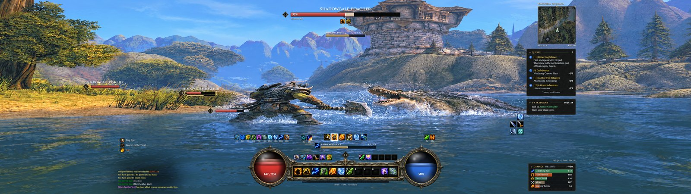

Test render of the addon: the Orbs HUD in combat on a 5120 by 1440 screen. Every picture on this page is a test render drawn from KstyleUI's own code, not a game screenshot.

## Two HUD styles: Frames and Orbs

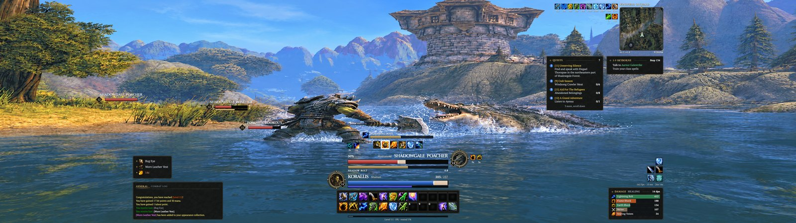

Test render of the addon: the Frames HUD in combat on a 5120 by 1440 screen.

**Frames** keeps your health and resource on a player card above the action bars, with your target's card stacked over it, its portrait on the far side. **Orbs** puts your health and resource in two orbs either side of a forged tray round your first action bar, and moves your target to a wide bar at the top of the screen.

<table>
<tr>
<td width="50%">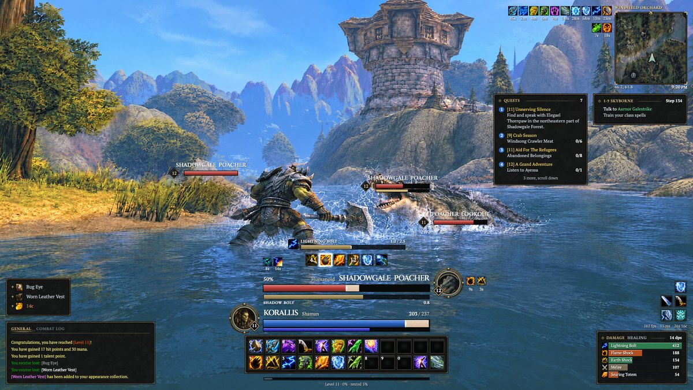</td>
<td width="50%">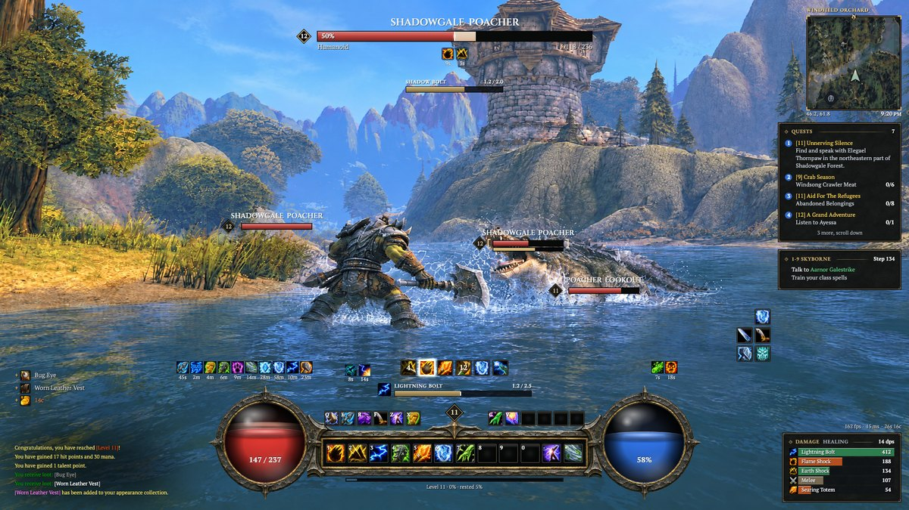</td>
</tr>
</table>

Test renders of the addon on a 1920 by 1080 screen, in combat: Frames on the left, Orbs on the right.

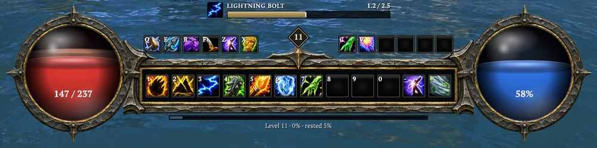

Test render of the addon: the orbs and the forged tray, a moment after a hit.

Switch any time in **Options, General, HUD style**, which shows a picture of each, or on the HUD style step of the first-run setup. The change applies at once out of combat; picked in combat, it waits for the fight to end.

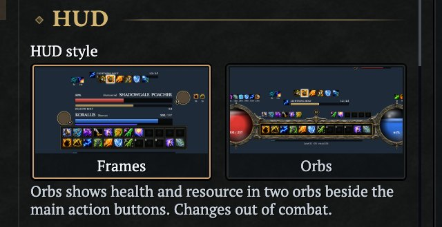

Test render of the addon's settings window at the HUD style picker.

## Clean bars you read at a glance

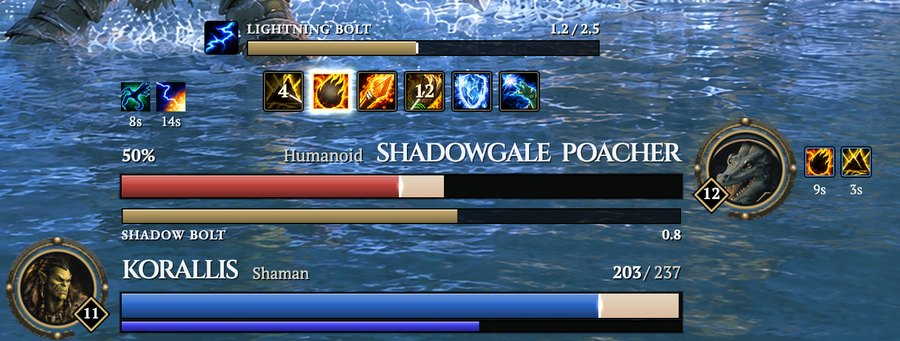

Test render of the addon: the target over the player, both mid-cast.

Health and resource fill flat and clean. A hit flashes, the health you just lost holds as a pale band before it drains, and low health warns you. The target fills from the left, cast bars are tall enough to read in a pull, and party and raid frames use the same bars with a glow on a member in trouble. Action buttons and the cooldown rows share one slot: a pressed state, a proc glow, a lit sweep edge and a gilt flash when an ability is ready again.

## Nameplates that stay out of the way

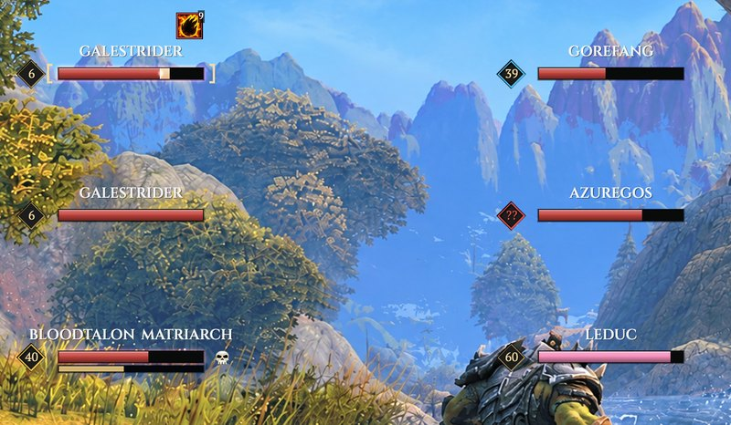

Test render of the addon's nameplates in combat.

Plates are plain flat bars under tracked capital names, with your own debuffs on top. Your target wears brackets, a cast flashes when it starts and when it is stopped, and the track turns black while you hold threat. Objects such as a mailbox get a name-only plate, and plates keep a steady size instead of darting about.

## A group damage meter

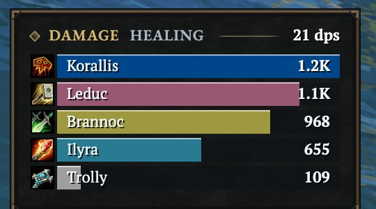

Test render of the addon's damage meter in a party of five.

One card with a bar per player in their class colour, in the style of Details. Switch between this fight, the last fight and the whole session, and point at a row to open that player's spell split under it. Alone, it lists your own spells. The threat card next to it follows the same design.

## Quests, guide and map on the right

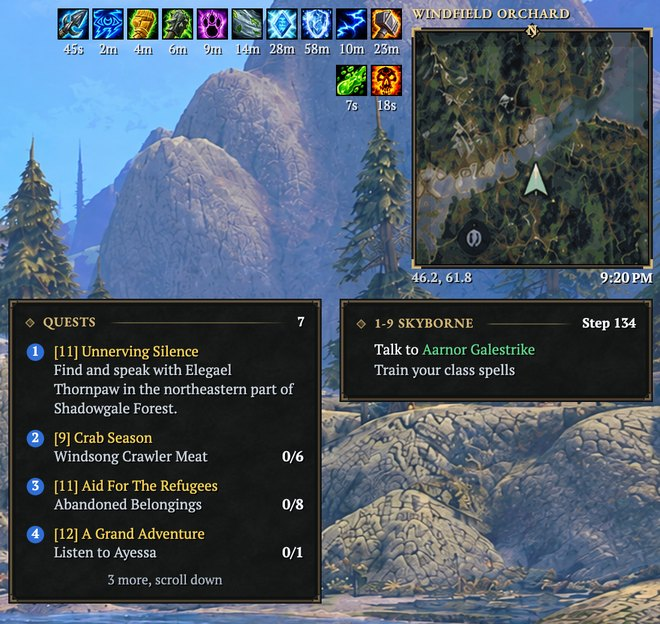

Test render of the addon's right rail: the map card, the quest card and the guide card.

Your buffs and debuffs sit in rows above a square map card with the zone, your coordinates and the clock. Under it, the quest card keeps four quests in view with the count of the rest, and the RestedXP guide gets its own card beside it with the current step. Tooltips, windows and these cards share one card design, and the minimap's addon drawer collects stray minimap buttons.

## Pixel perfect at every size

With **Interface size: Auto (pixel perfect)**, the default, KstyleUI works out the size that fits your screen exactly and keeps every frame, bar, slot, aura and combat number on whole screen pixels, so edges stay sharp instead of blurring between pixels. Both HUD styles reach the same size. Turn Auto off in **Options, General, Size** to set the size yourself, still in whole-pixel steps. Text never drops below a readable size.

## Every screen, ultrawide included

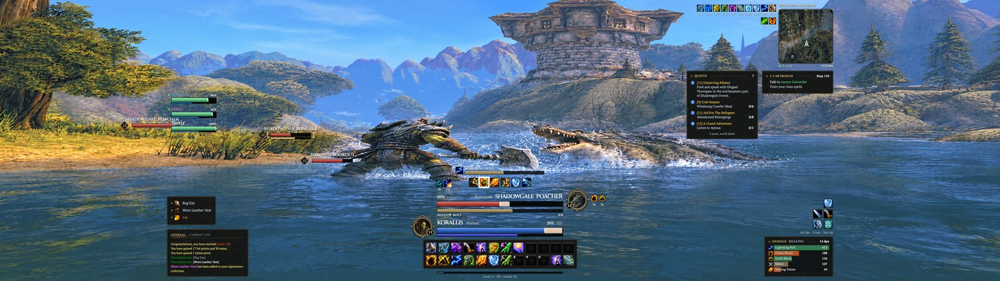

Test render of the addon's Healer layout on 5120 by 1440, Centred.

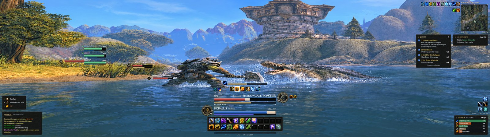

Test render of the addon's Healer layout on 5120 by 1440, Spread.

On a 21:9 or 32:9 monitor, choose how the HUD uses the width in **Options, Elements, Ultrawide arrangement**. **Centred**, the default, keeps everything in a 21:9 band in the middle, so nothing is stranded at the far edges. **Spread** moves the side columns out to the edges of the screen and keeps your group frames on the 21:9 line, close to your character. **HUD width** sets the band itself: 21:9, 16:9 or the full width.

## Set up in one window

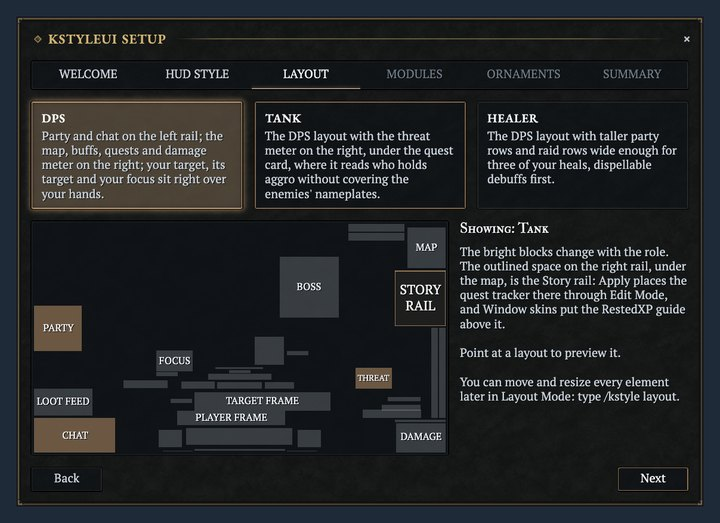

Test render of the addon's first-run setup on its layout step.

The first time you log in, a short setup walks you through it: pick Frames or Orbs, pick the DPS, Tank or Healer layout over a live preview, choose your modules and the level of forged trim, then apply. KstyleUI also writes a matching Edit Mode layout, so the quest tracker and your tracked buffs take their places too. Close it early and you get the DPS layout with every module on; **Keep my UI** leaves the game's interface as it is. Run it again with `/kstyle setup`.

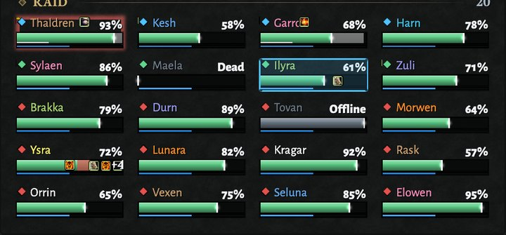

Test render of the addon's raid frames.

Tank adds a threat card in the combat cluster. Healer gives party and raid frames more room: dispellable debuffs lead the row, a member with a boss debuff glows, shields and your heals over time show on each tile, and the frames work with the game's Click Casting.

## The rest of the screen, in the same style

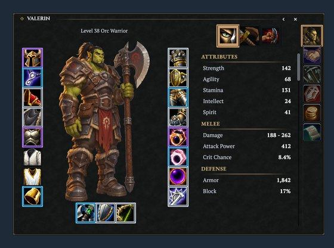

Test render of the addon's skin on the character sheet.

Turn on Window skins and Blizzard's windows take the same dark card: the character sheet, spellbook, talents, world map and quest log, mail, merchant, professions, loot, group finder, social windows and the game menu. The settings window (`/kstyle`) has a page per module, a search across every setting and a live preview, and every element can be moved, resized or scaled in Layout Mode.

Every module

KstyleUI is one core addon and one addon per module. A module you switch off costs nothing.

| Module | What it does |
| --- | --- |
| Core | The settings window, the HUD style, Layout Mode, profiles, the first-run setup, fonts, card material and `/kstyle` |
| Unit Frames | Player, target, target of target, focus, pet and boss 1 to 5, as cards under Frames and as orbs and a wide target bar under Orbs, with cast bars, auras, the class resource and threat |
| Group Frames | Party and raid frames up to 40, with roles, range fade, incoming heals, shields, debuffs and the dispel highlight |
| Action Bars | Secure action bars with paging, pet and stance bars, keybinds, cooldowns, proc glows, range shading and fade on mouseover, and an offer to put a newly learned rank on your bars |
| Cooldowns | Blizzard's Cooldown Manager in KstyleUI's slots: essential and utility rows, tracked buff icons and bars |
| Auras | Your buffs and debuffs as icon rows beside the map, sorted by how you use them |
| Nameplates | Flat plates with your debuffs, a cast bar, threat colour and name-only plates for objects |
| Combat Text | White hits and gold crits with a short rise, on KstyleUI's font |
| Minimap | A square map card with the zone, coordinates, clock and an addon-button drawer |
| Chat | Chat on a card, with tabs, timestamps, short channel names, clickable links, a copy window and history that survives a reload |
| Bags | Combined bags and bank with search, sorting, categories, quality borders and junk selling |
| Tooltips | Tooltips on the same card, with quality and class colours, a health bar and cursor anchoring |
| Data Bars | Experience, reputation and honour as a clean strip, the micro menu when you need it, and a readout with frame rate, latency, gold and time |
| Meters | The group damage meter, the threat meter and a swing timer |
| QoL | Fast auto loot, auto repair, quest hand-in and quiet error text |
| Skins | Blizzard's windows and the RestedXP Guides windows in KstyleUI's style |

Every module stays inside the rules Forever sets for addons: a protected change made in combat waits for combat to end, and the action bars, group frames, bags and auras hand back to Blizzard's own in the gamepad interface.

## Install

KstyleUI runs on the World of Warcraft: Forever client.

1. Download `KstyleUI-v<version>-forever.zip` from the [latest release](https://github.com/korallis/KstyleUI/releases/latest) and unzip it into `World of Warcraft/_forever_/Interface/AddOns`, so that `KstyleUI` and the `KstyleUI_*` module folders sit there.
2. Start the game. If the addons are not ticked in the AddOns list on the character screen, tick them.
3. Log in. The setup opens: pick your HUD style, layout and modules, then click **Apply** and **Reload**.
4. Type `/kstyle` for the settings, or `/kstyle layout` to move things.

### Optional: the repainted icons

`KstyleUI-Icons-<version>.zip`, on the same release, repaints ability and item icons everywhere, buff and debuff tiles included. It is not an addon, so it does not go into `AddOns`. Quit the game, unzip it, and copy its `Interface` folder into `World of Warcraft/_forever_/` so the files land in `_forever_/Interface/Icons/`, then start the game again (a full restart, not `/reload`). To go back to Blizzard's icons, delete those files and restart. [The icon pack guide](docs/icons.md) has the details.

Every command

| Command | What it does |
| --- | --- |
| `/kstyle` | Opens or closes the settings window. Esc > Options > AddOns > KstyleUI and the minimap's addon compartment open it too. |
| `/kstyle layout` | Enters or leaves Layout Mode: drag, snap, nudge with the arrow keys, undo and redo. |
| `/kstyle setup` | Runs the first-run setup again. |
| `/kstyle bind` | Opens Blizzard's Quick Keybind mode: hover a button and press a key to bind it. |
| `/kstyle profile` | Lists the profiles and marks the one this character uses. |
| `/kstyle profile use <name>` | Switches this character to a profile, creating it if needed. |
| `/kstyle profile new <name>` | Creates a profile with the default settings. |
| `/kstyle profile copy <name>` | Copies a profile into the active one. |
| `/kstyle profile rename <name>` | Renames the active profile. |
| `/kstyle profile delete <name>` | Deletes a profile. |
| `/kstyle profile reset` | Resets the active profile to the defaults. |

The settings window's Profiles page also exports a profile as one string and imports one back.

### Languages

KstyleUI ships English, German (`deDE`), French (`frFR`), Spanish (`esES`, also used on `esMX`) and Simplified Chinese (`zhCN`), using WoW's own terms for each language. The translations are machine-made and not yet checked by a native speaker, so please report a wrong or awkward string as an issue. On Chinese, Korean and Russian clients, KstyleUI uses the game's own font where its bundled fonts have no glyphs.

## Licence

All rights reserved. See [`LICENSE.md`](LICENSE.md). Building or contributing? See [`docs/DEVELOPING.md`](docs/DEVELOPING.md).
