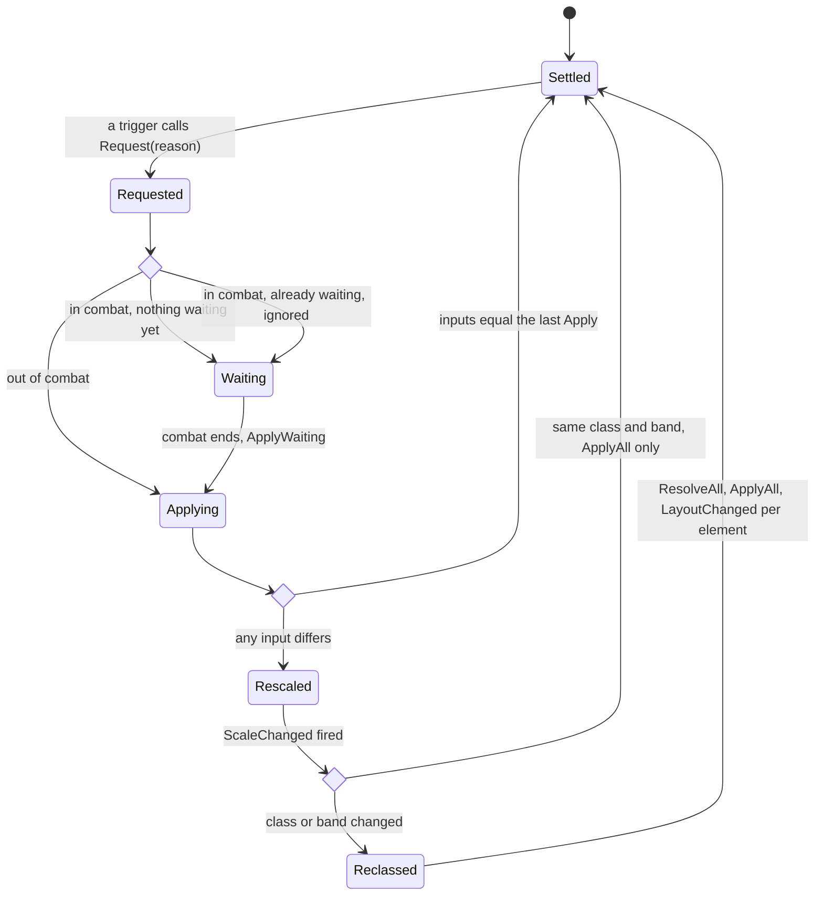

# Ultrawide arrangement and layout class

`Core/Scale.lua` sizes and places `KstyleUI_Root`, the canvas every HUD element anchors to, and names its layout class. Three Elements settings feed it: Ultrawide arrangement (Centred or Spread), HUD width (21:9, 16:9 or full) and the layout preset. When the class or the Spread band inset changes, `Core/Layout/Layout.lua` moves every element still at its default to the new class's place; a place the player set stays. `test-layout-ultrawide` drives it.

## States

| State | What holds | Code |
| --- | --- | --- |
| Requested | Out of combat `Request` calls `Apply` at once. In combat it sets `state.waiting` once and queues `ApplyWaiting` with `ns.Combat.Queue`; later requests in the same fight are dropped, because the one Apply reads every input fresh. | `Request`, `ApplyWaiting` |
| Applying | `Apply` reads the physical screen, works out the canvas width (`CanvasWidth`: the screen under Spread; under Centred `BandWidth`, the screen capped at the HUD width's aspect), the band width, the scale limit for the preset, style and enabled elements (`Limit`), and the size (Auto or the player's, in whole-pixel steps). It compares eight inputs with the last Apply and returns when none changed. | `Apply`, `CanvasWidth`, `BandWidth`, `Limit` |
| Rescaled | The root's scale and points are set: centred on the screen when the canvas is narrower than it, else all points on `UIParent`. `state.aspect` is `AspectClass(width, height)` of the canvas: `16:9` below 2.05, `21:9` from 2.05, `32:9` from 2.9. `state.band` is the Spread inset where group and boss frames stay. Then `ScaleChanged` fires. | `Apply`, `AspectClass`, `Scale.Aspect`, `Scale.Band` |
| Reclassed | Layout's `ScaleChanged` handler saw a new class or band: `ResolveAll` gives each element `StyleDefault`, the place for this class and HUD style from `Setup.Layouts`, with the player's saved fields on top, then `UpdateEvents`, `ApplyAll` and `LayoutChanged` for every element, and `Mode("Refresh")` when Layout Mode is open. Setup's own `ScaleChanged` handler calls `Restyle`, which queues `EditMode.Restyle` when the active Edit Mode layout is KstyleUI's. | `Layout.lua` `ScaleChanged` handler, `ResolveAll`, `StyleDefault`; `Setup.lua` `Restyle` |

## What calls Request

- `SettingChanged` for `Layout.arrangement`, `Layout.canvas` (HUD width), `Layout.preset`, or any module's setting.
- `HudStyleChanged` (see [hud-style.md](hud-style.md)), `ModuleChanged` and `ProfileChanged` (which first reloads Auto and the size from Appearance).
- `Scale.SetAuto` and `Scale.SetUserScale` when the value changes.
- `UI_SCALE_CHANGED`, `DISPLAY_SIZE_CHANGED` and `CVAR_UPDATE` for `uiScale` or `useUiScale`, each followed by a second request on the next frame for a late display change, and the root's `OnSizeChanged`.

`PLAYER_LOGIN` and the file's last line call `Apply` directly.
