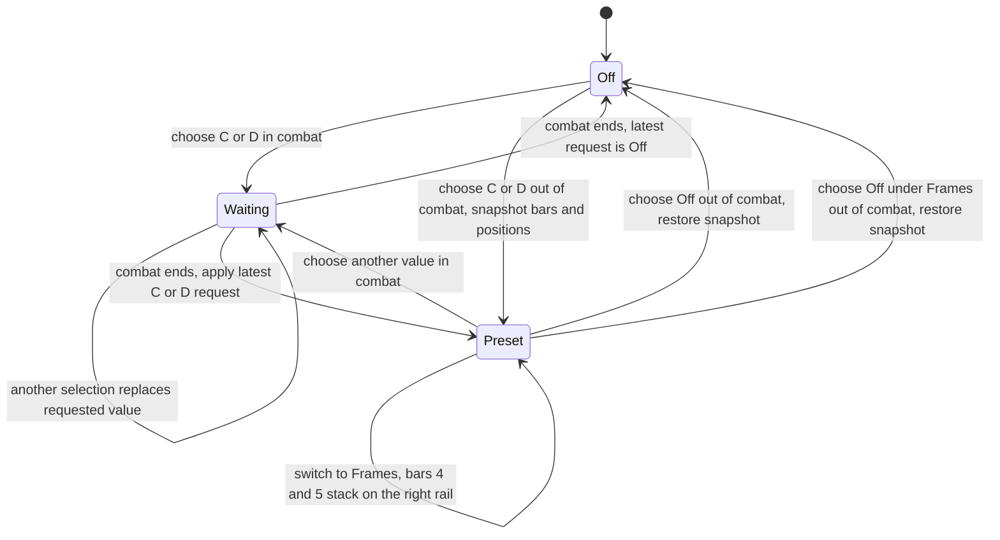

# Medallions extra-bar presets

The Action Bars page offers Off, Two rows on the slab (C), and Beside the slab (D) in Medallions. Under Frames it shows the selector only while a preset is applied, with Off and that preset, so the player can undo it; Frames stacks bar 5 above bar 4 on the right rail meanwhile. `extraBarsLayout` is the requested value; `extraBarsApplied` is the last value applied out of combat. `Settings.lua` owns the one-shot settings table and previous-settings snapshot; `Module.lua` uses the existing combat queue and bar apply path.

Applying a preset refreshes Layout defaults for the additional rows and their clearance. Layout still resolves saved player positions on top. C's upper rows join the main slab only while their actual rectangles align with its sockets; reshaping or moving either row releases it to its own slab plate. D moves a conflicting default chat and loot-feed position; a saved chat position is never written, and a conflicting left bar moves above it instead. The normal [arrangement and layout-class flow](arrangement-layout-class.md) continues to preserve saved positions.
