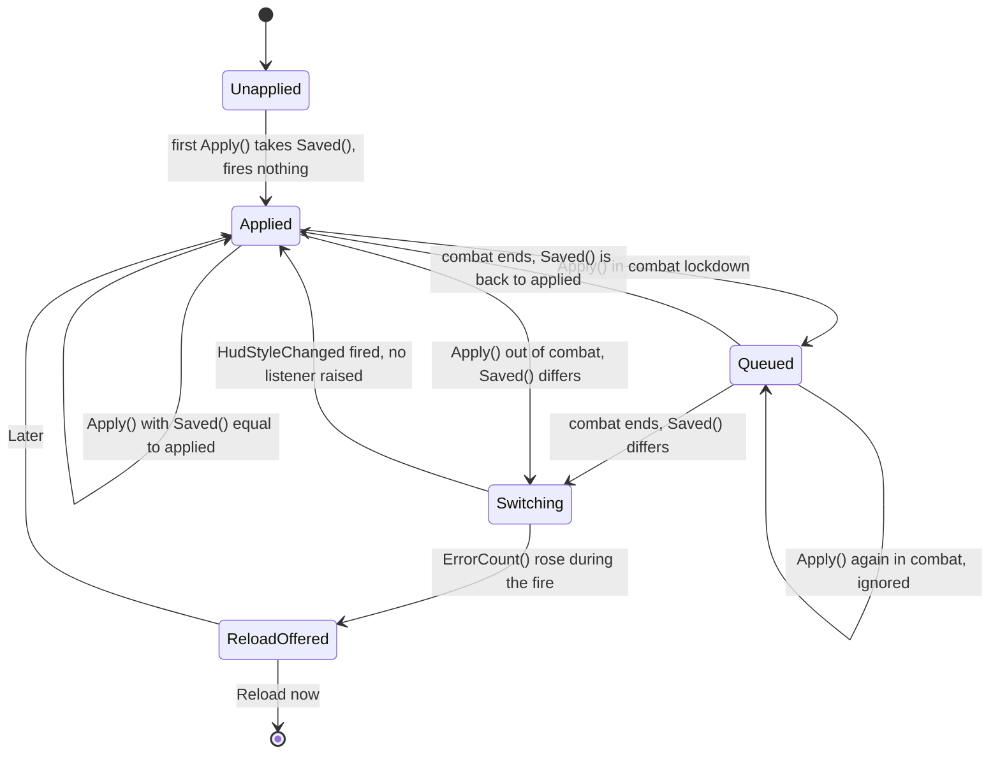
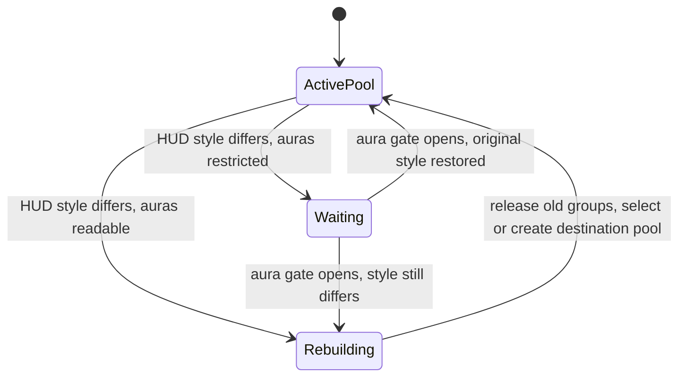

# HUD style switch

The HUD style is Medallions (the default) or Frames, saved per profile in the `HudStyle` section. Store migration 45 moves every profile to Medallions except one explicitly saved on Frames, which keeps Frames. In v0.2.12 and v0.2.13 it moved those too, so a player who used Frames there picks it again; their Frames Layout Mode positions (unprefixed keys) were kept. `Core/HudStyle.lua` owns the switch: it applies the saved style out of combat, holds a change made in combat until combat ends, fires `HudStyleChanged` once per real change, and offers a reload when a listener raised an error. `test-hud-style-gate` drives the live switch both ways and the two pickers; no test yet covers the combat queue (a second pick in combat prints nothing more), ending combat with the pick undone, or the reload prompt's Later and Reload now.

## States

| State | What holds | Code |
| --- | --- | --- |
| Unapplied | `applied` is nil, so `HudStyle.Current()` returns `HudStyle.Saved()`: the profile's style when the Store is loaded and the value is a known, non-secret style, else `medallions`. | `HudStyle.Saved`, `HudStyle.Current` |
| Applied | `applied` is the style every module draws; `Current()` returns it. | `Apply` (local) |
| Queued | `queued` is true. The player was told "Your HUD style changes when combat ends." and one function waits in `ns.Combat.Queue`. `Current()` still returns the old style, so modules keep drawing it while `Saved()` already holds the new one. | `Apply`, `Combat.Queue` (`Core/Combat.lua`) |
| Switching | When the player picked the style (General > HUD style or `Setup.Apply`, not a login or profile switch), `Look` first rewrites the settings whose Frames look differs (`HudStyle.FRAMES_LOOK`): picking Frames writes the Frames value over any still at its default, and picking Medallions puts the default back over any still at the Frames value. Then `applied` is the new style. `ns.Callbacks.Fire("HudStyleChanged", style)` runs each listener through `ns.Call`, so a listener that raises is counted, not propagated. | `Apply`, `Look`, `Callbacks.Fire` (`Core/Callbacks.lua`), `ns.ErrorCount` (`Core/Init.lua`) |
| ReloadOffered | `Widgets.ReloadPrompt` shows "Your HUD style finishes changing when you reload." with Reload now and Later. Later leaves the new style applied, with the failed module part-way switched until the next reload. | `Widgets.ReloadPrompt` (`Core/Widgets/Dialog.lua`) |

## What calls Apply

- `ADDON_LOADED` for KstyleUI once the Store is loaded; the handler unregisters itself.
- `SettingChanged` for the `HudStyle` section: General > HUD style in the settings window, and `Setup.Apply`, which writes `HudStyle.style` through `Options.Write` with its `applying` flag set.
- `ProfileChanged`.

`Combat.Queue` flushes on `PLAYER_REGEN_ENABLED`; the queued function clears `queued` and calls `Apply` again, so a player who switches twice in one fight gets one change, or none when the second pick undoes the first.

## Who listens to HudStyleChanged

| Listener | What it does |
| --- | --- |
| `Core/Scale.lua` | `Request("the HUD style")`: the scale limit depends on the style. Under Medallions `Layouts.Fits` sizes bars 1 and 2 as the slab's two groups (12 by 1 at every layout class, the slots `Layouts.MEDALLIONS_SLOT` wide) and counts the hub, a square 150 units wide centred on the slots' top edge, as a rect no element may enter except the experience strip, which runs along the slab's lower edge under the hub (the hub draws over it). See [arrangement-layout-class.md](arrangement-layout-class.md). |
| `Core/Layout/Layout.lua` | `Restyle`: `ResolveAll` (each element's default comes from `StyleDefault` for the new style: Medallions has a table in `Setup/Layouts.lua`, with 21:9 and 32:9 places of its own, and Frames takes the role preset's), `UpdateEvents`, `ApplyAll`, `LayoutChanged` for every element, then `Mode("Refresh")` when Layout Mode is open. |
| `Core/Setup/Setup.lua` | `Apply` writes the picked style; `Restyle`: when `Setup.Apply` is not writing and the active Edit Mode layout is KstyleUI's layout for the current `Layout.preset` (`EditMode.ActiveName()` equals the preset), queues `EditMode.Restyle` to move the viewers and rows KstyleUI placed. |
| `KstyleUI_UnitFrames/Frames.lua` | `OnHudStyleChanged`: the player frame, every restyle, and Blizzard's frames. Entering Medallions with Cast bars on unit frames on moves the player and target casts onto their frames' own bars and takes the two cast elements out of Layout Mode, unless the player moved one or gave it its own shown rule; leaving gives Frames its own cast placement back. `Auras.Apply` releases the old debuff/buff groups and selects tiles born in the new style; restricted auras wait for the gate to open. |
| `KstyleUI_UnitFrames/Fan.lua` (through `Auras.Apply`) | Medallions with Aura layout set to Crest fan and the target's crest-debuff option enables seven clipped native target-aura groups and the overflow counter, and gives the target medallion the complementary `HARMFUL\|!PLAYER` filter. Frames, disabling the option or disabling UnitFrames stops those engines and hides the fan and its mover. The target's original aura filter returns; Rows above frames selects the cached mirrored upward-growing pool instead. Changing Aura layout uses the existing deferred frame restyle. |
| `KstyleUI_Skins/Quests/Quests.lua` | `Replace`: places the quest card again. |
| `KstyleUI_QoL/Feed.lua` | `Restyle`, registered while the loot feed is on. |
| `KstyleUI_GroupFrames/Medallions.lua` | `Frames.Apply`, registered while the group frames run: the party medallions and the raid tiles. |
| `KstyleUI_Nameplates/Medallions.lua` | `Plates.RestyleAll`, registered while the plates run: the badges, brackets and level diamonds. |
| `Core/Widgets/Base.lua` | Fires `ThemeChanged` when the switch enters or leaves Medallions, so every module repaints its gilt as steel (or back), cards take or drop the steel material, the forged ornaments show or hide and the minimap turns round or square. |
| `Core/EffectModels.lua` | Leaving Medallions stops every live 3D model. |
| `Core/Vignette.lua` | Listens to the player's health and death only under Medallions; shows or hides the low-health vignette. |
| `Core/Layout/Rest.lua` | Listens to combat only under Medallions; leaving Medallions wakes any resting secondary frame at once. |
| `KstyleUI_ActionBars/Slab.lua` | `OnStyle`: `Slab.Refresh` shows the action slab and the crest hub under Medallions while bars 1 and 2 stand on one baseline, hides them otherwise, and starts or stops each proc slot's Medallions loop. Bars 1 and 2 take the slab's one row (`Slab.Rows`) and its slot size (`Slab.Size`, from `Layouts.MedallionsGroup`), and at 16:9 the pet and stance bars its two rows of five, when Layout's `LayoutChanged` lays them out again. |
| `KstyleUI_ActionBars/Totems.lua` | `Totems.Update`, from `Slab.Refresh`: a shaman's totem bar (Spirit Poles) shows on the crest hub while it shows and hides Blizzard's `MultiCastActionBarFrame` and the Ghost Wolf stance bar; leaving Medallions (or the slab) hides it and gives both back, out of combat. |

## Medallions in the module listeners

The style switch itself has no Medallions state: `HudStyle.Valid` accepts the value and `HudStyle.Current()` answers `"medallions"`. Medallions places the unit slabs 14 units above the action slab, with one row of twelve action sockets on each side of the crest hub. The unit frames use Medallions slabs and debuff underlines; Frames uses its own creation paths.

## Aura tile pools

`Auras.Apply` disables both old aura groups, which releases their assigned frames, and disables and hides their container. It creates a destination-style container through the same `Dress` path used at login, or reactivates that style's existing pool. Pools never change style, so switching repeatedly stays bounded and never converts regions in place. `test-unitframes-aura-style-switch` compares switched debuff and buff trees against fresh controls, including texture colours, layers, sublevels and frame levels, and keeps overlapping dispel tint below the icon.

The data bar follows this switch: Frames uses its top placement, with the micro menu docked while `strip.menus` is on and returned to its standalone hover slot while off. Medallions docks the readouts beneath the action slab, sharing the XP caption font and baseline, and returns the menu to its hover slot; the explicit Rail placement retains the rail. The bar remains movable through Layout Mode. Only a bar at its default top position reserves the shared top inset; moving it, hiding it or switching to Medallions releases that space. `test-databars-top` covers the inset, saved positions and overlap guard across both styles and all layouts.
