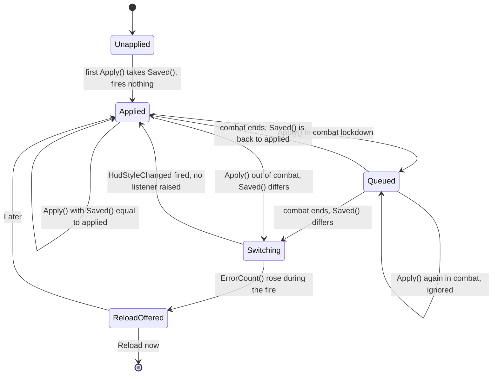

# HUD style switch

The HUD style is Frames, Orbs or Medallions, saved per profile in the `HudStyle` section. `Core/HudStyle.lua` owns the switch: it applies the saved style out of combat, holds a change made in combat until combat ends, fires `HudStyleChanged` once per real change, and offers a reload when a listener raised an error. `test-unitframes-orbs` drives the live switch, the combat queue (a second pick in combat prints nothing more) and the reload prompt; no test yet ends combat with the pick undone, or presses Later or Reload now.

## States

| State | What holds | Code |
| --- | --- | --- |
| Unapplied | `applied` is nil, so `HudStyle.Current()` returns `HudStyle.Saved()`: the profile's style when the Store is loaded and the value is a known, non-secret style that is offered, else `frames`. `HudStyle.MEDALLIONS_READY` is true, so all three styles are offered; were it false, a profile that saved Medallions would draw Frames and keep the saved value. | `HudStyle.Saved`, `HudStyle.Current` |
| Applied | `applied` is the style every module draws; `Current()` returns it. | `Apply` (local) |
| Queued | `queued` is true. The player was told "Your HUD style changes when combat ends." and one function waits in `ns.Combat.Queue`. `Current()` still returns the old style, so modules keep drawing it while `Saved()` already holds the new one. | `Apply`, `Combat.Queue` (`Core/Combat.lua`) |
| Switching | `applied` is already the new style. `ns.Callbacks.Fire("HudStyleChanged", style)` runs each listener through `ns.Call`, so a listener that raises is counted, not propagated. | `Apply`, `Callbacks.Fire` (`Core/Callbacks.lua`), `ns.ErrorCount` (`Core/Init.lua`) |
| ReloadOffered | `Widgets.ReloadPrompt` shows "Your HUD style finishes changing when you reload." with Reload now and Later. Later leaves the new style applied, with the failed module part-way switched until the next reload. | `Widgets.ReloadPrompt` (`Core/Widgets/Dialog.lua`) |

## What calls Apply

- `ADDON_LOADED` for KstyleUI once the Store is loaded; the handler unregisters itself.
- `SettingChanged` for the `HudStyle` section: General > HUD style in the settings window, and `Setup.Apply`, which writes `HudStyle.style` through `Options.Write` with its `applying` flag set.
- `ProfileChanged`.

`Combat.Queue` flushes on `PLAYER_REGEN_ENABLED`; the queued function clears `queued` and calls `Apply` again, so a player who switches twice in one fight gets one change, or none when the second pick undoes the first.

## Who listens to HudStyleChanged

| Listener | What it does |
| --- | --- |
| `Core/Scale.lua` | `Request("the HUD style")`: the scale limit depends on the style. Under Medallions `Layouts.Fits` sizes bars 1 and 2 as the slab's two groups (12 by 1 at every layout class, the slots `Layouts.MEDALLIONS_SLOT` wide) and counts the hub, a square 150 units wide centred on the slots' top edge, as a rect no element may enter except the experience strip, which runs along the slab's lower edge under the hub (the hub draws over it). See [arrangement-layout-class.md](arrangement-layout-class.md). |
| `Core/Layout/Layout.lua` | `Restyle`: `ResolveAll` (each element's default comes from `StyleDefault` for the new style: Orbs and Medallions each have a table in `Setup/Layouts.lua`, Medallions' with 21:9 and 32:9 places of its own), `UpdateEvents`, `ApplyAll`, `LayoutChanged` for every element, then `Mode("Refresh")` when Layout Mode is open. |
| `Core/Setup/Setup.lua` | `Apply` takes any style `HudStyle.Offered` allows (Medallions while `HudStyle.MEDALLIONS_READY` is true, as it ships); `Restyle`: when `Setup.Apply` is not writing and the active Edit Mode layout is KstyleUI's layout for the current `Layout.preset` (`EditMode.ActiveName()` equals the preset), queues `EditMode.Restyle` to move the viewers and rows KstyleUI placed. |
| `KstyleUI_UnitFrames/Frames.lua` | `OnHudStyleChanged`: `Orbs.Apply`, the player frame, every restyle, and Blizzard's frames. |
| `KstyleUI_Chat/Module.lua` | `Refresh("framing")`. |
| `KstyleUI_Skins/Quests/Quests.lua` | `Replace`: places the quest card again. |
| `KstyleUI_QoL/Feed.lua` | `Restyle`, registered while the loot feed is on. |
| `KstyleUI_GroupFrames/Medallions.lua` | `Frames.Apply`, registered while the group frames run: the party medallions and the raid tiles. |
| `KstyleUI_Nameplates/Medallions.lua` | `Plates.RestyleAll`, registered while the plates run: the badges, brackets and level diamonds. |
| `Core/Widgets/Base.lua` | Fires `ThemeChanged` when the switch enters or leaves Medallions, so every module repaints its gilt as steel (or back), cards take or drop the steel material and the minimap turns round or square. A switch between Frames and Orbs fires nothing here. |
| `Core/EffectModels.lua` | Leaving Medallions stops every live 3D model. |
| `Core/Vignette.lua` | Listens to the player's health and death only under Medallions; shows or hides the low-health vignette. |
| `Core/Layout/Rest.lua` | Listens to combat only under Medallions; leaving Medallions wakes any resting secondary frame at once. |
| `KstyleUI_ActionBars/Slab.lua` | `OnStyle`: `Slab.Refresh` shows the action slab and the crest hub under Medallions while bars 1 and 2 stand on one baseline, hides them otherwise, and starts or stops each proc slot's Medallions loop. Bars 1 and 2 take the slab's one row (`Slab.Rows`) and its slot size (`Slab.Size`, from `Layouts.MedallionsGroup`), and at 16:9 the pet and stance bars its two rows of five, when Layout's `LayoutChanged` lays them out again. |

## Medallions in the module listeners

The style switch itself has no Medallions state: `HudStyle.Valid` accepts the value and `HudStyle.Current()` answers `"medallions"`. The module listeners above test for `"orbs"` only, so until the Medallions module work lands each draws the Frames look under Medallions (unit frames, chat framing, story rail, loot feed), while the action bars draw the Medallions slab: bars 1 and 2 as its two groups and the crest hub between them at strata LOW under every slot (`test-actionbars-medallions-hub`, `test-actionbars-medallions-effects`). The widget kit's listener in `Core/Widgets/Base.lua` is the exception: under Medallions every card, popup, tooltip and menu takes the steel material and the minimap turns round (`test-medallions-steel`, `test-medallions-minimap`). What Medallions changes today is placement: `Core/Setup/Layouts.lua` gives it its own table, `Layouts.Fits` and so `Scale`'s limit know the slab's two groups and the hub, and the unit frames take the mock-up's sizes and stand either side of the hub, 120 mock pixels over the slots' top edge. `test-layout-medallions` drives the switch and the way back; `test-layout-medallions-hub` holds the hub against every slot.
