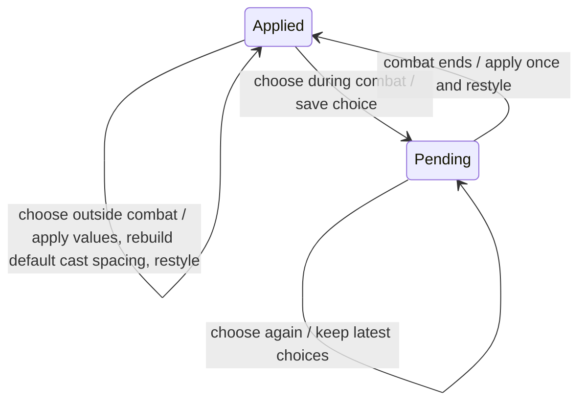

# Readability options

Appearance has four independent switches, enabled by default: Readable text on bars, Backing for text over the world, Chat tabs always readable, and Bar colour refinements. Off restores the original appearance for that group. Existing font and layout choices remain saved.

The applied values stay unchanged during combat. The deferred callback rebuilds Medallions defaults and uses Layout's normal resolver; saved positions are never rewritten. The world-text switch removes existing scrims when disabled, and skin bars restore their original height and label anchors.

`Widgets.Readability(key)` returns the applied value. `InkFor` chooses fill contrast, `InkText` applies it, and `TextScrim` respects the world-text switch. `ReadabilityChanged` precedes `ThemeChanged`; both run after the combat queue flushes.
