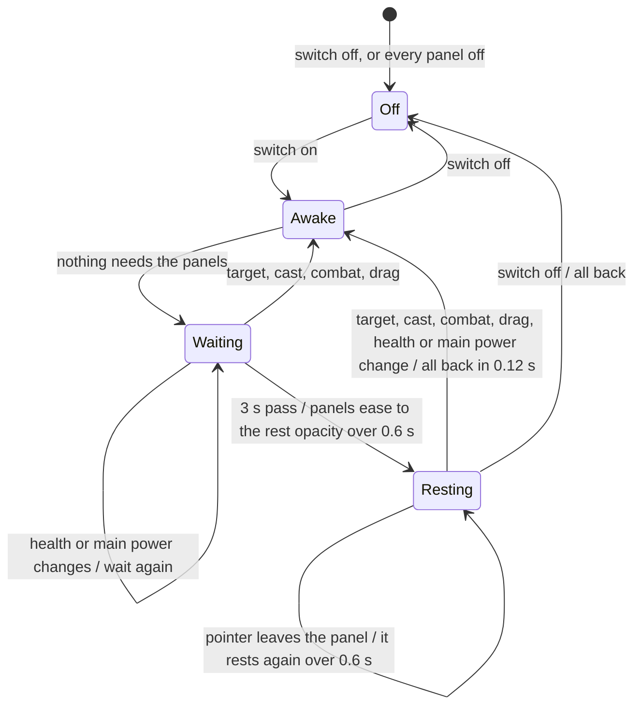

# Clean screen at rest

Elements > Clean screen at rest, on by default: out of combat, with nothing that needs them, the chosen panels ease to the rest opacity; anything that needs them brings them straight back. `Core/Layout/Rest.lua` drives it through `Layout.RefreshAlpha`, so it is alpha only; [Core/Layout/README.md](../../Core/Layout/README.md#the-clean-screen-at-rest) lists the panels, events and rules.

- **Nothing needs the panels**: out of combat, no target, no cast or channel, nothing on the cursor, Layout Mode closed.
- **Waiting** is one `C_Timer.After` of 3 s (`combatOutDelay`) per change; only the last one settles. A change of health or the main power restarts it, since health is secret and a change stands for "not full".
- **Hover** acts on one panel at a time and never on the shared state: the hovered panel returns while the others stay at rest.
- **Off** unregisters every event; panels at rest return over 0.12 s and nothing is written again.
- Layout Mode does not wake panels already at rest; no rest begins while it is open.
