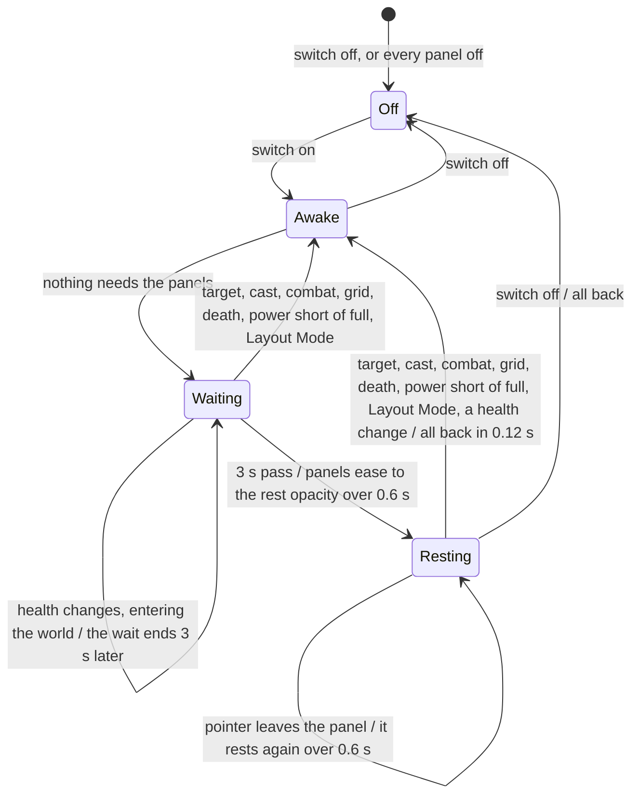

# Clean screen at rest

Elements > Clean screen at rest, on by default: out of combat, with nothing that needs them, the chosen panels ease to the rest opacity; anything that needs them brings them straight back. `Core/Layout/Rest.lua` drives it through `Layout.RefreshAlpha`, so it is alpha only; [Core/Layout/README.md](../../Core/Layout/README.md#the-clean-screen-at-rest) lists the panels, events and rules.

- **Nothing needs the panels**: out of combat, no target, no cast or channel, alive, the action bar grid closed, Layout Mode closed, and the main power full or empty.
- **Waiting** is one `C_Timer.After` of 3 s (`combatOutDelay`); a health change or entering the world moves its end, since Forever keeps health secret and a change stands for "not full". Nothing is scheduled while something needs the panels.
- **Resting** takes in each shown, live element of an enabled panel that the player kept at full alpha and whose alpha no other owner set; a bar on Fade until hovered keeps its own fade. A pointer already over a panel keeps it up.
- **Hover** acts on one panel at a time and never on the shared state: the hovered panel returns while the others stay at rest.
- **Off** unregisters every event; panels at rest return over 0.12 s and nothing is written again.
- **Layout Mode** wakes the panels when it opens; closing it starts the wait again.
