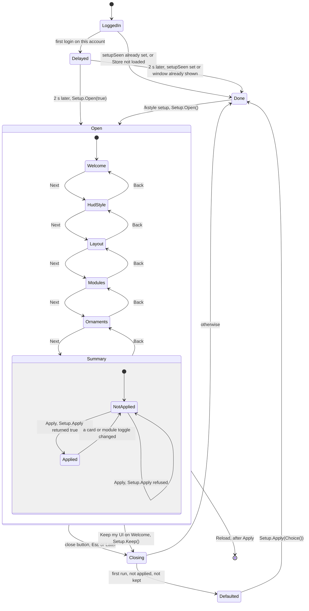
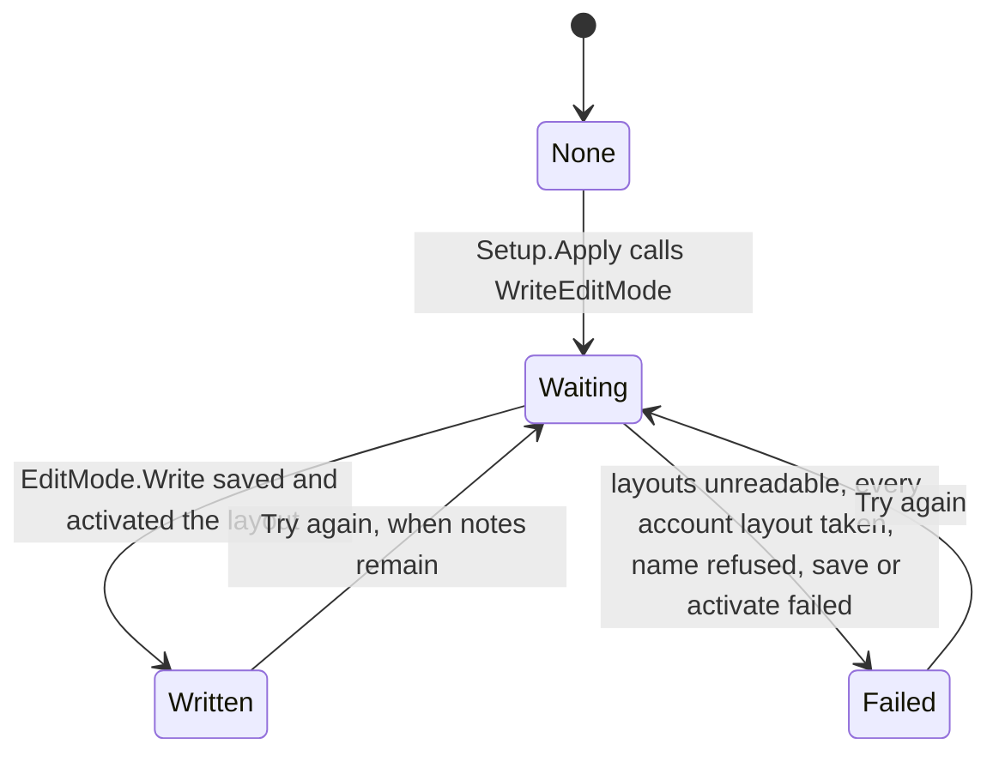

# First-run setup

The first-run setup picks a HUD style, a DPS, Tank or Healer layout, the modules and the ornament level, then applies them and writes a matching Edit Mode layout. `Core/Setup/Setup.lua` holds the choice and Apply; `Core/Setup/Window.lua` holds the six-step window. `test-setup`, `test-setup-summary` and `test-setup-editmode*` drive it.

## Window flow

| State | What holds | Code |
| --- | --- | --- |
| LoggedIn | `PLAYER_LOGIN` fired once; the handler unregisters itself. | `Setup.lua`, the `PLAYER_LOGIN` handler |
| Delayed | `C_Timer.After(OPEN_DELAY)`, 2 s, so the game's own frames settle first. | same |
| Open | `Setup.Open(first)`: refuses and prints when the Store is not loaded or `Setup.ShowWindow` is missing; otherwise sets `firstRun`, clears `kept`, resets the choice with `Setup.NewChoice` (the saved HUD style, DPS, every installed module on, Full ornaments) and calls `Setup.ShowWindow`, which opens on step 1 with only step 1 reachable. | `Setup.Open`, `Setup.NewChoice`, `Setup.ShowWindow` |
| Steps | `Setup.Go(target)` moves one step; the step tabs open every step up to the furthest reached. Keep my UI shows only on step 1. | `Setup.Go`, `Refresh` |
| NotApplied, Applied | The window's `applied` flag. Apply shows only while it is false; Reload and Later only while it is true. Picking any card (HUD style, layout, ornaments) or module toggle calls `Changed`, which clears it. | `Refresh`, `Changed`, the Apply button's `onClick` |
| Closing | The panel's `onClose` calls `Setup.Closed(applied)`, which always calls `Setup.MarkSeen`. Closing without applying prints "You can run the setup again at any time with /kstyle setup." | `OnClose`, `Setup.Closed`, `Setup.MarkSeen` |
| Defaulted | A first run closed without Apply and without Keep my UI applies the current choice, which is the defaults unless the player changed it, and prints "KstyleUI applied the %s layout. Type /reload to finish, or /kstyle setup to change it." | `Setup.Closed` |

`Setup.Apply(picked)` refuses when the Store is not loaded or the layout is unknown. Otherwise, in order: it writes each installed module's `enabled`, moves every element through `writeLayout` (live through `Layout.Update`, else saved for the reload), writes the layout's module settings and `Layout.preset` through `writeSettings`, writes the ornament level, writes the HUD style with `applying` set (which fires the [HUD style switch](hud-style.md)), starts the Edit Mode write below, and marks the setup seen.

## Edit Mode write

`WriteEditMode` calls `EditMode.Waiting(name)` and queues `EditMode.Write` with `ns.Combat.Queue`, so in combat the write waits for combat to end. `EditMode.Last().state` is the state above. The summary's Try again (`Setup.RetryEditMode`) shows when the state is Failed, or Written with notes, such as tracked buffs that did not fit; Open the Cooldown Manager shows beside it for Written with notes. `Setup.EditModeChanged` refreshes the summary after each write. Code: `Core/Setup/EditMode.lua` (`EditMode.Waiting`, `EditMode.Write`, `Read`, `Target`, `Fail`, `EditMode.Last`), `Core/Setup/Window.lua` (`RefreshEditMode`).
