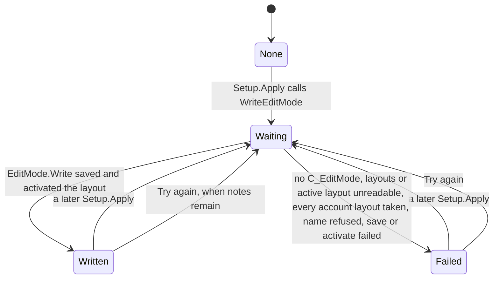

# First-run setup

The first-run setup picks a HUD style, a DPS, Tank or Healer layout, the modules, addon choices and the ornament level, then applies them and writes a matching Edit Mode layout. `Core/Setup/Setup.lua` holds the choice and Apply; `Core/Setup/Window.lua` holds the window and `Addons.lua` its addon controls. The window has seven steps when enabled supported addons are detected, otherwise six. `test-setup`, `test-setup-addons`, `test-setup-summary` and `test-setup-editmode*` drive it.

## Window flow

```mermaid
stateDiagram-v2
    [*] --> LoggedIn
    LoggedIn --> Done : setupSeen already set, or Store not loaded
    LoggedIn --> Delayed : first login on this account
    Delayed --> Done : 2 s later, setupSeen set or window already shown
    Delayed --> Open : 2 s later, Setup.Open(true)
    Done --> Open : /kstyle setup, Setup.Open() with the Store loaded
    Done --> Done : /kstyle setup before the Store loads, refused

    state Open {
        [*] --> Welcome
        Welcome --> HudStyle : Next
        HudStyle --> Layout : Next, role pictures follow the chosen HUD
        Layout --> Modules : Next, whole-module overlaps start off
        Modules --> YourAddons : Next, enabled supported addons detected
        Modules --> Ornaments : Next, no enabled supported addons
        YourAddons --> Ornaments : Next
        Ornaments --> Summary : Next
        Summary --> Ornaments : Back
        Ornaments --> YourAddons : Back, addons detected
        Ornaments --> Modules : Back, no addons
        YourAddons --> Modules : Back
        Modules --> Layout : Back
        Layout --> HudStyle : Back
        HudStyle --> Welcome : Back
        state Summary {
            [*] --> NotApplied
            NotApplied --> Applied : Apply, Setup.Apply returned true
            NotApplied --> NotApplied : Apply, Setup.Apply refused
            Applied --> NotApplied : a card, module or addon choice changed
        }
    }

    Open --> Closing : close button, Esc or Later
    Open --> Closing : Keep my UI on Welcome, Setup.Keep()
    Open --> [*] : Reload, after Apply
    Closing --> Done : Later choice; leave choices alone, ask next login
    Closing --> Done : Apply the default setup (default); first-run close calls Apply
    Closing --> Done : Keep my UI or already applied; save setupSeen
```

| State | What holds | Code |
| --- | --- | --- |
| LoggedIn | `PLAYER_LOGIN` fired once; the handler unregisters itself. | `Setup.lua`, the `PLAYER_LOGIN` handler |
| Delayed | `C_Timer.After(OPEN_DELAY)`, 2 s, so the game's own frames settle first. | same |
| Open | `Setup.Open(first)`: refuses and prints when the Store is not loaded or `Setup.ShowWindow` is missing; otherwise sets `firstRun`, resets the choice with `Setup.NewChoice` (the saved HUD style, DPS, installed modules on unless `Integrations.Detected` finds a whole-module overlap, Full ornaments) and calls `Setup.ShowWindow`, which opens on step 1 with only step 1 reachable. DataBars and Meters stay selected: only their overlapping parts yield. | `Setup.Open`, `Setup.NewChoice`, `Setup.ShowWindow` |
| Steps | Next and Back call `Setup.Go` one step on; a step tab calls `Setup.Go(value)` for any step up to the furthest reached. Your addons follows Modules only when the live client list contains enabled supported addons; the strip and final step adjust to six or seven steps. Keep my UI shows only on step 1. | `Setup.Go`, `Setup.ShowWindow`, `Refresh` |
| Your addons | Enumerates `C_AddOns.GetNumAddOns` / `GetAddOnInfo`, excluding Blizzard and KstyleUI addons. `GetAddOnEnableState` uses the player's GUID, as Blizzard's AddOnList does; `Integrations.Loaded` is the fallback. Registry skins get Skin it; same-job addons get the existing Options settings, including the Questie tracker choices. Unsupported addons and unavailable skin choices are omitted. Reopening rebuilds the list and reads current choices. Changes remain pending until Apply. | `Integrations.Addons`, `Integrations.AddonRows`, `Setup.NewChoice`, `Addons.lua`; `test-setup-addons` |
| Layout pictures | General > Layout pictures in setup defaults on: each role card shows its rendered Frames, Orbs or Medallions layout, following the HUD style chosen on the previous step. Off restores the hovered footprint diagram and story-rail legend. The picture never applies settings. | `PlaceLayouts`, `BuildLayouts`; `test-setup-polish` |
| NotApplied, Applied | The window's `applied` flag. Apply shows only while it is false; Reload and Later only while it is true. Picking any card (HUD style, layout, ornaments) or module toggle calls `Changed`, which clears it. | `Refresh`, `Changed`, the Apply button's `onClick` |
| Closing | Close, Escape and Later call `Setup.Closed(applied)`. By default an unapplied first-run close applies the picked setup, as before. General > Closing the setup window > Do nothing, ask again later leaves settings, modules, positions and setupSeen alone, so next login asks again. Keep my UI and an applied setup mark setupSeen. | `OnClose`, `Setup.Closed`, `Setup.MarkSeen` |

`Setup.Apply(picked)` refuses when the Store is not loaded or the layout is unknown. With Profiles > Recovery backups on (default), it first saves a named **Before setup** recovery profile, then writes module switches, layout positions, module settings, ornaments and the chosen HUD style, queues the Edit Mode write, and marks setup seen. Closing calls Apply in the default **Apply the default setup** mode; the **Do nothing, ask again later** choice does not apply. Timer/announcement lanes and named WeakAuras anchors default on and can be switched off in General. With General > Other-addon notices on (default), the Modules step names detected overlapping addons; its feature toggles choose which KstyleUI modules Apply enables, without rewriting another addon's settings.

When all five account Edit Mode layouts are occupied, the summary offers **Replace this one** while General > Choose an Edit Mode replacement is on (default). Off retains the previous full-list refusal. Apply replaces only the chosen account layout; leaving the picker empty preserves every layout and reports the refusal. With Recovery backups on, the previous Edit Mode layouts are included in the setup backup and restored with the profile's **Restore backup** action, queued out of combat.

DataBars stays on beside Bartender4 or Dominos. On the profile's first detected overlap, only **Micro menu > Replace Blizzard's** and **Bag bar > Replace Blizzard's** start off; the data strip and XP bars keep running. Meters stays on beside Details: only **Show the damage meter** starts off, leaving threat and swing available. Turning those part switches back on overrides the yield and survives reload; the damage switch remains available beside Details even with role-based meters on. ActionBars posts its bindings notice after the setting change finishes, only while bindings still yield and **Other-addon notices** is on.

Skins and every registry skin default on. Missing values inherit the new defaults without a migration; saved master and per-skin off values remain off. A master off stripped as the old default now inherits on. Questie never disables the entire Skins module: Your addons offers KstyleUI's quest card (recommended), Questie's tracker or both, using the same setting as General > Existing addons. Addon choices apply after the layout preset so the player's menu and meter decisions win. Keep my UI discards pending addon choices too.

Forever proof: `Interface/AddOns/Blizzard_APIDocumentationGenerated/AddOnsDocumentation.lua` and `Interface/AddOns/Blizzard_AddOnList/AddonList.lua` at `9dc84f0` prove enumeration, addon information, loaded/enabled state and the current-character GUID argument. No new game global is introduced.

## Edit Mode write

General > Readable setup notes defaults on. Notes use the body face at 11 units, obey the reading floor when the setup window is scaled, and wrap. The module list scrolls when the notes need more room; Off restores the previous small single-line notes. `test-setup-polish` covers the 0.65 scale and both choices.

Setup Apply also queues `nameplateShowSelf = 0` out of combat. Keep my UI does not write it. After setup, only a deliberate change to Nameplates > Personal resource display writes that CVar; login, presets and profile refreshes preserve later choices in Blizzard's settings. `test-personal-resource-display` checks those transitions and combat deferral.



`WriteEditMode` calls `EditMode.Waiting(name)` and queues `EditMode.Write` with `ns.Combat.Queue`, so in combat the write waits for combat to end. `EditMode.Last().state` is the state above. The summary's Try again (`Setup.RetryEditMode`) shows when the state is Failed, or Written with notes, such as tracked buffs that did not fit; Open the Cooldown Manager shows beside it for Written with notes. `Setup.EditModeChanged` refreshes the summary after each write. Code: `Core/Setup/EditMode.lua` (`EditMode.Waiting`, `EditMode.Write`, `Read`, `Target`, `Fail`, `EditMode.Last`), `Core/Setup/Window.lua` (`RefreshEditMode`).
