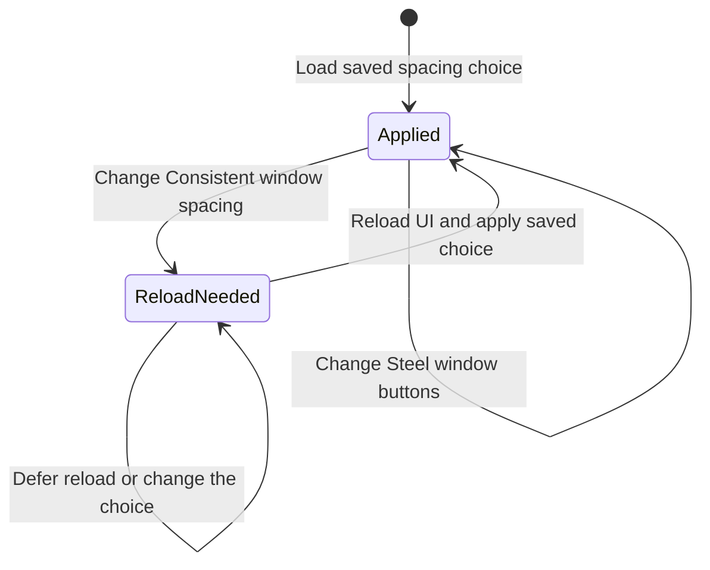

# Window finish options

The Skins page offers Steel window buttons and Consistent window spacing. Button material changes apply immediately. Native spacing uses the existing reload prompt so Blizzard rebuilds its anchors with the saved choice; both choices default on.

The quest continuation, story alignment, meter fitting, data-strip docking, minimap plaque clearance, bag-heading and bag-figure switches refresh their matching module immediately. Switching them off restores their previous arrangement.
