# CurseForge page

Paste the blocks below into the authors console. The research, the proposed TOC lines, and the owner's steps are in [RESEARCH.md](RESEARCH.md) and [CHECKLIST.md](CHECKLIST.md).

The hero picture is in-game. The clips and the two HUD pictures are test renders of this addon over in-game screenshots, the same ones the README shows. Say that in the gallery captions. CurseForge asks for a visible note when a showcase picture could be read as something the addon does not do. These renders are the addon. The captions say which are which.

## Project name

KstyleUI

The [submission guide](https://support.curseforge.com/en/support/solutions/articles/9000199552-project-submission-guide-and-tips) asks for a distinct name, with no version number and no word such as "addon".

## Summary

Paste this one sentence. It is the README's pitch. The authors console rejects a summary longer than 256 characters (`summary.maxLength` 256 in the console). This one is 170.

```
One dark forged UI for World of Warcraft: Forever. Pick Medallions or Frames for your HUD, get a class crest that lights up as you fight, and set it all up in one window.
```

The [moderation policies](https://support.curseforge.com/en/support/solutions/articles/9000197279-project-and-modpack-moderation-policies) call the summary a one-sentence tldr of what the project does.

## Moderation policy

The page follows CurseForge's [moderation policies](https://support.curseforge.com/support/solutions/articles/9000197279-moderation-policies), checked on 2026-11-17:

- The summary is a one-sentence tl;dr and is not repeated as the description's first line.
- The description has no external download links for the addon. Its one releases link points at the GitHub releases page, not a file, and only for the optional icon pack, which is not an addon and cannot ship through CurseForge. Links to the source code and Discord for bug reports and help sit at the bottom of the page.
- A Credits section credits the bundled SIL Open Font License fonts and says the art is original to KstyleUI, with the AI-made pieces named.
- The name has no game name or version, the avatar is the 400x400 logo, the gallery has in-game pictures and labels the test renders, and every file carries the changelog.

## Description

On the Description step, switch the editor to Markdown, then paste this. The block is [description.md](description.md) verbatim, regenerated with `python3 Tools/media/marketing.py --pages`; edit that file, not this block.

```markdown
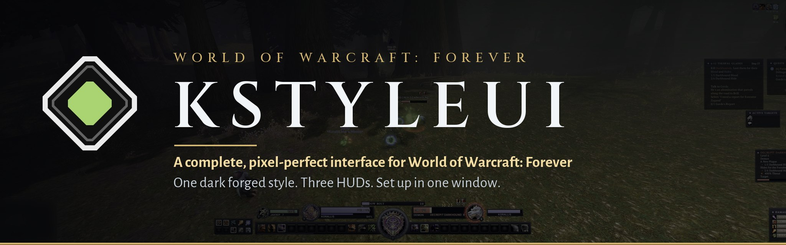

*In-game screenshot behind the wordmark. Icons in this picture are the optional AI-made icon pack, not art shipped in the addon.*

**Come say hi on Discord: [discord.gg/A5qqGZEXyN](https://discord.gg/A5qqGZEXyN).** That's the place for help or a bug report, and new stuff shows up there before it ships.

KstyleUI swaps the default UI for one dark forged style, the same on your bars, frames, bags and windows. The HUD comes in two looks. Medallions puts you and your target in round medallions with your class crest between your action bars, doing something different for every class. Frames is the classic layout cleaned up, with your target stacked over you above the bars. It's made for World of Warcraft: Forever only, and setup is one window the first time you log in.

Every picture below is a test render of the addon over my own in-game screenshots. Icons in these pictures are the optional AI-made icon pack, not art shipped in the addon.

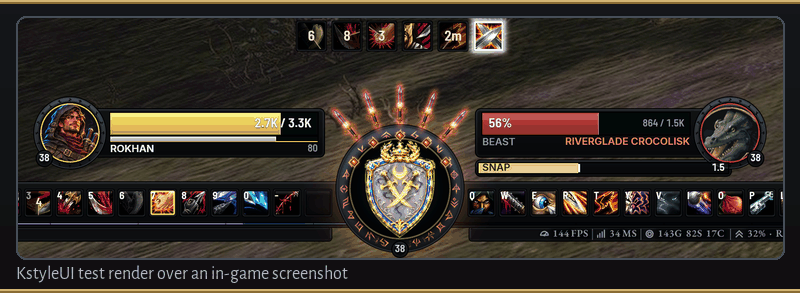

*Every class gets its own crest, and most of them get a crown on top.*

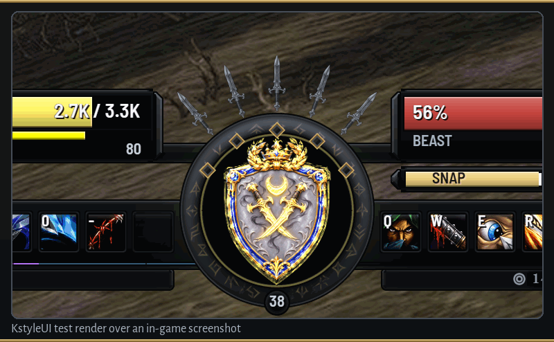

*Rogues get a crown of blades and cat druids get claws. Each combo point lights one and a jewel on the ring, the ring glows when you're capped, and a finisher slashes them out.*

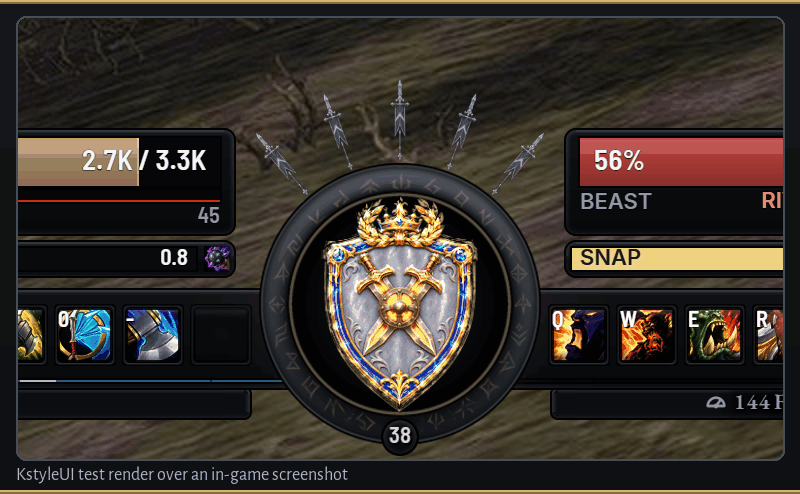

*Warriors get banners for Sunder stacks, shadow priests get candles, mages get Arcane Blast shards, hunters get arrows for Sniper Shot and bears get talons for Lacerate.*

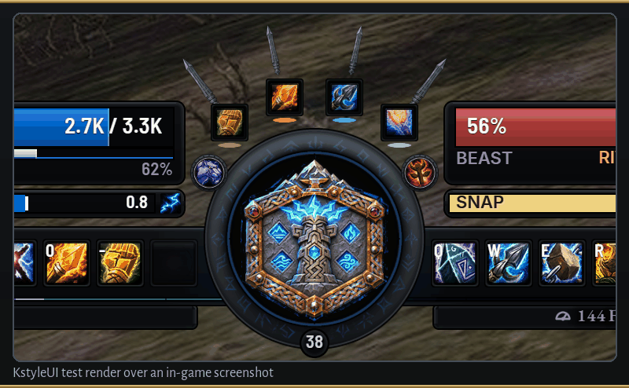

*I put way too much effort into shamans. Your totem bar sits on the crest, and Lightning Shield turns into storm orbs, and each one throws a bolt when its charge gets used up.*

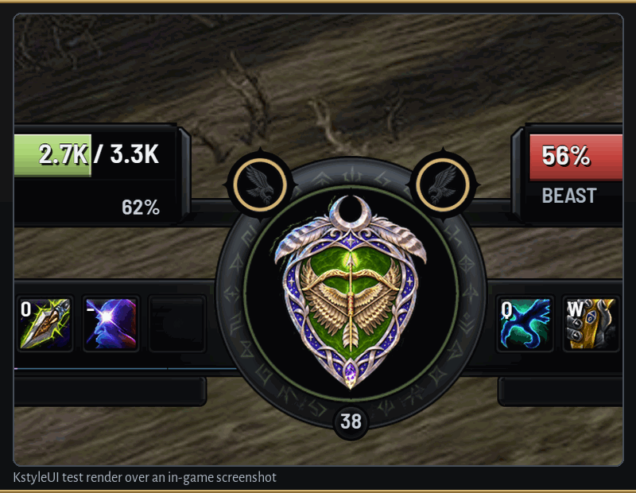

*Hunters with Summon Hawk get a perch on the ring for each hawk, with a timer round it. Baine's idea.*

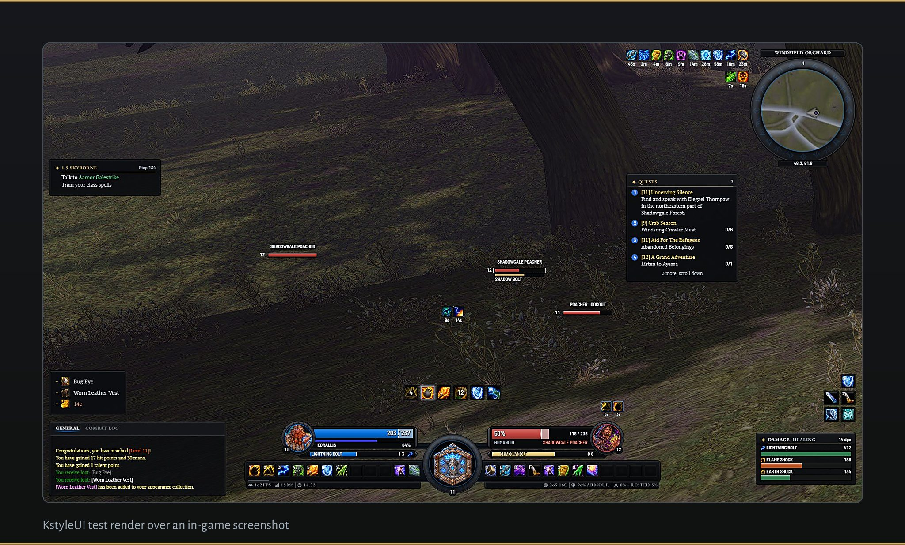

*The whole thing in Medallions. Your RestedXP or Zygor guide sits top left and your quests sit on the right under the map.*

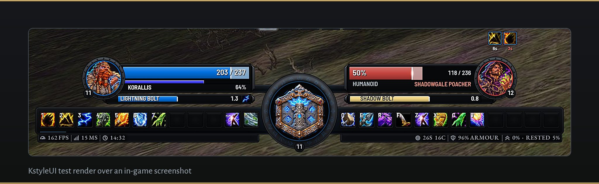

*Every bar has a lit glass finish now, and the Medallions frames end in forged steel caps.*

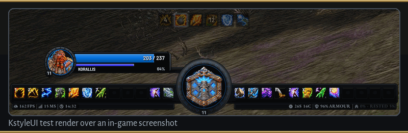

*Out of combat with nothing targeted, your bars fade back so you can see the game. Target something and they're straight back.*

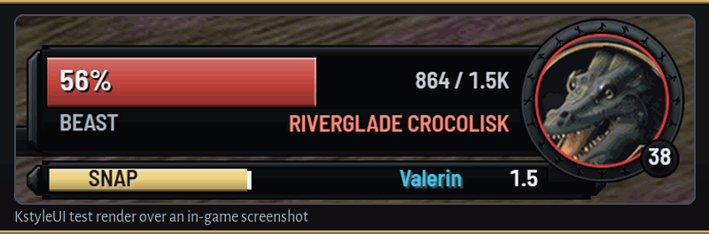

*Enemy cast bars say who the spell is aimed at, or YOU. A shield means you can't kick it, and a gold mark shows where your kick is back.*

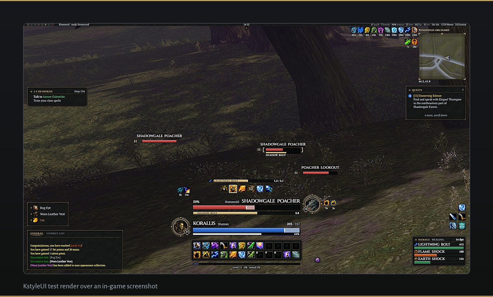

*If the crest isn't your thing, Frames is the other look: big plain cards for you and your target, same forged style. Pick it in the setup, or switch any time under HUD style on the General page of `/kstyle`.*


*Party and raid frames get the same look, with the debuffs you can dispel up front.*

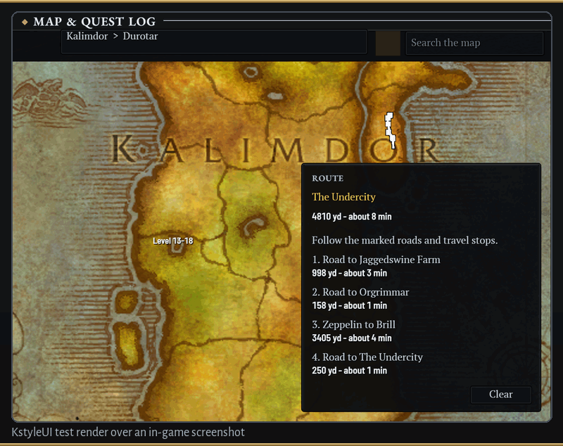

*The map plans your route, zeppelins and the tram included, and finds the nearest innkeeper, bank or trainer you've been to. The map art is the game's own.*

There's a lot more in there than fits here: nameplates, a damage and threat meter, bags, tooltips, chat and skins for most of Blizzard's windows. Every bit of it can be switched off in `/kstyle`. Each module has a README on [GitHub](https://github.com/korallis/KstyleUI) with all its settings.

## Install

1. Install it with the CurseForge app, the Wago app or WowUp. By hand, unzip it into `World of Warcraft/_forever_/Interface/AddOns`.
2. Log in, pick Medallions or Frames and a Look, then DPS, Tank or Healer in the setup window, then click **Apply** and **Reload**.
3. `/kstyle` opens the settings, `/kstyle layout` lets you move stuff and `/kb` binds your keys.

The icon pack is optional and isn't an addon, so it's only on [GitHub](https://github.com/korallis/KstyleUI/releases/latest). The [icon pack guide](https://github.com/korallis/KstyleUI/blob/main/docs/icons.md) has the steps.

## Links

- Help, bug reports and news: [Discord](https://discord.gg/A5qqGZEXyN). For a bug, paste the report from About > Status in `/kstyle`.
- Source code: https://github.com/korallis/KstyleUI

## Credits

- Fonts, all under the SIL Open Font License 1.1, with their licence files in the addon's `Media/Fonts` folder: Cinzel, Alegreya Sans, Barlow Semi Condensed, Source Sans 3, Inter, PT Serif, EB Garamond and IM Fell. Some are adapted for the game's renderer and renamed, as the licence allows.
- The portraits, crests and textures are KstyleUI's own art. Some were made with AI image tools and the rest is drawn by the addon's code. Nothing is extracted or traced from the game. The scenery in the pictures is cropped from my own Forever screenshots, and none of it is AI-generated.
- Zygor support and the hawk perches idea: Baine.
- By the KstyleUI authors. All rights reserved.
```

## Class, categories, game version

- Game: World of Warcraft.
- Class: Addons.
- Game version: Forever. On the public addon list that flavor is [gameVersionTypeId 88568](https://www.curseforge.com/wow/search?class=addons&gameVersionTypeId=88568), and the patch is [1.60.1](https://www.curseforge.com/wow/search?class=addons&version=1.60.1). Do not tick Retail or Classic.
- Main category: Unit Frames. If the form offers the HUDs subcategory as the main choice, pick HUDs.
- Additional categories, up to four ([submission guide](https://support.curseforge.com/en/support/solutions/articles/9000199552-project-submission-guide-and-tips)): Action Bars, Map & Minimap, Bags & Inventory, Quests & Leveling.

## Licence

The TOC says `## X-License: All Rights Reserved`, and [LICENSE.md](../../LICENSE.md) says "Copyright 2026 the KstyleUI authors. All rights reserved." Pick **All Rights Reserved** if it is in the list. If it is not, pick **Custom** and paste that sentence. Do not pick a permissive licence. The bundled fonts keep their own SIL Open Font Licence. That stays in the repository. It is not the project licence.

## Links to set on the project

- Source: https://github.com/korallis/KstyleUI
- Issues: https://discord.gg/A5qqGZEXyN
- Discord: https://discord.gg/A5qqGZEXyN

## Logo

`logo/curseforge-avatar.png`

400×400 PNG, the chamfered diamond, transparent outside the diamond. The console asks for a minimum of 400×400 at 1:1 ([submission guide](https://support.curseforge.com/en/support/solutions/articles/9000199552-project-submission-guide-and-tips): "at least minimum 400*400 px (1:1 scale) .png"; the console's own line is "Upload a minimum of 400px by 400px with 1:1 ratio image") and rejects an avatar over 102400 bytes. WebP avatars are warned off. This file is PNG and under that cap. It is not a filled square: the diamond is the mark, and the page behind it is dark.

## Gallery

CurseForge's submission guide tells you to add in-game screenshots on the Images tab, and moderation requires at least one gallery image. Neither that guide nor the authors console publishes a gallery pixel size. These files are the README's own pictures and clips. The hero is half of `docs/media/readme/game_medallions_hero.jpg` (5120×1440 down to 2560×720) so the page is not handed a 5K file. Stills are JPEG and the clips are GIFs under 1.5 MB each. The console's image file control accepts `.png`, `.jpg`, `.jpeg`, `.gif` and `.webp`.

Upload in this order. Title, then caption. CurseForge captions are 256 characters at most.

| File | Pixels | Title | Caption |
| --- | --- | --- | --- |
| `gallery/01-medallions-hero.jpg` | 2560×720 | Medallions on an ultrawide screen | In-game screenshot: the Medallions HUD on a 5120 by 1440 screen, in Tirisfal Glades. Chat and distant player names are blurred. Icons in this picture are the optional AI-made icon pack, not art shipped in the addon. |
| `gallery/02-classes.gif` | 800×293 | A crest for every class | KstyleUI test render over an in-game screenshot: the Medallions HUD for nine classes in turn, each with its own crest. Icons in this picture are the optional AI-made icon pack, not art shipped in the addon. |
| `gallery/03-crowns.gif` | 800×494 | Crown of blades and claws | KstyleUI test render over an in-game screenshot: a rogue's crown of blades and a cat druid's claws fill with combo points, then a finisher slashes them out. Icons in this picture are the optional AI-made icon pack, not art shipped in the addon. |
| `gallery/04-crowns-more.gif` | 800×494 | Class crowns | KstyleUI test render over an in-game screenshot: warrior banners, priest candles, mage shards, hunter arrows and bear talons fill as their stacks build. Icons in this picture are the optional AI-made icon pack, not art shipped in the addon. |
| `gallery/05-shaman.gif` | 800×494 | Totems and Lightning Shield | KstyleUI test render over an in-game screenshot: the shaman's totem bar on the crest, then Lightning Shield's storm orbs, each throwing a bolt as its charge is spent. Icons in this picture are the optional AI-made icon pack, not art shipped in the addon. |
| `gallery/06-hawks.gif` | 800×494 | Hawk perches | KstyleUI test render over an in-game screenshot: a hunter's hawk perches on the crest ring, each with a timer for its hawk. Icons in this picture are the optional AI-made icon pack, not art shipped in the addon. |
| `gallery/07-hud.jpg` | 1920×1080 | The whole HUD | KstyleUI test render over an in-game screenshot of the whole HUD on a 1920 by 1080 screen: the guide card top left, the quests on the right under the map. Icons in this picture are the optional AI-made icon pack, not art shipped in the addon. |
| `gallery/08-frames.jpg` | 1200×675 | The Frames look | KstyleUI test render over an in-game screenshot of the Frames look on a 1920 by 1080 screen: the target's card stacked over the player's above the action bars. Icons in this picture are the optional AI-made icon pack, not art shipped in the addon. |
| `gallery/09-rest.gif` | 800×261 | Clean screen at rest | KstyleUI test render over an in-game screenshot: out of combat with no target, the bars and player frame fade back, then a target brings them straight back. Icons in this picture are the optional AI-made icon pack, not art shipped in the addon. |
| `gallery/10-casts.gif` | 800×264 | Who a cast is aimed at | KstyleUI test render over an in-game screenshot: the cast bar names the target or says YOU, shields casts you can't interrupt and marks your interrupt coming back. Icons in this picture are the optional AI-made icon pack, not art shipped in the addon. |
| `gallery/11-map.gif` | 800×611 | Routes and nearest services | KstyleUI test render over an in-game screenshot with the game's map art: a road and zeppelin route to the Undercity, then the Nearest picker. Icons in this picture are the optional AI-made icon pack, not art shipped in the addon. |
