# CurseForge page

Paste the blocks below into the authors console. The research, the proposed TOC lines, and the owner's steps are in [RESEARCH.md](RESEARCH.md) and [CHECKLIST.md](CHECKLIST.md).

The Medallions pictures and the clip are in-game. The Frames, Orbs, ultrawide, setup and detail pictures are test renders of this addon, the same ones the README shows. Say that in the gallery captions. CurseForge asks for a visible note when a showcase picture could be read as something the addon does not do. These renders are the addon. The captions say which are which.

## Project name

KstyleUI

The [submission guide](https://support.curseforge.com/en/support/solutions/articles/9000199552-project-submission-guide-and-tips) asks for a distinct name, with no version number and no word such as "addon".

## Summary

Paste this one sentence. It is the README's pitch. The authors console rejects a summary longer than 256 characters (`summary.maxLength` 256 in the console). This one is 125.

```
A complete, pixel-perfect interface for World of Warcraft: Forever — one dark forged style, three HUDs, set up in one window.
```

The [moderation policies](https://support.curseforge.com/en/support/solutions/articles/9000197279-project-and-modpack-moderation-policies) call the summary a one-sentence tldr of what the project does.

## Moderation policy

The page follows CurseForge's [moderation policies](https://support.curseforge.com/support/solutions/articles/9000197279-moderation-policies), checked on 2026-11-17:

- The summary is a one-sentence tl;dr and is not repeated as the description's first line.
- The description has no external download links: the optional icon pack, which is not an addon, is offered only on GitHub and is not linked here. Links to the source code and the issue tracker sit at the bottom of the page.
- A Credits section credits the bundled SIL Open Font License fonts and says the art is original to KstyleUI, with the AI-made pieces named.
- The name has no game name or version, the avatar is the 400x400 logo, the gallery has in-game pictures and labels the test renders, and every file carries the changelog.

## Description

On the Description step, switch the editor to Markdown, then paste this. The block is [description.md](description.md) verbatim, regenerated with `python3 Tools/media/marketing.py --pages`; edit that file, not this block.

```markdown


*In-game screenshot behind the banner wordmark. Icons in this picture are the optional AI-made icon pack, not art shipped in the addon.*

**Your whole interface, forged as one piece.** Pick a HUD, run one short setup, and play - every bar, plate, bag and window in the same dark gunmetal and gold.

**Install in a minute:** the CurseForge app, the Wago app or WowUp, or unzip by hand into your AddOns folder - full steps are at the bottom.

Rendered previews below use cropped real Forever scenery, enlarged to fit the preview. They show fixture data, not a live play session. The source screenshots and exact crops are recorded in [scenery provenance](https://github.com/korallis/KstyleUI/blob/main/docs/media/plates/PROVENANCE.md).

**Why players switch**

- **Three HUDs, one choice at setup.** Medallions, Frames or Orbs - pick yours on first login, change it any time.
- **The whole game in one style.** Bars, nameplates, bags, tooltips, windows and the damage meter all wear the same dark forged chrome.
- **Sharp on every screen.** Pixel-perfect sizing from a laptop to a 32:9 ultrawide; at 1080 lines and above, a text floor that scales with your screen keeps type readable.
- **Nothing you don't want.** Every part is its own module. Switch one off and it costs nothing.
- **Ready in minutes.** One short setup, layouts for DPS, Tank and Healer, and profiles you can copy between characters.

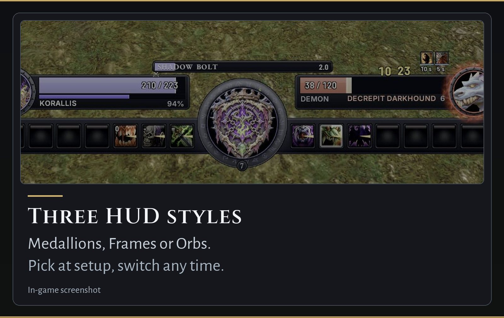

*In-game screenshot. Icons in this picture are the optional AI-made icon pack, not art shipped in the addon.*

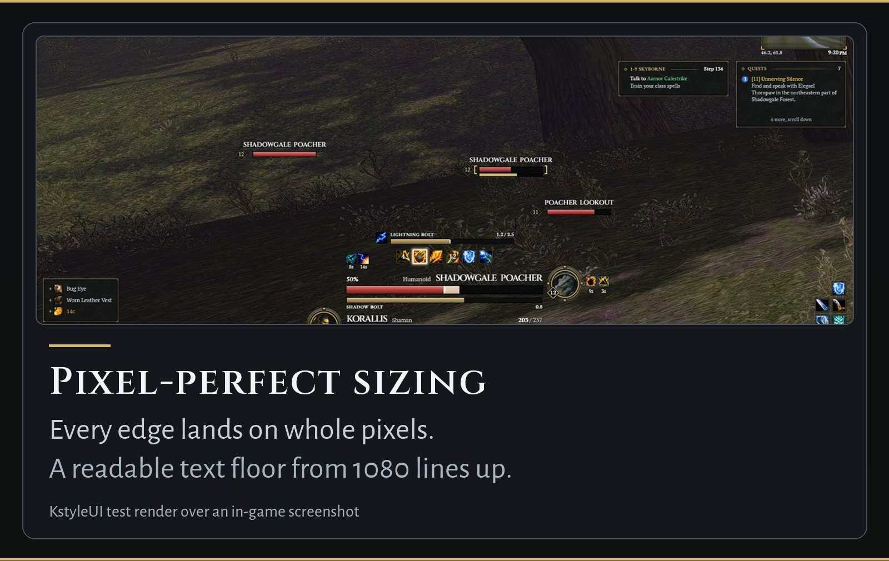

*KstyleUI test render over an in-game screenshot. Icons in this picture are the optional AI-made icon pack, not art shipped in the addon.*

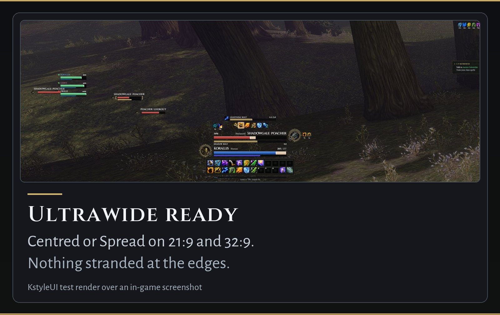

*KstyleUI test render over an in-game screenshot. Icons in this picture are the optional AI-made icon pack, not art shipped in the addon.*

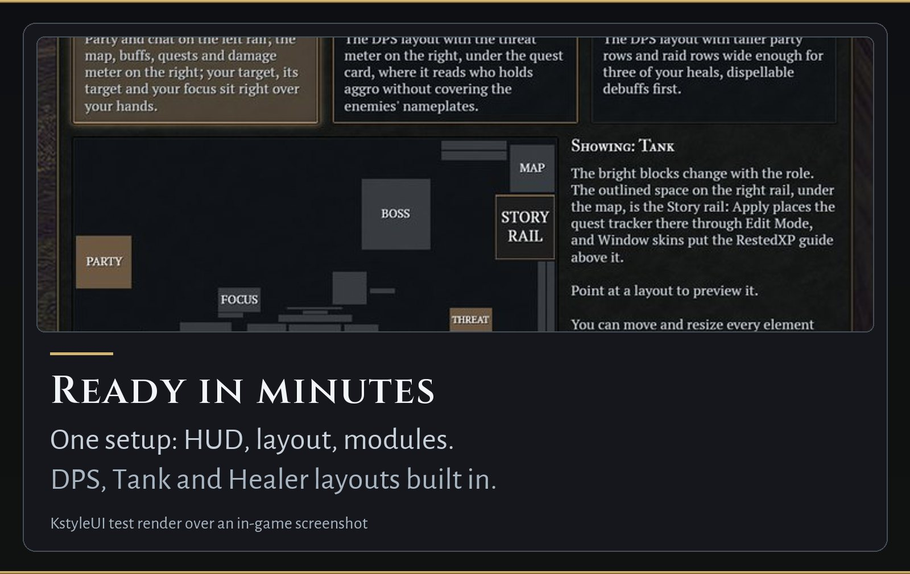

*KstyleUI test render over an in-game screenshot.*

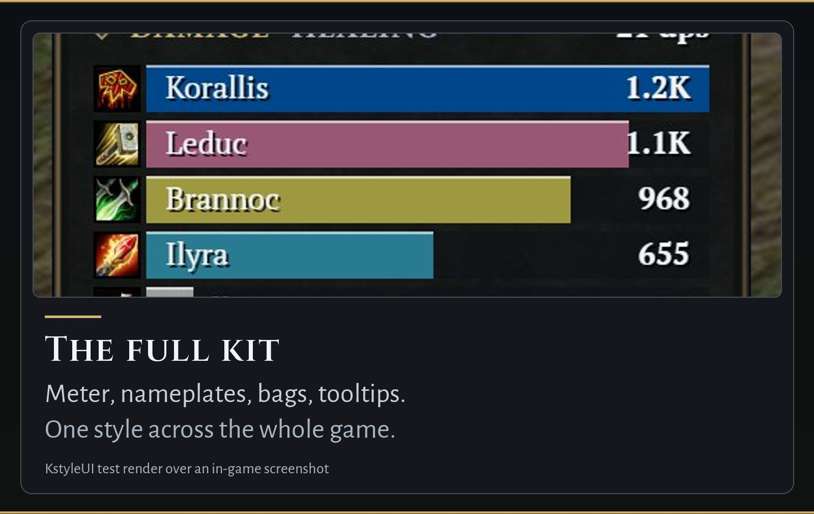

*KstyleUI test render over an in-game screenshot. Icons in this picture are the optional AI-made icon pack, not art shipped in the addon.*

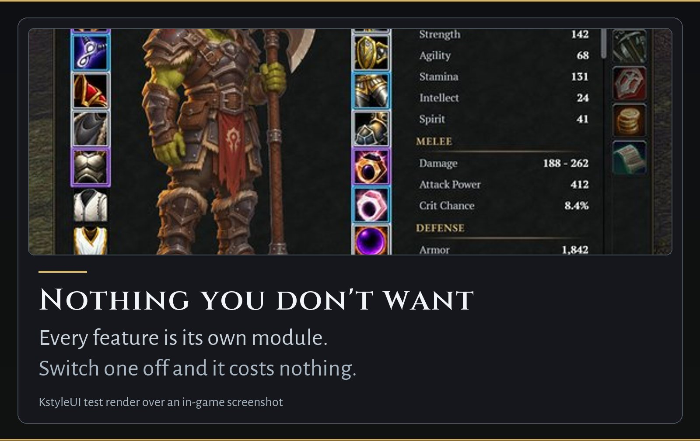

*KstyleUI test render over an in-game screenshot. Icons in this picture are the optional AI-made icon pack, not art shipped in the addon.*

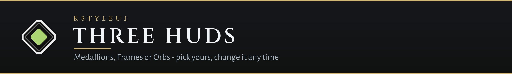

Pick your style in the first-run setup. Switch later in **Options, General, HUD style**, which shows a picture of each; out of combat the change applies at once, in combat it waits for the fight to end.

### Medallions


*In-game screenshot: the Medallions HUD on a 5120 by 1440 screen, in Tirisfal Glades. Chat and distant player names are blurred. Icons in this picture are the optional AI-made icon pack, not art shipped in the addon.*

Dark gunmetal with rounded, bevelled edges, like a piece of forged hardware. You and your target are slabs with clean bars and a round medallion on the outer end, its rim engraved with runes. Yours is a painted portrait of your race, class and sex - other players get their own; a creature, pet or boss shows the game's portrait.

Your first two action bars sit in recessed sockets on one dark slab: twelve buttons each side of a crest painted for your race and class, in a ring of runes in your class colour. Your pet and stance bars get small slabs beside it, and your experience runs along the slab's lower edge.


*In-game screenshot: Medallions in combat, a 16:9 crop of the ultrawide capture above. Icons in this picture are the optional AI-made icon pack, not art shipped in the addon.*


*In-game screenshot: the medallions, cast bar and crest up close. Icons in this picture are the optional AI-made icon pack, not art shipped in the addon.*

Medallions also answers what happens in a fight: a slot flashes when its cooldown comes back, your cast bar flashes when a cast lands and red when it is stopped, a red edge grows round the screen at low health, and three seconds after combat your side frames dim until the next fight. **Medallions motion** (Options, General, Medallions) sets how much moves - Full, Calm or Off.

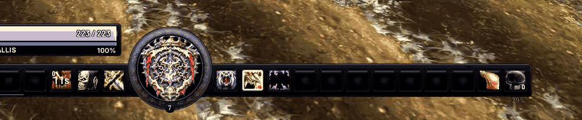

*In-game screenshot: selecting a target brings in the target medallion; its red ring pulses at low health. Icons in this picture are the optional AI-made icon pack, not art shipped in the addon.*


*In-game screenshot: cast bars fill above the crest while the sockets sweep through their cooldowns. Icons in this picture are the optional AI-made icon pack, not art shipped in the addon.*


*In-game screenshot: an interrupted cast flashes, then a channel counts down as the target frame clears. Icons in this picture are the optional AI-made icon pack, not art shipped in the addon.*

### Frames

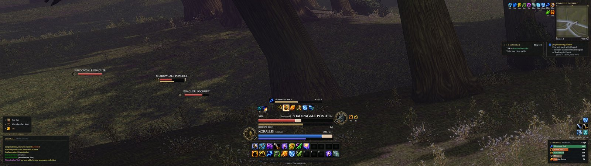

*KstyleUI test render over an in-game screenshot: the Frames HUD in combat on a 5120 by 1440 screen, in the Spread arrangement. Icons in this picture are the optional AI-made icon pack, not art shipped in the addon.*

**Frames** is the classic layout, cleaned up: your health and resource on a player card above the action bars, your target's card stacked over it with its portrait on the far side.


*KstyleUI test render over an in-game screenshot: the Frames HUD on a 1920 by 1080 screen, in combat. Icons in this picture are the optional AI-made icon pack, not art shipped in the addon.*


*KstyleUI test render over an in-game screenshot: the target over the player, both mid-cast. Icons in this picture are the optional AI-made icon pack, not art shipped in the addon.*

Whichever style you pick, the bars read the same way: a hit flashes, the health you just lost holds as a pale band before it drains, and cast bars are tall enough to read in a pull.

### Orbs


*KstyleUI test render over an in-game screenshot: the Orbs HUD in combat on a 5120 by 1440 screen, in the Spread arrangement. Icons in this picture are the optional AI-made icon pack, not art shipped in the addon.*

**Orbs** puts your health and resource in two orbs either side of a forged tray round your first action bar, and moves your target to a wide bar at the top of the screen.

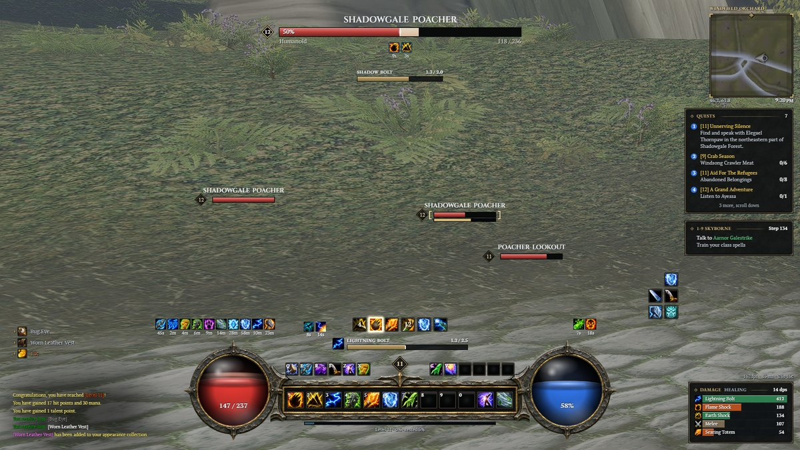

*KstyleUI test render over an in-game screenshot: the Orbs HUD on a 1920 by 1080 screen, in combat. Icons in this picture are the optional AI-made icon pack, not art shipped in the addon.*

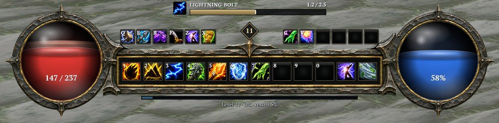

*KstyleUI test render over an in-game screenshot: the orbs and the forged tray up close, a moment after a hit. Icons in this picture are the optional AI-made icon pack, not art shipped in the addon.*


On a 21:9 or 32:9 monitor, you choose how the HUD uses the width. **Centred** (the default) keeps everything in a band in the middle, so nothing is stranded at the far edges. **Spread** moves the side columns out to the screen edges and keeps your group frames close to your character.


*KstyleUI test render over an in-game screenshot: the Healer layout on 5120 by 1440, Centred. Icons in this picture are the optional AI-made icon pack, not art shipped in the addon.*

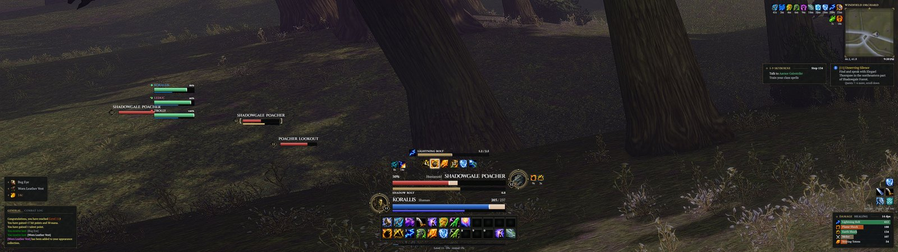

*KstyleUI test render over an in-game screenshot: the Healer layout on 5120 by 1440, Spread. Icons in this picture are the optional AI-made icon pack, not art shipped in the addon.*

Set it in **Options, Elements, Ultrawide arrangement**, and set the band itself - 21:9, 16:9 or the full width - under **HUD width**. Laptop screens and 4:3, 3:2 and 16:10 displays are covered too.

With **Interface size: Auto (pixel perfect)**, the default, KstyleUI picks the size that fits your screen exactly. Every frame, bar and slot lands on whole screen pixels, so edges stay sharp instead of blurring between pixels - and at 1080 lines and above, a text floor that scales with your screen keeps type readable. Prefer to set it yourself? Turn Auto off in **Options, General, Size**.

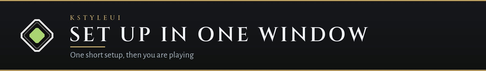

The first time you log in, one short setup does it all: pick Medallions, Frames or Orbs, pick the DPS, Tank or Healer layout over a live preview, choose your modules, then apply. Close it early and you get the DPS layout with every module on; **Keep my UI** leaves the game's interface untouched. Run it again any time with `/kstyle setup`.

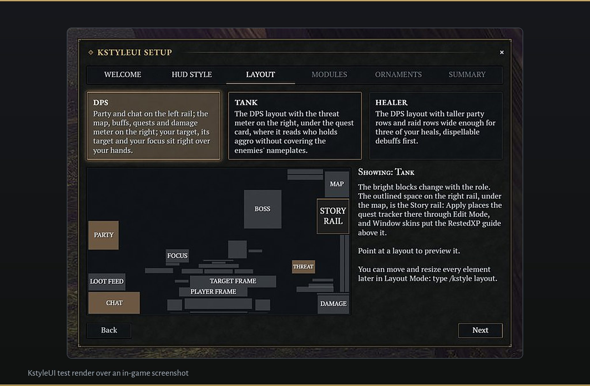

*KstyleUI test render over an in-game screenshot: the first-run setup on its layout step.*

Tank adds a threat card in the combat cluster. Healer gives party and raid frames more room: dispellable debuffs lead the row, a member with a boss debuff glows, shields and your heals over time show on each tile, and the frames work with the game's Click Casting.

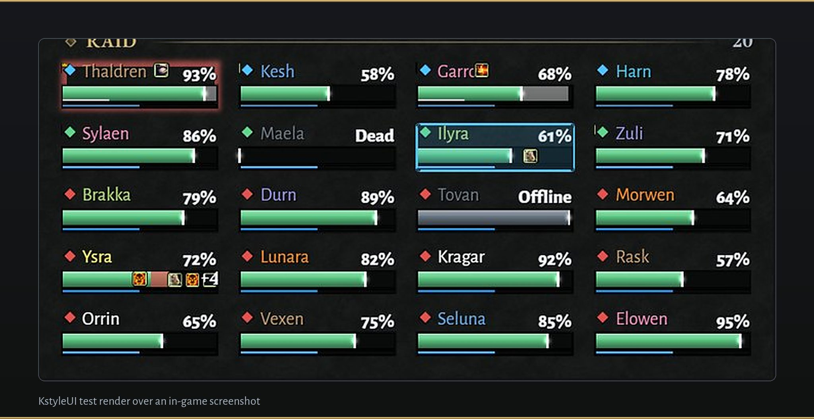

*KstyleUI test render over an in-game screenshot: the raid frames. Icons in this picture are the optional AI-made icon pack, not art shipped in the addon.*

`/kstyle` opens one settings window with a page per module, a search across every setting and a live preview. `/kb` or `/kstyle kb` binds your action buttons: hover a button, press a key, then save. `/kstyle layout` moves, resizes or scales any element. Profiles copy between characters, and export and import as one string.


### Nameplates that stay out of the way

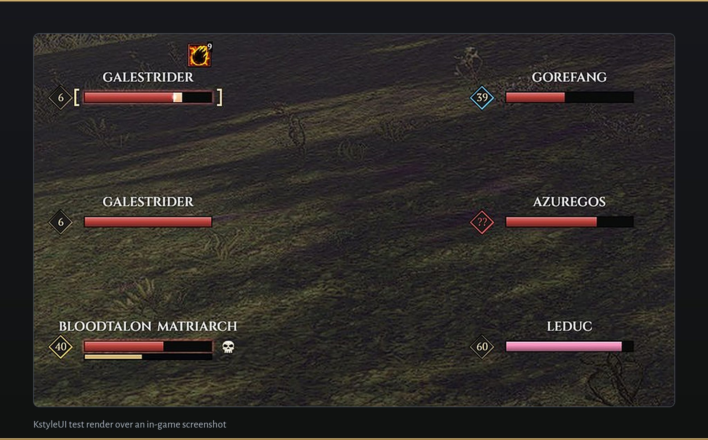

*KstyleUI test render over an in-game screenshot: nameplates in combat. Icons in this picture are the optional AI-made icon pack, not art shipped in the addon.*

Plain flat bars under tracked capital names, with your own debuffs on top. Your target wears brackets, a cast flashes when it starts and when it is stopped, and objects such as a mailbox get a name-only plate.

### A group damage meter

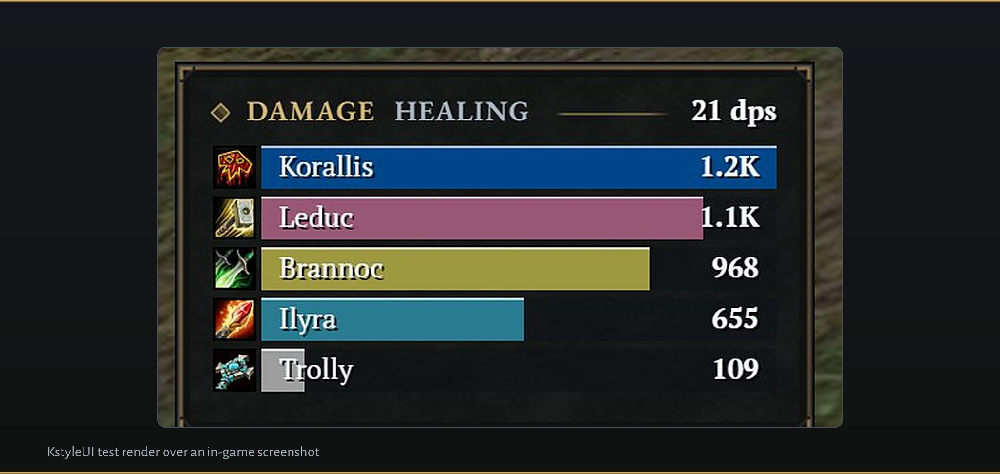

*KstyleUI test render over an in-game screenshot: the damage meter in a party of five. Icons in this picture are the optional AI-made icon pack, not art shipped in the addon.*

One card, a class-coloured bar per player. Switch between this fight, the last fight and the whole session; point at a row for that player's spell split. The threat card beside it follows the same design.

### Quests, guide and map on the right

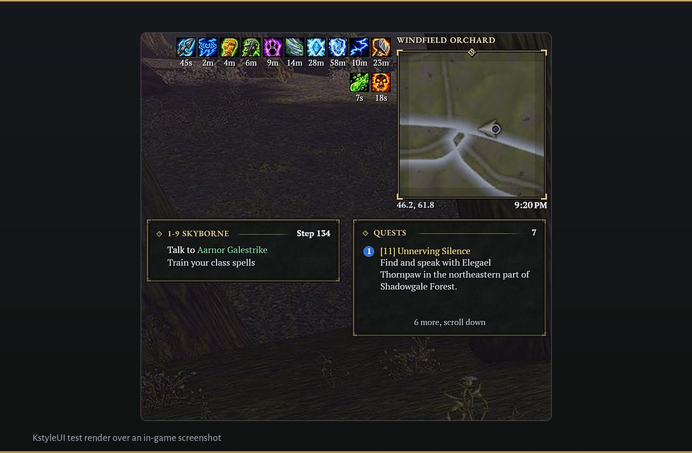

*KstyleUI test render over an in-game screenshot: the right rail - map card, quest card and guide card. Icons in this picture are the optional AI-made icon pack, not art shipped in the addon.*

Your buffs sit above a map card with the zone, your coordinates and the clock. The quest card keeps your quests in view and scrolls for the rest; in the picture the taller guide card beside it takes more of the rail, so it shows one quest and counts the others below. With a RestedXP guide open, the guide takes the tall column beside it, and RestedXP's target and item boxes dock underneath. The minimap's drawer collects every addon button cluttering the map.

### Bags, tooltips and windows


*KstyleUI test render over an in-game screenshot: the skin on the character sheet. Icons in this picture are the optional AI-made icon pack, not art shipped in the addon.*

- **Bags:** combined bags and bank with search, sorting, categories, quality borders and junk selling.
- **Tooltips:** on the same dark card, with quality and class colours and a health bar.
- **Window skins:** the character sheet, spellbook, talents, world map and quest log, mail, merchant, professions, loot, group finder, social windows and the game menu - and the RestedXP windows - all in KstyleUI's style.
- **And the rest:** unit frames, group frames to 40, action bars, cooldowns, auras, combat text, chat, data bars, a threat meter and swing timer, and quality-of-life touches such as fast auto loot and auto repair. Each is its own module, and a module you switch off costs nothing.

Every module stays inside the rules Forever sets for addons: a protected change made in combat waits for combat to end.

## Install

KstyleUI runs on the World of Warcraft: Forever client.

1. Install KstyleUI with the CurseForge app or the Wago app (or WowUp) on your Forever installation. By hand, unzip the download into `World of Warcraft/_forever_/Interface/AddOns`, so that `KstyleUI` and the `KstyleUI_*` module folders sit there.
2. Start the game. If the addons are not ticked in the AddOns list on the character screen, tick them.
3. Log in. The setup opens: pick your HUD style, layout and modules, then click **Apply** and **Reload**.
4. Type `/kstyle` for the settings, or `/kstyle layout` to move things.

An optional icon pack repaints ability and item icons everywhere, including buffs. The icons were made with AI image tools. The pack is not an addon and is not part of this download: it is available from this project's GitHub page. Quit the game, copy its Interface folder into your Forever folder so the files land in Interface/Icons, then start the game again.

## FAQ

**Which client does KstyleUI support?**
World of Warcraft: Forever. It is built and tested for that client only.

**Does it work with RestedXP?**
Yes. The guide gets its own tall card beside your quest card, RestedXP's Active Targets and Active Items boxes dock underneath it, and the RestedXP windows are skinned to match.

**How do I switch HUD style?**
In **Options, General, HUD style**, or by running the setup again with `/kstyle setup`. Out of combat the change applies at once; picked in combat, it waits for the fight to end.

**Can I keep parts of the default UI?**
Yes. Every feature is a module you can switch off, and **Keep my UI** in the setup leaves the game's interface as it is.

**Which languages are included?**
English, German, French, Spanish and Simplified Chinese, using the game's own terms for each language. The translations are machine-made and not yet checked by a native speaker, so please report a wrong or awkward string as an issue.

**How do I report a bug?**
Open an issue at the link below. Say what you were doing, what you expected and what happened instead, and add a screenshot and your KstyleUI version if you can.

## Links

- Source code: https://github.com/korallis/KstyleUI
- Issues: https://github.com/korallis/KstyleUI/issues

## Credits

- Fonts, all under the SIL Open Font License 1.1, with their licence files in the addon's `Media/Fonts` folder: Cinzel, Alegreya Sans, Barlow Semi Condensed, Source Sans 3, Inter, PT Serif, EB Garamond and IM Fell (the last three in KstyleUI's Folio faces). Some are adapted for the game's renderer and renamed, as the licence allows.
- KstyleUI's painted portraits, crests and textures are original addon art: some were made with AI image tools; the rest is drawn by KstyleUI's own code. No game assets are extracted or traced. Every scenery backdrop is cropped from an owner-captured World of Warcraft: Forever screenshot; none is AI-generated. The pictures on this page are in-game screenshots and KstyleUI test renders over those screenshot crops, captioned as such. Painted portrait and model stand-ins in renders are addon art, not live game models.
- By the KstyleUI authors. All rights reserved.
```

## Class, categories, game version

- Game: World of Warcraft.
- Class: Addons.
- Game version: Forever. On the public addon list that flavor is [gameVersionTypeId 88568](https://www.curseforge.com/wow/search?class=addons&gameVersionTypeId=88568), and the patch is [1.60.1](https://www.curseforge.com/wow/search?class=addons&version=1.60.1). Do not tick Retail or Classic.
- Main category: Unit Frames. If the form offers the HUDs subcategory as the main choice, pick HUDs.
- Additional categories, up to four ([submission guide](https://support.curseforge.com/en/support/solutions/articles/9000199552-project-submission-guide-and-tips)): Action Bars, Map & Minimap, Bags & Inventory, Quests & Leveling.

## Licence

The TOC says `## X-License: All Rights Reserved`, and [LICENSE.md](../../LICENSE.md) says "Copyright 2026 the KstyleUI authors. All rights reserved." Pick **All Rights Reserved** if it is in the list. If it is not, pick **Custom** and paste that sentence. Do not pick a permissive licence. The bundled fonts keep their own SIL Open Font Licence. That stays in the repository. It is not the project licence.

## Links to set on the project

- Source: https://github.com/korallis/KstyleUI
- Issues: https://github.com/korallis/KstyleUI/issues

## Logo

`logo/curseforge-avatar.png`

400×400 PNG, the chamfered diamond, transparent outside the diamond. The console asks for a minimum of 400×400 at 1:1 ([submission guide](https://support.curseforge.com/en/support/solutions/articles/9000199552-project-submission-guide-and-tips): "at least minimum 400*400 px (1:1 scale) .png"; the console's own line is "Upload a minimum of 400px by 400px with 1:1 ratio image") and rejects an avatar over 102400 bytes. WebP avatars are warned off. This file is PNG and under that cap. It is not a filled square: the diamond is the mark, and the page behind it is dark.

## Gallery

CurseForge's submission guide tells you to add in-game screenshots on the Images tab, and moderation requires at least one gallery image. Neither that guide nor the authors console publishes a gallery pixel size. These files keep each README picture's own pixels. The hero is half of `docs/media/readme/game_medallions_hero.jpg` (5120×1440 down to 2560×720) so the page is not handed a 5K file. Stills are JPEG, as the README already stores them. The clip is a GIF. The console's image file control accepts `.png`, `.jpg`, `.jpeg`, `.gif` and `.webp`.

Upload in this order. Title, then caption.

| File | Pixels | Title | Caption |
| --- | --- | --- | --- |
| `gallery/01-medallions-hero.jpg` | 2560×720 | Medallions on an ultrawide screen | In-game screenshot: the Medallions HUD on a 5120 by 1440 screen, in Tirisfal Glades. Chat and distant player names are blurred. Icons in this picture are the optional AI-made icon pack, not art shipped in the addon. |
| `gallery/02-style-medallions.jpg` | 1280×720 | Medallions | In-game screenshot of Medallions HUD in combat, cropped to 16:9 from the ultrawide screenshot. Icons in this picture are the optional AI-made icon pack, not art shipped in the addon. |
| `gallery/03-style-frames.jpg` | 1200×675 | Frames | KstyleUI test render over an in-game screenshot of the Frames HUD in combat on a 1920 by 1080 screen. Icons in this picture are the optional AI-made icon pack, not art shipped in the addon. |
| `gallery/04-style-orbs.jpg` | 1200×675 | Orbs | KstyleUI test render over an in-game screenshot of the Orbs HUD in combat on a 1920 by 1080 screen. Icons in this picture are the optional AI-made icon pack, not art shipped in the addon. |
| `gallery/05-ultrawide-spread.jpg` | 1600×450 | Ultrawide, Spread | KstyleUI test render over an in-game screenshot of the Healer layout on a 5120 by 1440 screen, in the Spread arrangement. The side columns sit at the edges. Icons in this picture are the optional AI-made icon pack, not art shipped in the addon. |
| `gallery/06-setup.jpg` | 720×523 | First-run setup | KstyleUI test render over an in-game screenshot of the first-run setup on its layout step: DPS, Tank and Healer, with a preview under the pointer. |
| `gallery/07-nameplates.jpg` | 800×466 | Nameplates | KstyleUI test render over an in-game screenshot of the nameplates in combat: a targeted beast, an elite, a rare, a world boss and a friendly player. Icons in this picture are the optional AI-made icon pack, not art shipped in the addon. |
| `gallery/08-meter.jpg` | 540×300 | Damage meter | KstyleUI test render over an in-game screenshot of the damage meter in a party of five, one class-coloured bar per player. Icons in this picture are the optional AI-made icon pack, not art shipped in the addon. |
| `gallery/09-quests.jpg` | 660×624 | Map, quests and guide | KstyleUI test render over an in-game screenshot of the right rail: the map card, the quest card and the guide card. Icons in this picture are the optional AI-made icon pack, not art shipped in the addon. |
| `gallery/10-medallion-closeup.gif` | 800×166 | Target medallion | In-game screenshot: selecting a target brings in the target medallion, and its red ring pulses at low health. Icons in this picture are the optional AI-made icon pack, not art shipped in the addon. |
