*In-game screenshot behind the banner wordmark. Icons in this picture are the optional AI-made icon pack, not art shipped in the addon.*

[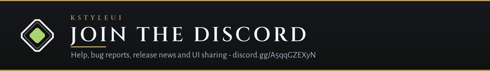](https://discord.gg/A5qqGZEXyN)

**Join the KstyleUI Discord: [discord.gg/A5qqGZEXyN](https://discord.gg/A5qqGZEXyN)** - get help, report a bug, hear about every release first and show off your UI.

**Your whole interface, forged as one piece.** Run one short setup and play - every bar, plate, bag and window in the same dark gunmetal and gold.

**Install in a minute:** the CurseForge app, the Wago app or WowUp, or unzip by hand into your AddOns folder - full steps are at the bottom.

Rendered previews below use cropped real Forever scenery, enlarged to fit the preview. They show fixture data, not a live play session. The source screenshots and exact crops are recorded in [scenery provenance](https://github.com/korallis/KstyleUI/blob/main/docs/media/plates/PROVENANCE.md).

## KstyleUI Icons: the full repainted look

The addon repaints the frames; **KstyleUI Icons** repaints the icons inside them. Every ability, item, buff and debuff icon in one style, everywhere the game draws it: your bars, bags, spellbook, tooltips and buff tiles. It is optional, and the icons were made with AI image tools.

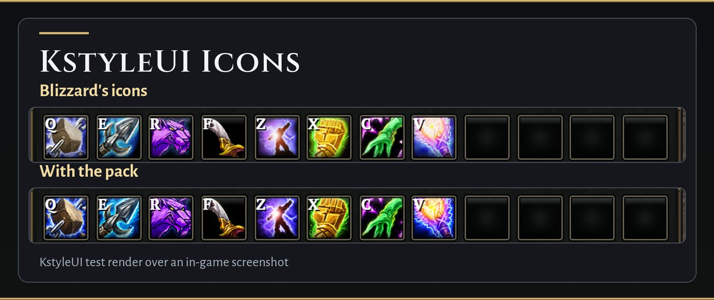

*KstyleUI test render over an in-game screenshot: the same action bar row - Blizzard's icons above, the pack below. Icons in this picture are the optional AI-made icon pack, not art shipped in the addon.*

**Get it:** the `KstyleUI-Icons-<version>.zip` on the [GitHub releases page](https://github.com/korallis/KstyleUI/releases/latest). CurseForge and Wago install addons only, and this pack is not an addon, so it is not part of this download and does not go in `AddOns`.

**Install it:**

1. Download `KstyleUI-Icons-<version>.zip` from the releases page above.
2. Quit the game fully.
3. Unzip it: on **Windows** right-click the zip and choose **Extract All**; on a **Mac** double-click it. Inside you find `Interface`, and inside that an `Icons` folder.
4. Copy that **`Icons`** folder into your game's `_forever_/Interface/` folder, so the files land in `_forever_/Interface/Icons/`. Copy `Icons` itself, not `Interface`: on a Mac, replacing the `Interface` folder would delete your addons.
   - **Windows:** `C:\Program Files (x86)\World of Warcraft\_forever_\Interface\` (in the Battle.net app, the gear next to **Play** has **Show in Explorer**).
   - **Mac:** `/Applications/World of Warcraft/_forever_/Interface/` (in Finder, **Go > Go to Folder**, then paste the path; the Battle.net gear has **Show in Finder**).
5. Start the game.

To remove it, delete its files from `Interface/Icons` (or the whole `Icons` folder, if nothing else is in it) and start the game again. Blizzard's icons come back.

Good to know: the pack works with or without the KstyleUI addon. It loads only at a full restart, never after `/reload`. A few store and event icons stay Blizzard's - the client encrypts them, so no pack can replace them.

**Why players switch**

- **One forged HUD.** Medallions puts painted portraits on your unit frames and your class crest between your action bars, on one dark slab.
- **The whole game in one style.** Bars, nameplates, bags, tooltips, windows and the damage meter all wear the same dark forged chrome.
- **Make every part yours.** Deep settings for unit, party and raid frames, nameplates, cooldowns, auras, chat, the minimap, bags, tooltips and meters, each with a live preview.
- **A map that plans the trip.** Search the world map and get a route along real roads, flights and boats, with every step and its travel time.
- **Sharp on every screen.** Pixel-perfect sizing from a laptop to a 32:9 ultrawide; at 1080 lines and above, a text floor that scales with your screen keeps type readable.
- **Nothing you don't want.** Every part is its own module. Switch one off and it costs nothing, and reloads are quick.
- **Ready in minutes.** One short setup, layouts for DPS, Tank and Healer, and profiles you can copy between characters.

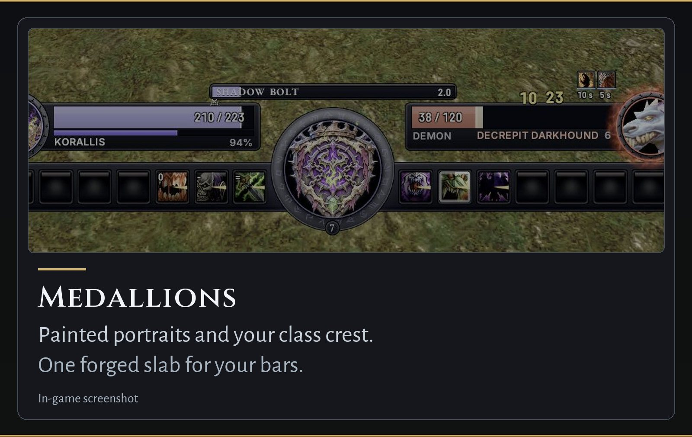

*In-game screenshot. Icons in this picture are the optional AI-made icon pack, not art shipped in the addon.*

*KstyleUI test render over an in-game screenshot. Icons in this picture are the optional AI-made icon pack, not art shipped in the addon.*

*KstyleUI test render over an in-game screenshot. Icons in this picture are the optional AI-made icon pack, not art shipped in the addon.*

*KstyleUI test render over an in-game screenshot.*

*KstyleUI test render over an in-game screenshot. Icons in this picture are the optional AI-made icon pack, not art shipped in the addon.*

*KstyleUI test render over an in-game screenshot. Icons in this picture are the optional AI-made icon pack, not art shipped in the addon.*

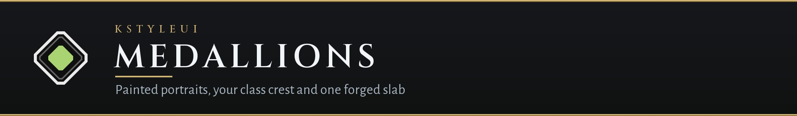

*In-game screenshot: the Medallions HUD on a 5120 by 1440 screen, in Tirisfal Glades. Chat and distant player names are blurred. Icons in this picture are the optional AI-made icon pack, not art shipped in the addon.*

Dark gunmetal with rounded, bevelled edges, like a piece of forged hardware. You and your target are slabs with clean bars and a round medallion on the outer end, its rim engraved with runes. Yours is a painted portrait of your race, class and sex - other players get their own; a creature, pet or boss shows the game's portrait.

Your first two action bars sit in recessed sockets on one dark slab: twelve buttons each side of a crest painted for your race and class, in a ring of runes in your class colour. Your pet and stance bars get small slabs beside it, and your experience runs along the slab's lower edge.

Rogues and cat-form druids see their combo points on the crest itself, as cut jewels round the top of the ring (**Options, Action Bars, Crest resource jewels**). A jewel flares when you gain a point and drains when you spend one, and at the maximum the whole ring glows (**Glow at max**). Hunters with Summon Hawk get hawk perches on the ring, each hawk with a green timer for its time left (**Hawk perches**).

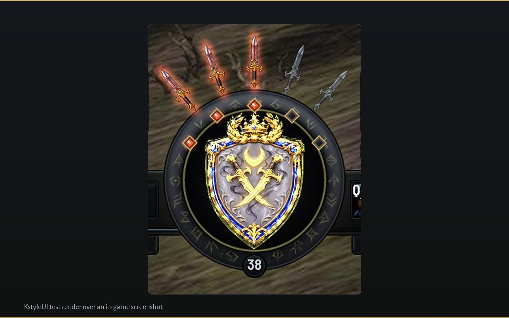

*KstyleUI test render over an in-game screenshot: a rogue's crown of blades and jewels, three of five combo points lit. Icons in this picture are the optional AI-made icon pack, not art shipped in the addon.*

Under the slab, your data bar docks on forged plates: the clock on one side; frame rate, latency, gold and experience on the other, each in its own segment with an icon and gilt dividers.

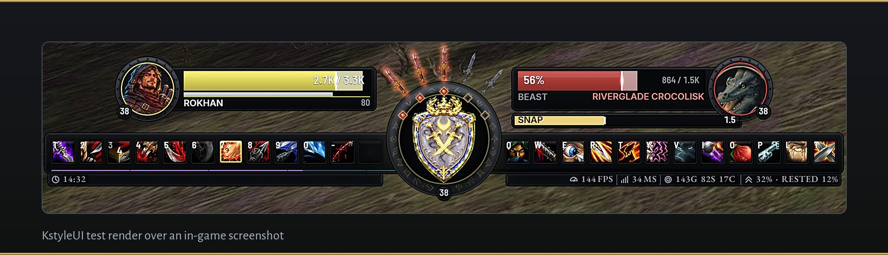

*KstyleUI test render over an in-game screenshot: the slab, the crest with its crown of blades and the forged data dock under it. Icons in this picture are the optional AI-made icon pack, not art shipped in the addon.*

*In-game screenshot: Medallions in combat, a 16:9 crop of the ultrawide capture above. Icons in this picture are the optional AI-made icon pack, not art shipped in the addon.*

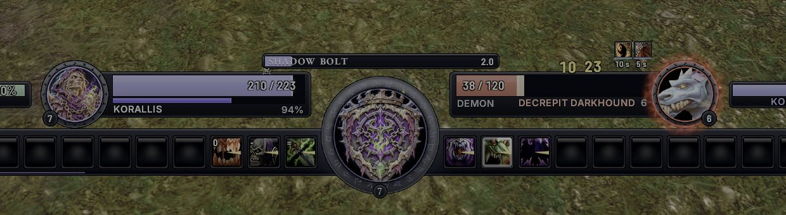

*In-game screenshot: the medallions, cast bar and crest up close. Icons in this picture are the optional AI-made icon pack, not art shipped in the addon.*

Medallions also answers what happens in a fight: a slot flashes when its cooldown comes back, your cast bar flashes when a cast lands and red when it is stopped, a red edge grows round the screen at low health, and three seconds after combat your side frames dim until the next fight. **Medallions motion** (Options, General, Medallions) sets how much moves - Full, Calm or Off.

*In-game screenshot: selecting a target brings in the target medallion; its red ring pulses at low health. Icons in this picture are the optional AI-made icon pack, not art shipped in the addon.*

*In-game screenshot: cast bars fill above the crest while the sockets sweep through their cooldowns. Icons in this picture are the optional AI-made icon pack, not art shipped in the addon.*

*In-game screenshot: an interrupted cast flashes, then a channel counts down as the target frame clears. Icons in this picture are the optional AI-made icon pack, not art shipped in the addon.*

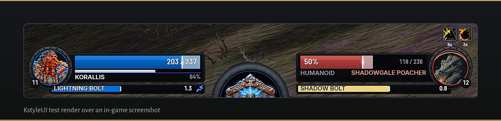

*KstyleUI test render over an in-game screenshot: you and your target, both mid-cast, a moment after a hit. Icons in this picture are the optional AI-made icon pack, not art shipped in the addon.*

The bars read at a glance: a hit flashes, the health you just lost holds as a pale band before it drains, and cast bars are tall enough to read in a pull.

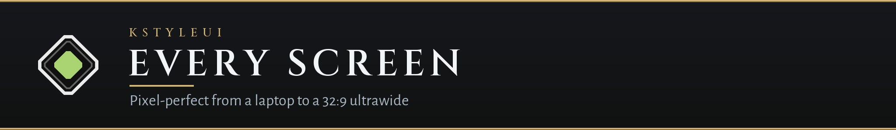

On a 21:9 or 32:9 monitor, you choose how the HUD uses the width. **Centred** (the default) keeps everything in a band in the middle, so nothing is stranded at the far edges. **Spread** moves the side columns out to the screen edges and keeps your group frames close to your character.

*KstyleUI test render over an in-game screenshot: the Healer layout on 5120 by 1440, Centred. Icons in this picture are the optional AI-made icon pack, not art shipped in the addon.*

*KstyleUI test render over an in-game screenshot: the Healer layout on 5120 by 1440, Spread. Icons in this picture are the optional AI-made icon pack, not art shipped in the addon.*

Set it in **Options, Elements, Ultrawide arrangement**, and set the band itself - 21:9, 16:9 or the full width - under **HUD width**. Laptop screens and 4:3, 3:2 and 16:10 displays are covered too.

With **Interface size: Auto (pixel perfect)**, the default, KstyleUI picks the size that fits your screen exactly. Every frame, bar and slot lands on whole screen pixels, so edges stay sharp instead of blurring between pixels - and at 1080 lines and above, a text floor that scales with your screen keeps type readable. Prefer to set it yourself? Turn Auto off in **Options, General, Size**.

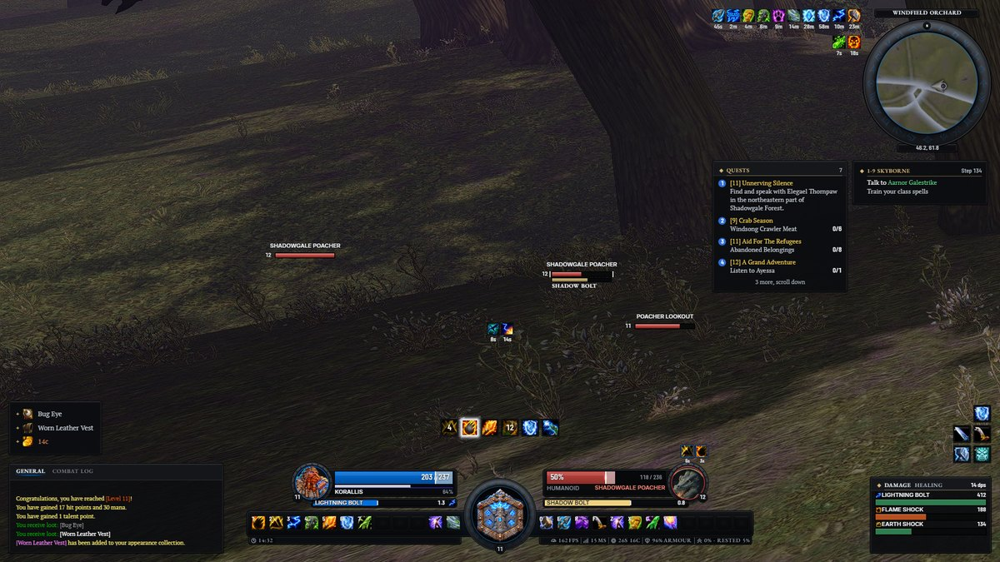

*KstyleUI test render over an in-game screenshot: the DPS layout on a 1920 by 1080 screen, in combat. Icons in this picture are the optional AI-made icon pack, not art shipped in the addon.*

The first time you log in, one short setup does it all: pick the DPS, Tank or Healer layout from a picture of each, choose your modules and which of your other addons KstyleUI skins, then apply. Close it early and you get the DPS layout with every module on; **Keep my UI** leaves the game's interface untouched. Run it again any time with `/kstyle setup`.

*KstyleUI test render over an in-game screenshot: the first-run setup on its layout step.*

Tank gives threat its own clear slot. Healer gives party and raid frames more room: dispellable debuffs lead the row, a member with a boss debuff glows, shields and your heals over time show on each tile, and the frames work with the game's Click Casting.

*KstyleUI test render over an in-game screenshot: the raid frames. Icons in this picture are the optional AI-made icon pack, not art shipped in the addon.*

`/kb` or `/kstyle kb` binds your action buttons: hover a button, press a key, then save. `/kstyle layout` moves, resizes or scales any element. Keep a profile per specialization, switching automatically after combat. Profiles copy between characters, and export and import as one string.

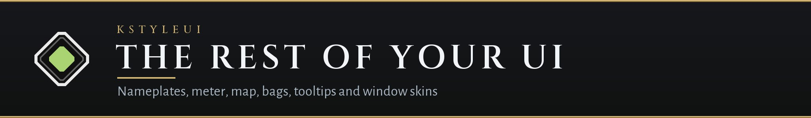

### Nameplates that stay out of the way

*KstyleUI test render over an in-game screenshot: nameplates in combat. Icons in this picture are the optional AI-made icon pack, not art shipped in the addon.*

Plain flat bars under tracked capital names, with your own debuffs on top. Your target wears brackets, a cast flashes when it starts and when it is stopped, and objects such as a mailbox get a name-only plate.

### A group damage meter

*KstyleUI test render over an in-game screenshot: the damage meter in a party of five. Icons in this picture are the optional AI-made icon pack, not art shipped in the addon.*

The meter follows your role: threat when you tank, damage otherwise. As DPS you can show Damage, Threat or Both in **Options, Meters, Meter while dealing damage**; Both places matching cards side by side, and Damage stays the default.

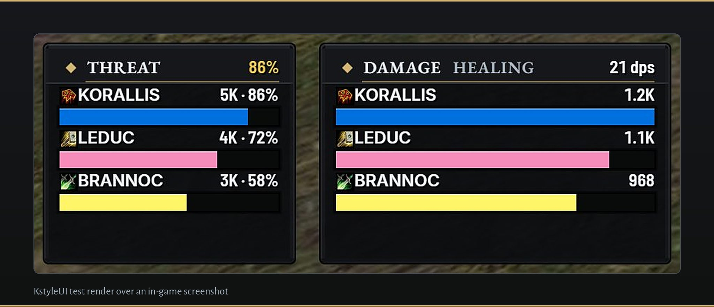

*KstyleUI test render over an in-game screenshot: Both shows threat next to damage. Icons in this picture are the optional AI-made icon pack, not art shipped in the addon.*

One class-coloured bar per player. Switch between this fight, the last fight and the whole session; point at a damage row for that player's spell split.

### Quests, guide and map on the right

*KstyleUI test render over an in-game screenshot: the right rail - map card, quest card and guide card. Icons in this picture are the optional AI-made icon pack, not art shipped in the addon.*

Your buffs sit beside a round map with the zone and your coordinates. The quest card keeps your quests in view and scrolls for the rest. With a RestedXP or Zygor Guides Viewer guide open, the guide takes the column beside it in the same forged card, and RestedXP's target and item boxes dock underneath. The minimap's drawer collects every addon button cluttering the map.

### A world map that plans the trip

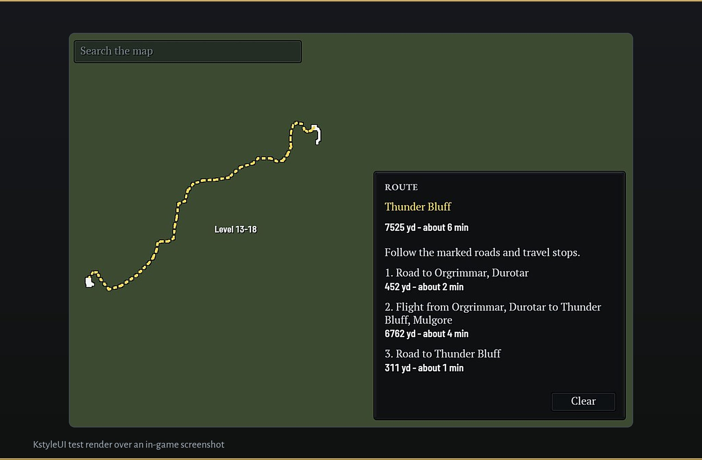

*KstyleUI test render over an in-game screenshot: a route from Orgrimmar to Thunder Bluff. The plain green stands in for the game's own map art.*

Search the map for a flight master, a dungeon or raid entrance or a quest, and KstyleUI draws the way there along real roads, passes, flights and boats. The route card lists every step with its distance and travel time, and offers a flight when one saves you at least a minute. The map zooms smoothly with the wheel, remembers where you were, and shows dungeon and zone level ranges.

### Bags, tooltips and windows

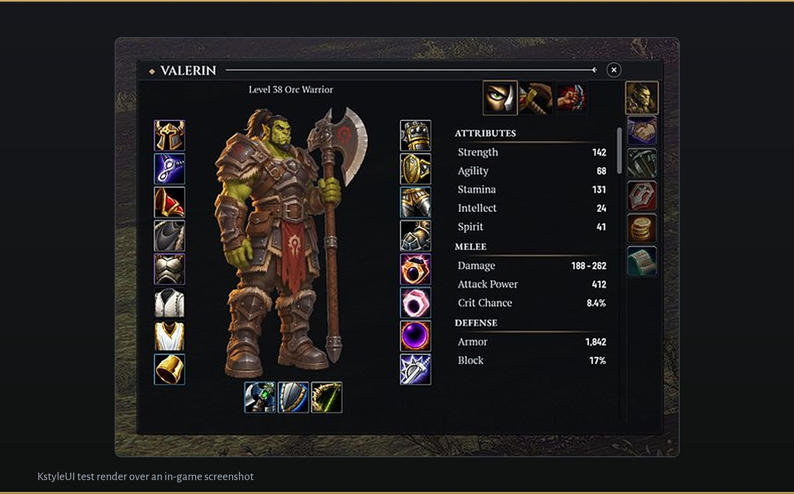

*KstyleUI test render over an in-game screenshot: the skin on the character sheet. Icons in this picture are the optional AI-made icon pack, not art shipped in the addon.*

- **Bags:** combined bags and bank with search, sorting, categories, quality borders and junk selling.
- **Tooltips:** on the same dark card, with quality and class colours and a health bar.
- **Window skins:** the character sheet, spellbook, talents, world map and quest log, mail, merchant, professions, loot, group finder, social windows and the game menu - and the RestedXP and Zygor windows - all in KstyleUI's style.
- **And the rest:** unit frames, group frames to 40, action bars, cooldowns, auras, combat text, chat, data bars, a threat meter and swing timer, and quality-of-life touches such as fast auto loot and auto repair. Each is its own module, and a module you switch off costs nothing.

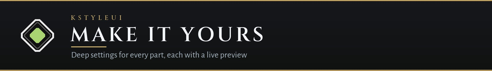

`/kstyle` opens one settings window with a page per module, a search across every setting and a live preview that redraws as you change things. Every module goes deep, and every new option starts at the look you already have:

- **Unit, party and raid frames:** text slots of your own, absorb shields, aura filters and sorting, cast bar colours with a latency zone, and AFK, resurrection and summon marks.
- **Nameplates:** colours for bosses, casters and minor mobs, threat percent, an execute-range mark and raid-marker tags.
- **Cooldowns and auras:** per-spell rules to hide, fade or glow a spell, and auras filtered by category, duration or spell.
- **Chat:** fading when it goes quiet, tabs and buttons you arrange, class-coloured names and link tooltips on hover.
- **Minimap:** zone, clock and coordinates inside the map, and buttons you can Shift-drag anywhere on it.
- **Bags:** a list view, pinned items, a category list down the side, and sections by slot, type, set or expansion.
- **Tooltips and meters:** item level and buffs on player tooltips; a second damage window, spell history and a combat timer.
- **Data bars:** icons on every readout, new readouts such as coordinates and professions, and a second data bar you place yourself.
- **Quality of life:** alerts for combat, deaths, low durability and potions, a cursor ring and crosshair, raid tools and `/way` waypoints.

New in a version? **About, What's new** lists the highlights in game, in your language.

Every module stays inside the rules Forever sets for addons: a protected change made in combat waits for combat to end.

## Install

KstyleUI runs on the World of Warcraft: Forever client.

1. Install KstyleUI with the CurseForge app or the Wago app (or WowUp) on your Forever installation. By hand, unzip the download into `World of Warcraft/_forever_/Interface/AddOns`, so that `KstyleUI` and the `KstyleUI_*` module folders sit there.
2. Start the game. If the addons are not ticked in the AddOns list on the character screen, tick them.
3. Log in. The setup opens: pick your layout and modules, then click **Apply** and **Reload**.
4. Type `/kstyle` for the settings, or `/kstyle layout` to move things.

An optional icon pack repaints ability and item icons everywhere, including buffs. The icons were made with AI image tools. The pack is not an addon and is not part of this download: it is available from this project's GitHub page. Quit the game, copy the Icons folder from inside its Interface folder into your game's _forever_/Interface folder, then start the game again. The KstyleUI Icons section above has the Windows and Mac steps.

## FAQ

**Which client does KstyleUI support?**
World of Warcraft: Forever. It is built and tested for that client only.

**Does it work with RestedXP?**
Yes. The guide gets its own tall card beside your quest card, RestedXP's Active Targets and Active Items boxes dock underneath it, and the RestedXP windows are skinned to match.

**Does it work with Zygor Guides Viewer?**
Yes. The guide sits on the right rail like RestedXP's, in KstyleUI's forged card with themed controls, progress bar and waypoint arrow. Switch it under **Options, Window Skins, Zygor**.

**Does it work with Questie?** Yes. KstyleUI keeps Questie's map pins and uses its own quest card by default; choose your tracker under **Options, General, Existing addons**.

**My HUD sits in the middle of my ultrawide. How do I spread it out?**
On 21:9 and 32:9 screens KstyleUI keeps everything in a centred band by default. In **Options, Elements**, set **Ultrawide arrangement** to **Spread**: the chat, minimap, quest tracker and the other side columns move out to the screen edges, and your group frames stay close to your character. **HUD width**, just above it, sets how wide the centred band is.

**How do I get an action bar into the slab?**
The slab holds Action bars 1 and 2, twelve buttons each side of the crest. Action bar 3, the pet bar and the stance bar get their own small slabs beside it: turn on Action bar 3 in **Options, Action Bars** and set its buttons, and it sits beside the left slab. You can move any bar with Layout Mode (below).

**What is the bar of items like Healthstones that shows up?**
That is RestedXP's **Active Items** box: RestedXP shows the items your current guide step uses, such as Healthstones, quest items or your hearthstone. KstyleUI docks it under the RestedXP guide card. If you drag it away it stays where you put it; to change what it shows, use RestedXP's own settings.

**How do I move a bar or any other piece?**
Type `/kstyle layout` (or click **Layout Mode** in Options). Every piece of the interface shows a plate with its name: drag a plate to move it, scroll over an action bar's plate to make it bigger or smaller, right-click a plate to put it back, and click **Done**. Layout Mode closes if you enter combat. A bar or box from another addon, like RestedXP's, moves with that addon's own drag or unlock.

**Can I keep parts of the default UI?**
Yes. Every feature is a module you can switch off, and **Keep my UI** in the setup leaves the game's interface as it is.

**Which languages are included?**
English, German, French, Spanish and Simplified Chinese, using the game's own terms for each language. The translations are machine-made and not yet checked by a native speaker, so please report a wrong or awkward string in #bug-reports on Discord.

**How do I install the KstyleUI Icons pack?**

1. Download `KstyleUI-Icons-<version>.zip` from the [GitHub releases page](https://github.com/korallis/KstyleUI/releases/latest).
2. Quit the game fully.
3. Unzip it: on **Windows** right-click the zip and choose **Extract All**; on a **Mac** double-click it. Inside you find `Interface`, and inside that an `Icons` folder.
4. Copy that **`Icons`** folder into your game's `_forever_/Interface/` folder, so the files land in `_forever_/Interface/Icons/`. Copy `Icons` itself, not `Interface`: on a Mac, replacing the `Interface` folder would delete your addons.
   - **Windows:** `C:\Program Files (x86)\World of Warcraft\_forever_\Interface\` (in the Battle.net app, the gear next to **Play** has **Show in Explorer**).
   - **Mac:** `/Applications/World of Warcraft/_forever_/Interface/` (in Finder, **Go > Go to Folder**, then paste the path; the Battle.net gear has **Show in Finder**).
5. Start the game. A `/reload` is not enough.

**How do I report a bug?**
Post in #bug-reports on the [KstyleUI Discord](https://discord.gg/A5qqGZEXyN). Say what you were doing, what you expected and what happened instead, and add your KstyleUI version and a screenshot.

## Links

- Source code: https://github.com/korallis/KstyleUI
- Bug reports and help: https://discord.gg/A5qqGZEXyN

## Credits

- Fonts, all under the SIL Open Font License 1.1, with their licence files in the addon's `Media/Fonts` folder: Cinzel, Alegreya Sans, Barlow Semi Condensed, Source Sans 3, Inter, PT Serif, EB Garamond and IM Fell (the last three in KstyleUI's Folio faces). Some are adapted for the game's renderer and renamed, as the licence allows.
- KstyleUI's painted portraits, crests and textures are original addon art: some were made with AI image tools; the rest is drawn by KstyleUI's own code. No game assets are extracted or traced. Every scenery backdrop is cropped from an owner-captured World of Warcraft: Forever screenshot; none is AI-generated. The pictures on this page are in-game screenshots and KstyleUI test renders over those screenshot crops, captioned as such. Painted portrait and model stand-ins in renders are addon art, not live game models.
- Zygor Guides Viewer support and the hawk perches idea: Baine.
- By the KstyleUI authors. All rights reserved.
