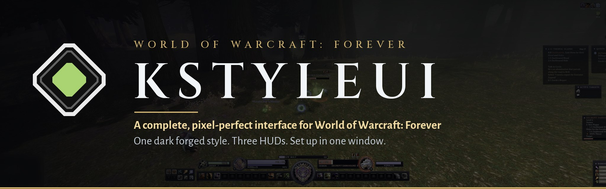

*In-game screenshot behind the wordmark. Icons in this picture are the optional AI-made icon pack, not art shipped in the addon.*

**Come say hi on Discord: [discord.gg/A5qqGZEXyN](https://discord.gg/A5qqGZEXyN).** That's the place for help or a bug report, and new stuff shows up there before it ships.

KstyleUI swaps the default UI for one dark forged style, the same on your bars, frames, bags and windows. The HUD comes in two looks. Medallions puts you and your target in round medallions with your class crest between your action bars, doing something different for every class. Frames is the classic layout cleaned up, with your target stacked over you above the bars. It's made for World of Warcraft: Forever only, and setup is one window the first time you log in.

Every picture below is a test render of the addon over my own in-game screenshots. Icons in these pictures are the optional AI-made icon pack, not art shipped in the addon.

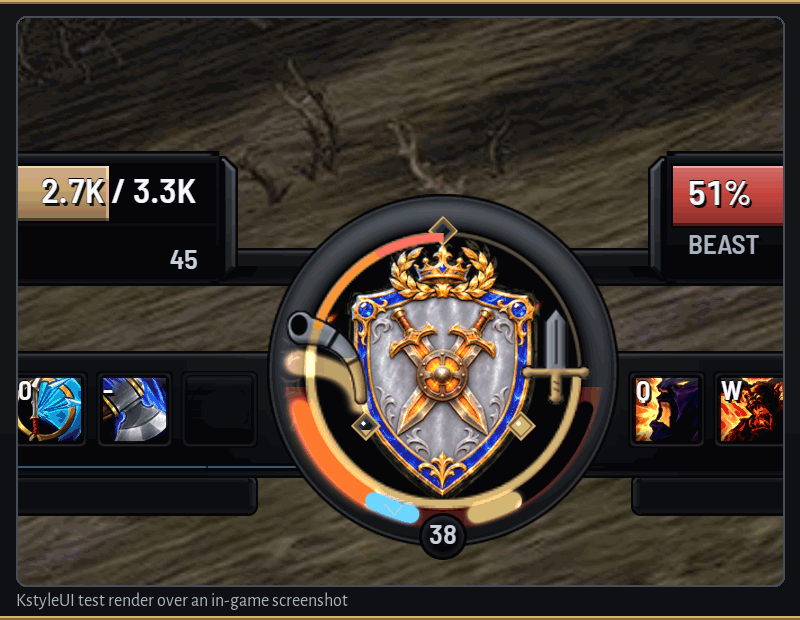

*Every class's crest now carries the stuff you'd normally hunt for all over the screen: your buffs, procs, your debuffs on the target, and big cooldowns burning round the rim. One place to look.*

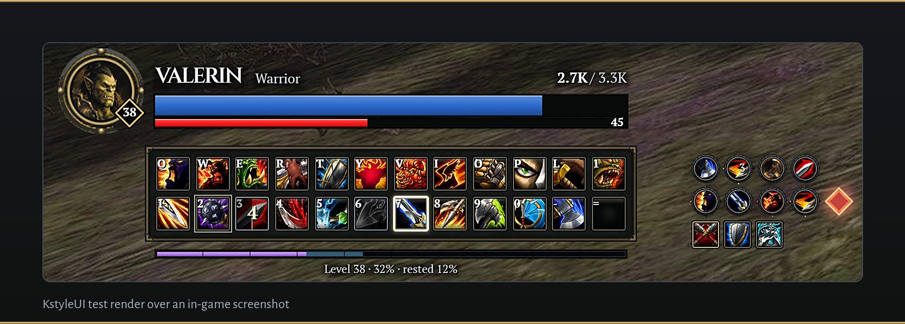

*On Frames the same pieces sit as medals in a row above your stance bar. Each one has its own switch in `/kstyle`.*

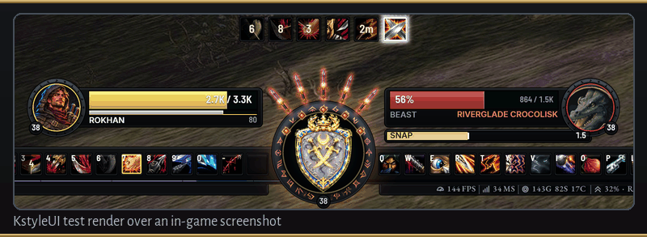

*Every class gets its own crest, and most of them get a crown on top.*

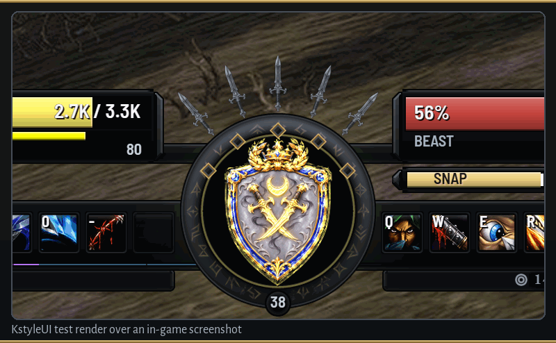

*Rogues get a crown of blades and cat druids get claws. Each combo point lights one and a jewel on the ring, the ring glows when you're capped, and a finisher slashes them out.*

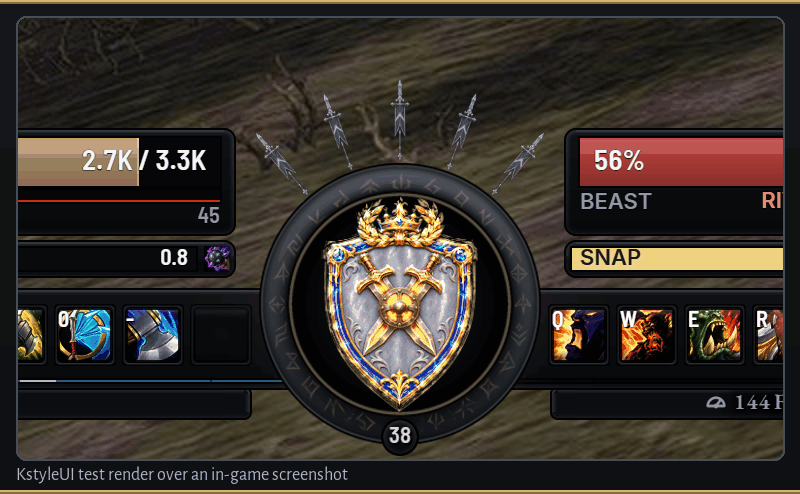

*Warriors get banners for Sunder stacks, shadow priests get candles, mages get Arcane Blast shards, hunters get arrows for Sniper Shot and bears get talons for Lacerate.*

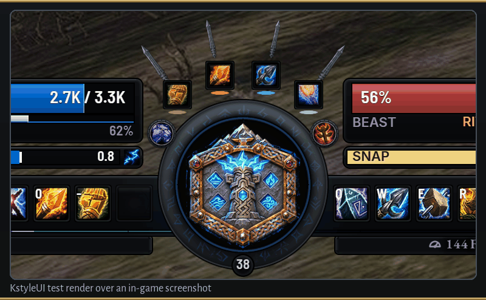

*I put way too much effort into shamans. Your totem bar sits on the crest, and Lightning Shield turns into storm orbs, and each one throws a bolt when its charge gets used up.*

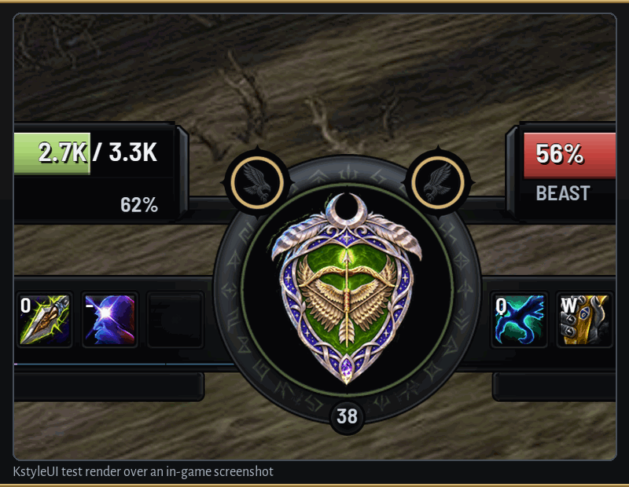

*Hunters with Summon Hawk get a perch on the ring for each hawk, with a timer round it. Baine's idea.*

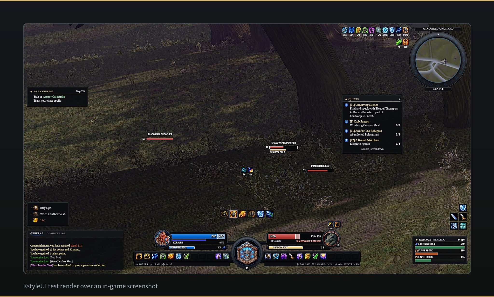

*The whole thing in Medallions. Your RestedXP or Zygor guide sits top left and your quests sit on the right under the map.*

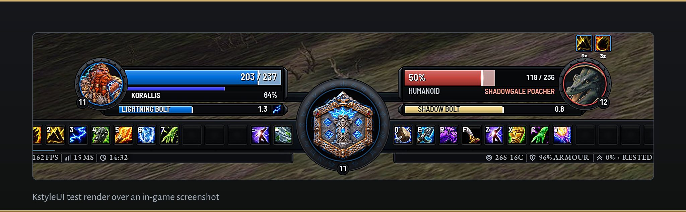

*Every bar has a lit glass finish, and the Medallions frames dock right into the crest.*

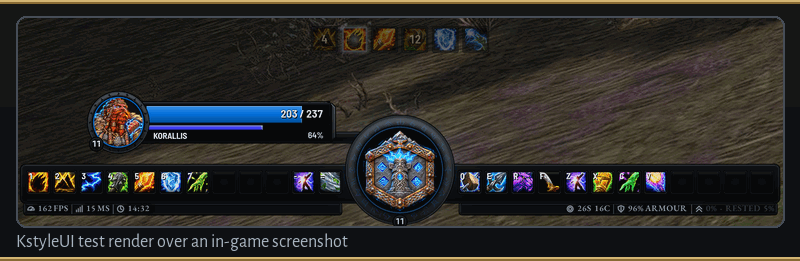

*Out of combat with nothing targeted, your bars fade back so you can see the game. Target something and they're straight back.*

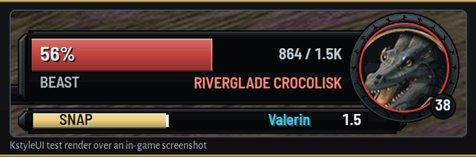

*Enemy cast bars say who the spell is aimed at, or YOU. A shield means you can't kick it, and a gold mark shows where your kick is back.*

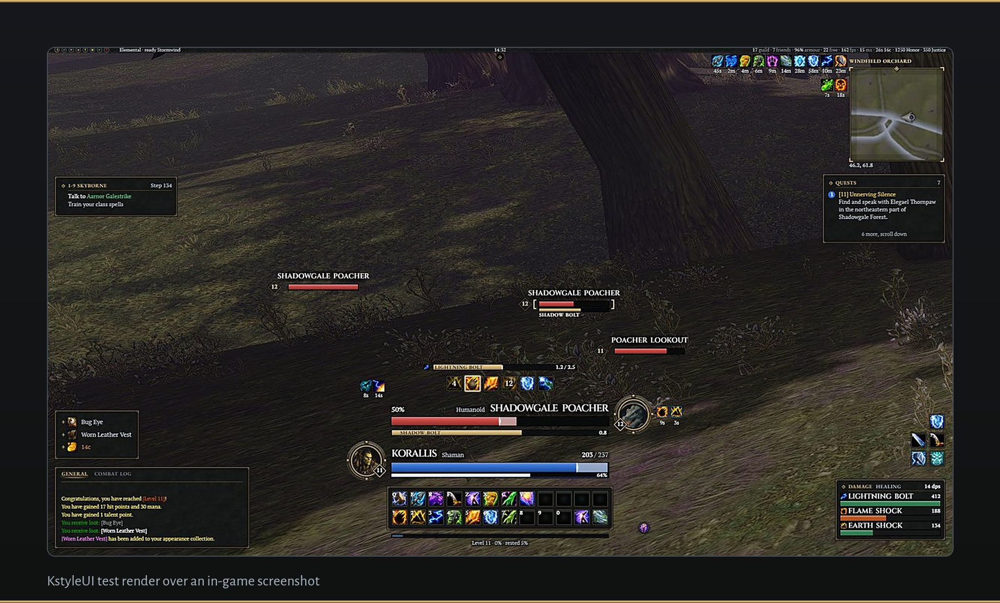

*If the crest isn't your thing, Frames is the other look: big plain cards for you and your target, same forged style. Pick it in the setup, or switch any time under HUD style on the General page of `/kstyle`.*

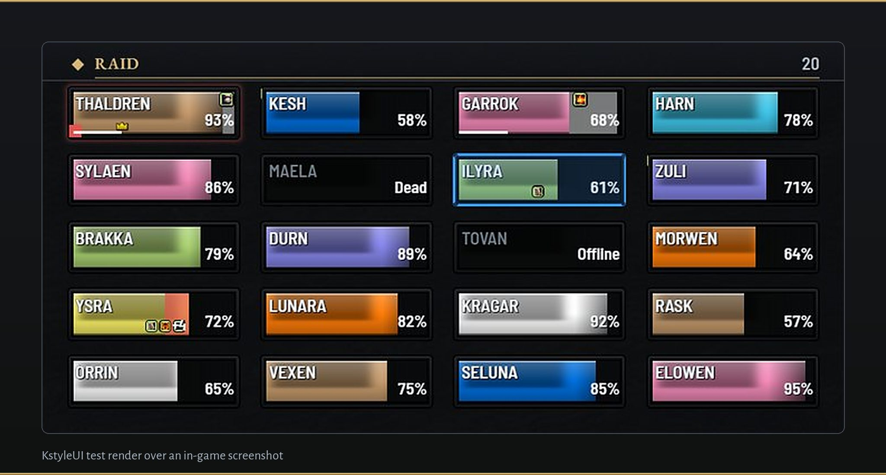

*Party and raid frames get the same look, with the debuffs you can dispel up front.*

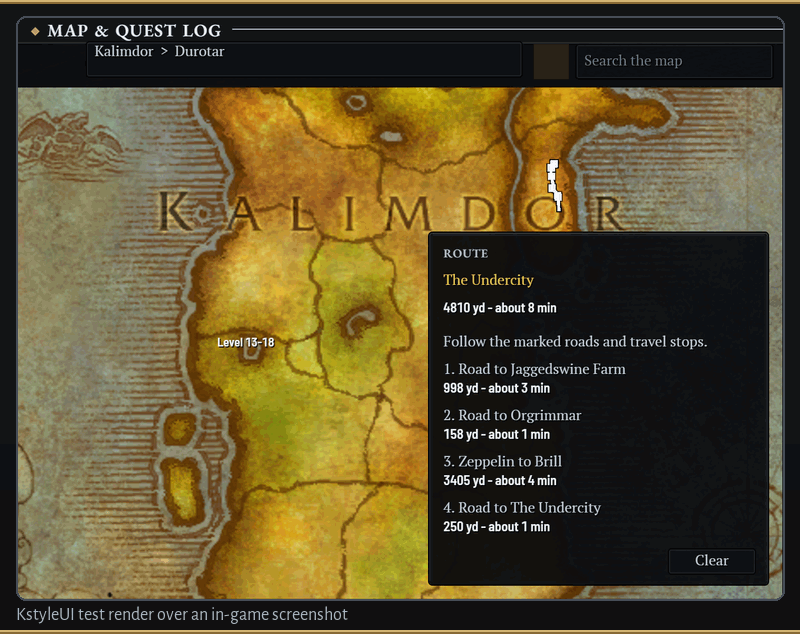

*The map plans your route, zeppelins and the tram included, and finds the nearest innkeeper, bank or trainer you've been to. The map art is the game's own.*

There's a lot more in there than fits here: nameplates, a damage and threat meter, bags, tooltips, chat and skins for most of Blizzard's windows. Every bit of it can be switched off in `/kstyle`. Each module has a README on [GitHub](https://github.com/korallis/KstyleUI) with all its settings.

## Install

1. Install it with the CurseForge app, the Wago app or WowUp. By hand, unzip it into `World of Warcraft/_forever_/Interface/AddOns`.
2. Log in, pick Medallions or Frames and a Look, then DPS, Tank or Healer in the setup window, then click **Apply** and **Reload**.
3. `/kstyle` opens the settings, `/kstyle layout` lets you move stuff and `/kb` binds your keys.

The icon pack is optional and isn't an addon, so it's only on [GitHub](https://github.com/korallis/KstyleUI/releases/latest). The [icon pack guide](https://github.com/korallis/KstyleUI/blob/main/docs/icons.md) has the steps.

## Links

- Help, bug reports and news: [Discord](https://discord.gg/A5qqGZEXyN). For a bug, paste the report from About > Status in `/kstyle`.
- Source code: https://github.com/korallis/KstyleUI

## Credits

- Fonts, all under the SIL Open Font License 1.1, with their licence files in the addon's `Media/Fonts` folder: Cinzel, Alegreya Sans, Barlow Semi Condensed, Source Sans 3, Inter, PT Serif, EB Garamond and IM Fell. Some are adapted for the game's renderer and renamed, as the licence allows.
- The portraits, crests and textures are KstyleUI's own art. Some were made with AI image tools and the rest is drawn by the addon's code. Nothing is extracted or traced from the game. The scenery in the pictures is cropped from my own Forever screenshots, and none of it is AI-generated.
- Zygor support and the hawk perches idea: Baine.
- By the KstyleUI authors. All rights reserved.
