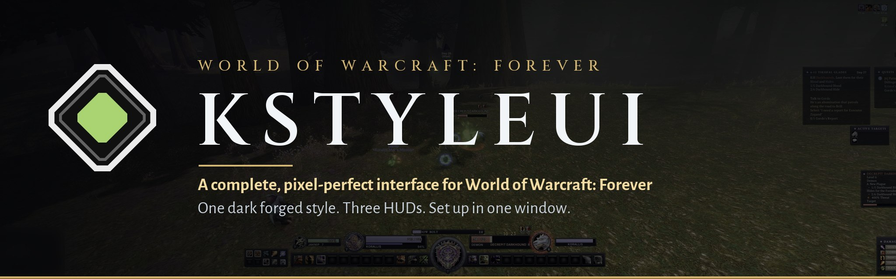
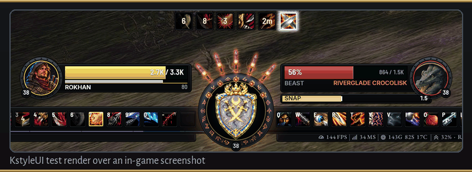
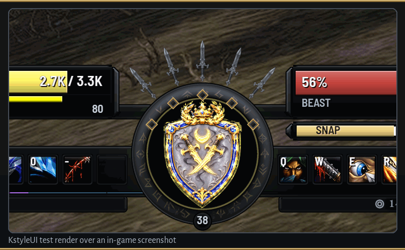
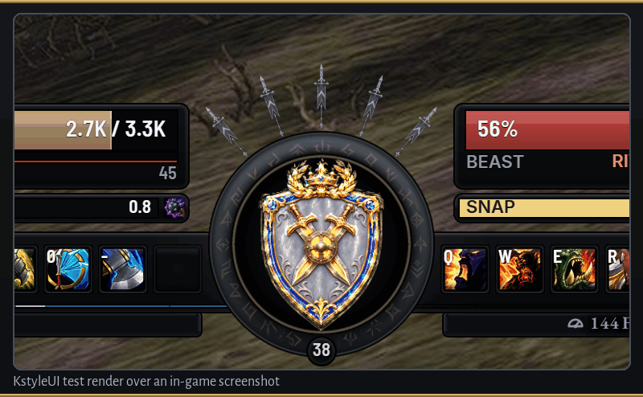
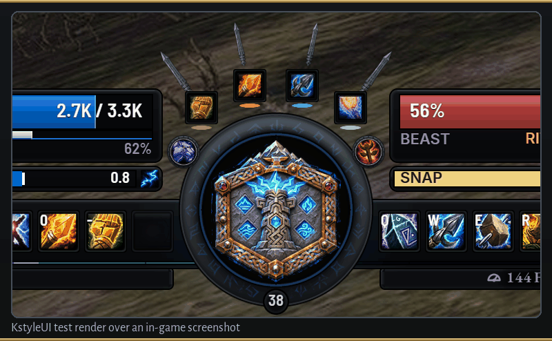
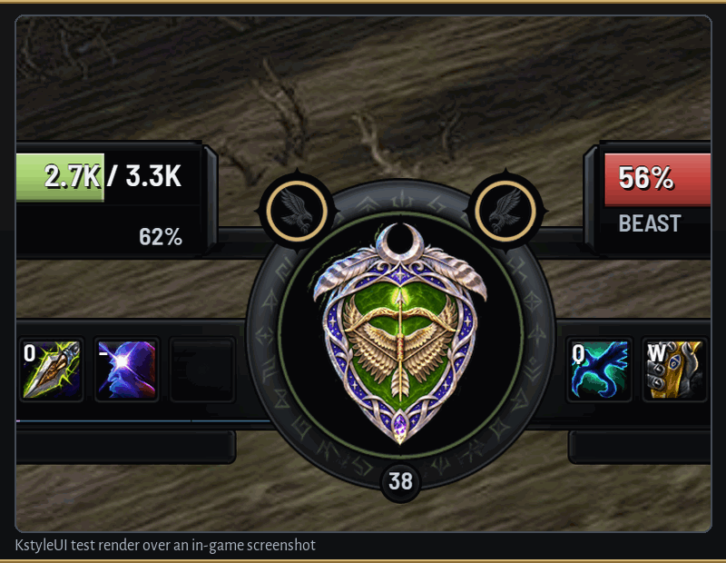
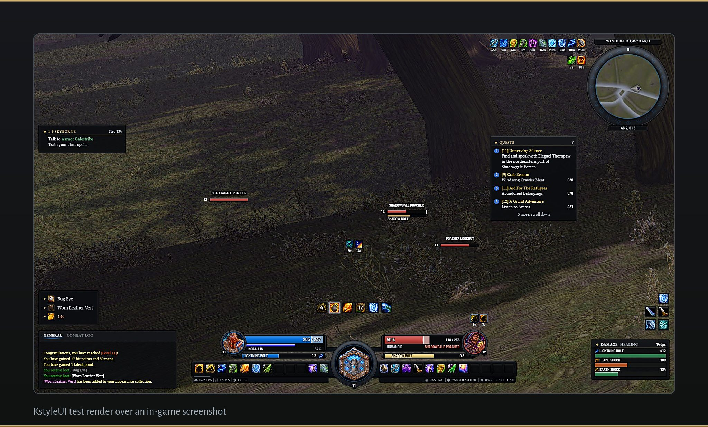
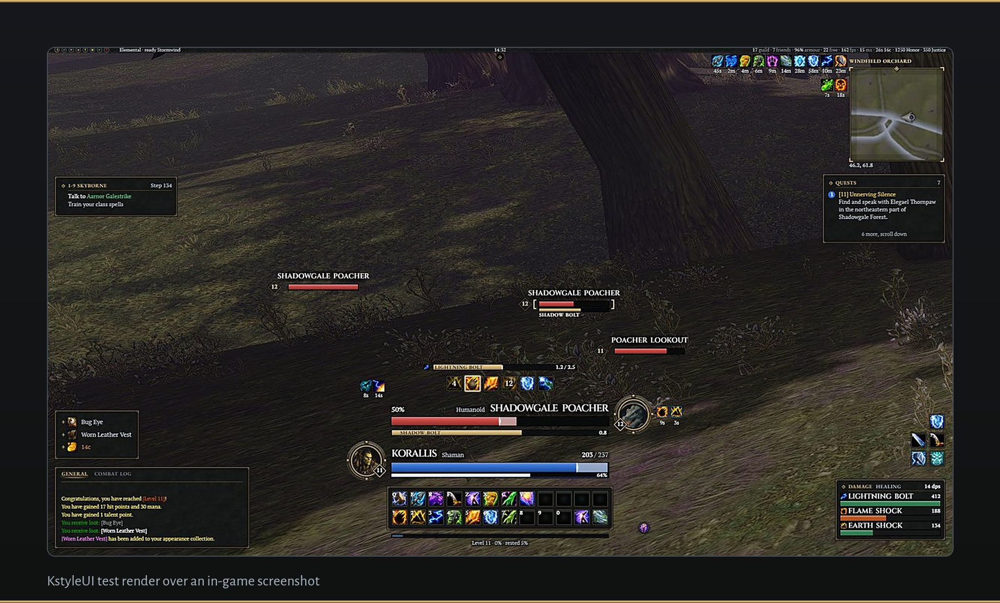
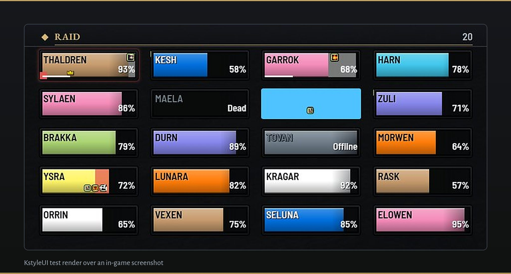

# Wago Addons page

Paste the blocks below on [the create-project page](https://addons.wago.io/developers/projects/create). The research, the proposed TOC lines, and the owner's steps are in [RESEARCH.md](RESEARCH.md) and [CHECKLIST.md](CHECKLIST.md).

Wago's public project stores a display name, a summary, a markdown description, categories, a thumbnail, gallery images with a description each, and source, website and issues URLs. [docs.wago.io](https://docs.wago.io/) documents the version-upload API, not these page fields. The description format below is the markdown Wago already renders (see [BigWigs](https://addons.wago.io/addons/bigwigs)). There is no published character limit. A page the length of this description is inside what that site already shows.

The hero picture is in-game. The clips and the two HUD pictures are test renders of this addon over in-game screenshots.

## Project name

KstyleUI

## Summary

```
A complete, pixel-perfect interface for World of Warcraft: Forever — one dark forged style, the Medallions HUD, set up in one window.
```

## Description

The description field is markdown. Paste this. The block is [description.md](description.md) verbatim, regenerated with `python3 Tools/media/marketing.py --pages`; edit that file, not this block.

```markdown


*In-game screenshot behind the wordmark. Icons in this picture are the optional AI-made icon pack, not art shipped in the addon.*

**Come say hi on Discord: [discord.gg/A5qqGZEXyN](https://discord.gg/A5qqGZEXyN).** That's the place for help or a bug report, and new stuff shows up there before it ships.

KstyleUI swaps the default UI for one dark forged style, the same on your bars, frames, bags and windows. The HUD comes in two looks. Medallions puts you and your target in round medallions with your class crest between your action bars, doing something different for every class. Frames is the classic layout cleaned up, with your target stacked over you above the bars. It's made for World of Warcraft: Forever only, and setup is one window the first time you log in.

Every picture below is a test render of the addon over my own in-game screenshots. Icons in these pictures are the optional AI-made icon pack, not art shipped in the addon.



*Every class gets its own crest, and most of them get a crown on top.*



*Rogues get a crown of blades and cat druids get claws. Each combo point lights one and a jewel on the ring, the ring glows when you're capped, and a finisher slashes them out.*



*Warriors get banners for Sunder stacks, shadow priests get candles, mages get Arcane Blast shards, hunters get arrows for Sniper Shot and bears get talons for Lacerate.*



*I put way too much effort into shamans. Your totem bar sits on the crest, and Lightning Shield turns into storm orbs that throw a bolt every time you get hit.*



*Hunters with Summon Hawk get a perch on the ring for each hawk, with a timer round it. Baine's idea.*



*The whole thing in Medallions. Your RestedXP or Zygor guide sits top left and your quests sit on the right under the map.*



*If the crest isn't your thing, Frames is the other look: big plain cards for you and your target, same forged style.*



*Party and raid frames get the same look, with the debuffs you can dispel up front.*

There's a lot more in there than fits here: nameplates, a damage and threat meter, bags, tooltips, chat, skins for most of Blizzard's windows and a world map that plans your route. Every bit of it can be switched off in `/kstyle`. Each module has a README on [GitHub](https://github.com/korallis/KstyleUI) with all its settings.

## Install

1. Install it with the CurseForge app, the Wago app or WowUp. By hand, unzip it into `World of Warcraft/_forever_/Interface/AddOns`.
2. Log in, pick DPS, Tank or Healer in the setup window, then click **Apply** and **Reload**.
3. `/kstyle` opens the settings, `/kstyle layout` lets you move stuff and `/kb` binds your keys.

The icon pack is optional and isn't an addon, so it's only on [GitHub](https://github.com/korallis/KstyleUI/releases/latest). The [icon pack guide](https://github.com/korallis/KstyleUI/blob/main/docs/icons.md) has the steps.

## Links

- Help, bug reports and news: [Discord](https://discord.gg/A5qqGZEXyN)
- Source code: https://github.com/korallis/KstyleUI

## Credits

- Fonts, all under the SIL Open Font License 1.1, with their licence files in the addon's `Media/Fonts` folder: Cinzel, Alegreya Sans, Barlow Semi Condensed, Source Sans 3, Inter, PT Serif, EB Garamond and IM Fell. Some are adapted for the game's renderer and renamed, as the licence allows.
- The portraits, crests and textures are KstyleUI's own art. Some were made with AI image tools and the rest is drawn by the addon's code. Nothing is extracted or traced from the game. The scenery in the pictures is cropped from my own Forever screenshots, and none of it is AI-generated.
- Zygor support and the hawk perches idea: Baine.
- By the KstyleUI authors. All rights reserved.
```

## Game version

Forever, patch 1.60.1. That is the only Forever patch [the game-data API](https://addons.wago.io/api/data/game) lists (`patches.forever` and `live_patches.supported_forever_patches`). Do not tick Retail or Classic. The packager sets `supported_forever_patches` on each upload. You only pick the flavor when the project is created, if the form asks.

## Categories

Wago has no separate tag field on a public project. It has categories, from [the category API](https://addons.wago.io/api/data/categories). Pick these. Unit Frames is the one to lead with. The others are the same four CurseForge is given, and the project model stores a list, so more than one is allowed.

- Unit Frames
- Action Bars
- Map & Minimap
- Bags & Inventory
- Quests & Leveling

## Licence

Same as the TOC: All Rights Reserved. [Plater's Wago page](https://addons.wago.io/addons/plater-nameplates) stores that as the licence URL `https://en.wikipedia.org/wiki/All_rights_reserved`. Use that URL if the form wants a link, or leave the URL empty and keep the sentence in the description. The sentence in the repository is "Copyright 2026 the KstyleUI authors. All rights reserved." Do not pick a permissive licence.

## Links to set on the project

- Source: https://github.com/korallis/KstyleUI
- Website: https://github.com/korallis/KstyleUI
- Issues (the support URL): https://discord.gg/A5qqGZEXyN

## Logo

`logo/wago-icon.png`

64×64 PNG, the same diamond, transparent outside it. [docs.wago.io](https://docs.wago.io/) does not publish an icon size. The thumbnail Wago serves for a project, measured from Plater's `thumbnail_image` on 2026-11-17, is 64×64 PNG, and the listing draws it at 64×64 CSS on a dark card (`bg-background-700`). A transparent diamond sits on that dark card the way the in-game icon sits on the UI. If the form refuses a file this small, upload `logo/curseforge-avatar.png` (400×400, the same drawing) and let Wago scale it.

## Gallery

[docs.wago.io](https://docs.wago.io/) does not publish a gallery pixel size. A live gallery, [LearnItAll](https://addons.wago.io/addons/learnitall/gallery), stores PNG and GIF files and a description on each, ten to a page. Use the same files as CurseForge: the README's pictures and clips, with the 5120-wide hero halved to 2560×720.

Upload in this order. The gallery description is the caption.

| File | Pixels | Title | Caption |
| --- | --- | --- | --- |
| `gallery/01-medallions-hero.jpg` | 2560×720 | Medallions on an ultrawide screen | In-game screenshot: the Medallions HUD on a 5120 by 1440 screen, in Tirisfal Glades. Chat and distant player names are blurred. Icons in this picture are the optional AI-made icon pack, not art shipped in the addon. |
| `gallery/02-classes.gif` | 800×293 | A crest for every class | KstyleUI test render over an in-game screenshot: the Medallions HUD for nine classes in turn, each with its own crest. Icons in this picture are the optional AI-made icon pack, not art shipped in the addon. |
| `gallery/03-crowns.gif` | 800×494 | Crown of blades and claws | KstyleUI test render over an in-game screenshot: a rogue's crown of blades and a cat druid's claws fill with combo points, then a finisher slashes them out. Icons in this picture are the optional AI-made icon pack, not art shipped in the addon. |
| `gallery/04-crowns-more.gif` | 800×494 | Class crowns | KstyleUI test render over an in-game screenshot: warrior banners, priest candles, mage shards, hunter arrows and bear talons fill as their stacks build. Icons in this picture are the optional AI-made icon pack, not art shipped in the addon. |
| `gallery/05-shaman.gif` | 800×494 | Totems and Lightning Shield | KstyleUI test render over an in-game screenshot: the shaman's totem bar on the crest, then Lightning Shield's storm orbs throwing a bolt on each hit. Icons in this picture are the optional AI-made icon pack, not art shipped in the addon. |
| `gallery/06-hawks.gif` | 800×494 | Hawk perches | KstyleUI test render over an in-game screenshot: a hunter's hawk perches on the crest ring, each with a timer for its hawk. Icons in this picture are the optional AI-made icon pack, not art shipped in the addon. |
| `gallery/07-hud.jpg` | 1920×1080 | The whole HUD | KstyleUI test render over an in-game screenshot of the whole HUD on a 1920 by 1080 screen: the guide card top left, the quests on the right under the map. Icons in this picture are the optional AI-made icon pack, not art shipped in the addon. |
| `gallery/08-frames.jpg` | 1200×675 | The Frames look | KstyleUI test render over an in-game screenshot of the Frames look on a 1920 by 1080 screen: the target's card stacked over the player's above the action bars. Icons in this picture are the optional AI-made icon pack, not art shipped in the addon. |

The upload page for a project, once it exists, is `https://addons.wago.io/developers/projects/<slug>/gallery/create`.
